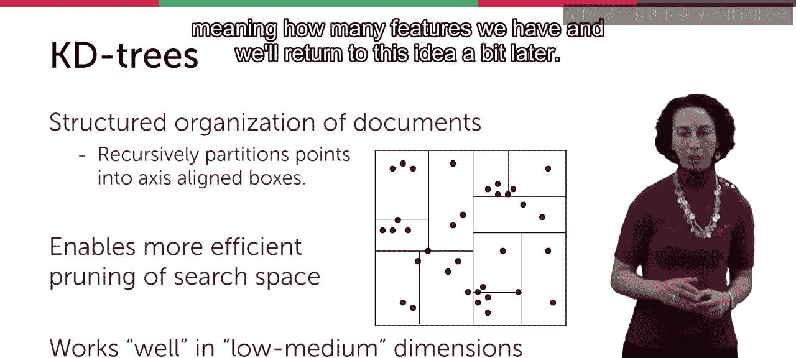
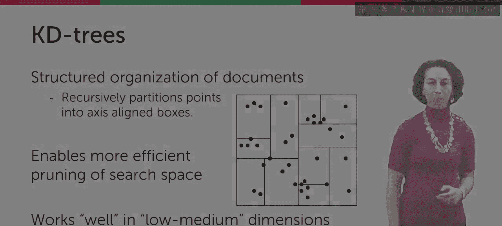
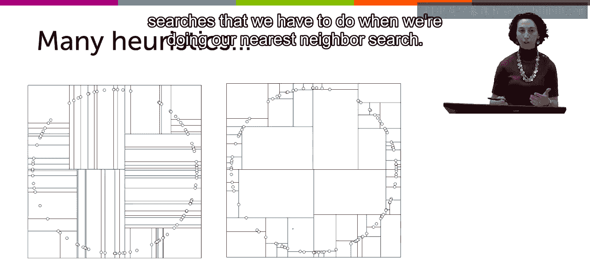

# 机器学习（分类，聚类和检索）：第3-4课：KD树表示 🌳

在本节课中，我们将要学习一种名为KD树的数据结构。它是一种用于高效组织和表示数据的方法，特别适用于低维到中维度的特征空间。通过将数据空间进行轴对齐的划分，KD树能够帮助我们快速剪枝搜索空间，从而在进行最近邻搜索时，无需检查每一个数据点。

## KD树的结构与构建 🏗️

上一节我们介绍了KD树的基本概念，本节中我们来看看如何构建一棵KD树。KD树的核心思想是递归地将数据空间划分为更小的子空间。

构建过程从一个包含所有数据点的数据表开始。我们首先选择一个划分维度（即一个特征）和一个划分值（阈值）。根据这个划分，数据点被分成两组：一组满足该特征值小于等于阈值，另一组满足该特征值大于阈值。然后，我们对每个子组递归地重复这个过程，直到满足停止条件（例如，子组中的数据点数量少于某个值，或子空间的宽度达到最小值）。

在树的每个节点上，我们存储三个关键信息：
1.  划分所依据的维度。
2.  划分所使用的阈值。
3.  包含该节点下所有数据点的**最小边界框**。

以下是构建KD树时需要考虑的几个关键选择：

*   **划分维度的选择**：常见启发式方法包括选择数据分布最宽的维度进行划分，或者简单地交替选择维度。
*   **划分值的选择**：可以选择该维度下数据点的**中位数**，也可以选择该维度边界范围的**中心点**。
*   **停止条件**：可以设定当节点内数据点数量少于一个阈值（例如 `M` 个点）时停止划分，或者当边界框的最小宽度达到某个值时停止。

## 构建选择的影响 ⚖️

正如我们在整个模块中反复强调的，算法的选择至关重要，对于KD树这样的数据结构也不例外。划分值的选择策略（例如使用中位数还是范围中心）会显著影响最终生成的树结构。

不同的数据分布下，不同的选择可能导致树的结构差异巨大。这种结构上的差异，又会直接影响我们后续进行最近邻搜索时需要访问的节点数量，从而影响搜索效率。

---

本节课中我们一起学习了KD树的基本原理和构建方法。我们了解到，KD树通过递归的轴对齐划分来组织数据，并在每个节点存储划分信息和最小边界框。构建过程中的关键选择（如划分维度、划分值和停止条件）会影响树的结构，进而影响搜索效率。在下一节中，我们将探讨如何利用构建好的KD树进行高效的最近邻搜索。