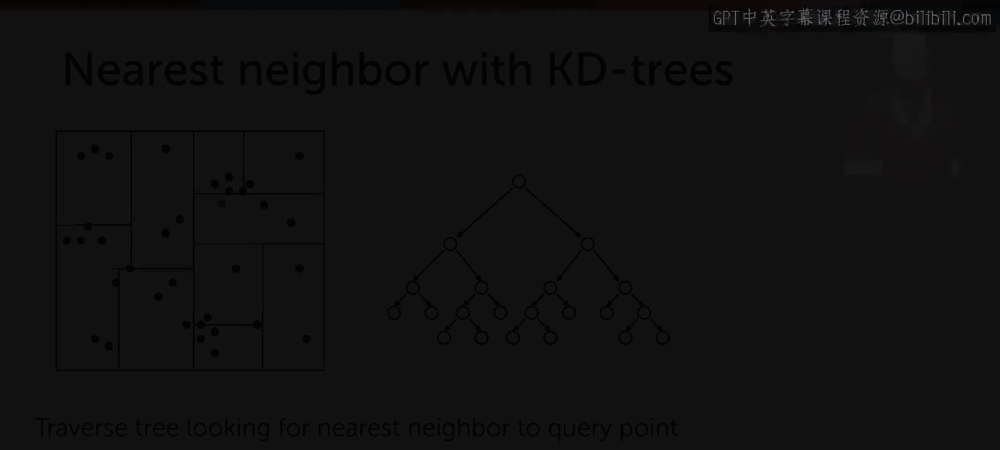
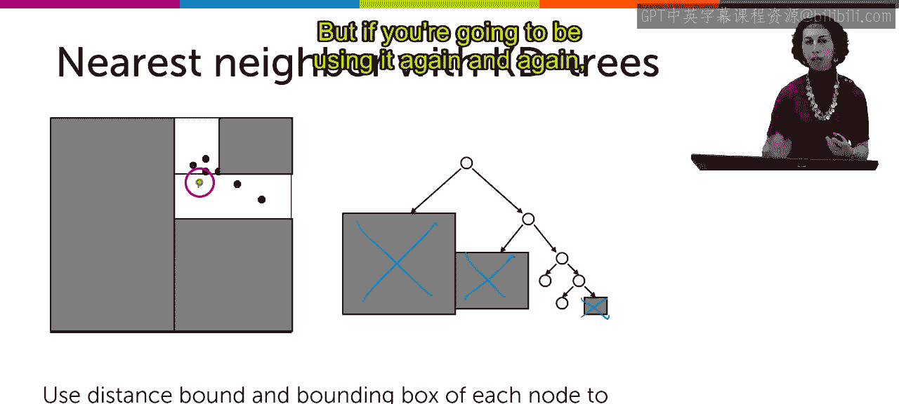

# 华盛顿大学《机器学习（分类，聚类和检索，第3-4课⧸共4课）｜Machine Learning》中英字幕 p136 14_KD树的最近邻搜索.zh_en -BV1Sr421F7N7_p136-

。

Let's now discuss how K T trees can aid in efficiently performing nearest neighbor search。

So to start with， we're gonna have our query point， which。嗯。Showing with this green circle here。

 So this is our。Qury point。And then the first thing we're going to do is we're going to traverse the tree all the way down to the leaf node that contains that query point。

What that means is we're going to check all the conditions of this point against the conditions at each one of these internal nodes until we get to a leaf node。

Okay， so to begin with， we're going to check。The first condition， remember， was a split on x1。

 whether or not it was greater than or less than 05。 In this case。

 x1 for this point is greater than 05。So。We have x1。For our query point xq is greater than 0。5。

 so we say yes， and we traverse down this side of the tree。Then， we check。The next condition。

 and this was a condition of whether x2。Was greater than some value。 I'll just call it V。

 So let's call this point here V。And here we see that， yes。X2 is greater than V。

 so again we have a yes。And we traverse down this way。 And we keep doing that。 And then。

All of a sudden， we get to a leaf node。Okay， now once we're at this leaf node。

 the first thing we do is start searching for nearest neighbors because what our hope is。

 is that within this box local to our point。That might be a likely place to find a nearest neighbor。

Okay， so we compute the distances。To each point contained in this box。

 So this node has a list of three points， the query point and these two other points here。

And we compute those distances。So。That's what's said right here on this slide。

Now that we've computed these distances， what we do is record the distance to the nearest neighbor found so far。

So let's call this R。And this is。Distance。2。Nearest neighbor。Found。So far。Okay。

 then a natural question is。Is that it， Are we done。

Does the nearest neighbor live within the blue box that we just searched。No， not necessarily right。

 that should be obvious because now that we've drawn this fusus circle。

 we see that there are other points that are closer to this green point that live in other neighboring boxes。

So what we're going to do then is we're going to continue searching so we're going to go from this node that we already examined。

 So that one's already done and we're going to backtrack。

 we're going to go back up the tree and start checking out other branches。Okay， so then。

We're going to go down to a leaf node。So we happened。

 so we checked this one and now we've traversed here to this leaf。

 and now we're going to compute distances to all of these points and compare relative to the distance our nearest neighbor found so far and in this case。

We have that。The distance。To nearest neighbor。Is。Smaller。Than what we had before。

 So this becomes our new nearest neighbor， and this becomes our new distance to nearest neighbor。

And then we continue searching。 So now。So。Let me just write this。 This becomes our new。

Distance to nearest neighbor。 And when we continue searching， we've now checked this node。

 We've checked this node， and we're going to go and check this other node。

But what this blue box here shows is that's the tight bounding box for that node。 Remember。

 it's the box that contains all the points within that node。

 And what we see is that the distance to that box。Is greater than the distance your nearest neighbor found so far。

So。Distance。2。😔，Boing。B。Is。Greater than。Distance。To nearest neighbor so far。

And so what this implies is that we're going to prune this。

We're not even going to go and compute the distance to any point in this， this leaf node here。

 because we know that no point in there can be a nearest neighbor closer than the nearest neighbor that we've found so far。

Okay。Now what we've done， we've checked this node， we've checked this node， we've pruned this node。

 we go up and we start going down this other branch。What happens here again。

 the distance to this box exceeds the distance to our nearest neighbor。 So we prune。

Then what we're going to do is we're going to go up and start searching the other branch。

But all the other boxes that we have exceed the distance to our nearest neighbor。

 So what we see is that we've been able to prune quite a lot of the search space。

 Let's just go back and look at all these points that we in the brute force method。

 We would have had to compute distances to all those points。

 But now we only had to compute distances to a very few number of data points in this example to find our nearest neighbor。

😊，So this is where keyD trees are so useful in performing efficient nearest neighbor search when you have lots and lots of observations。

 especially if you're going to be performing lots and lots of queries because you have to build the tree and there's some computational cost to building this KD tree。

 but if you're going to be using it again and again， it can actually provide a significant savings。

