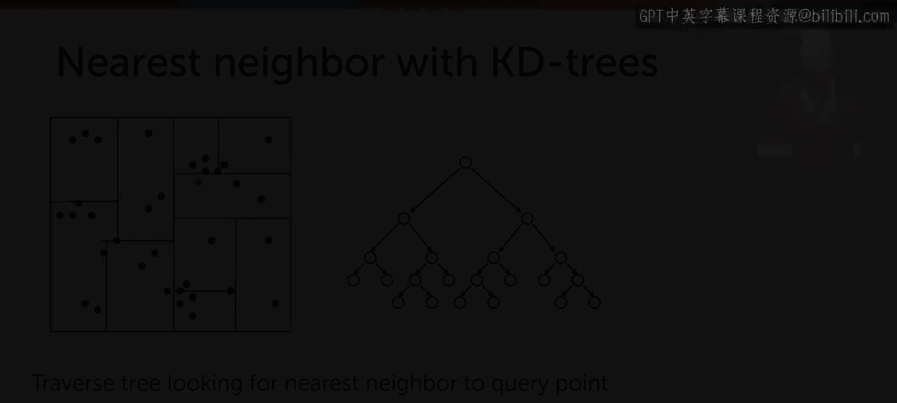
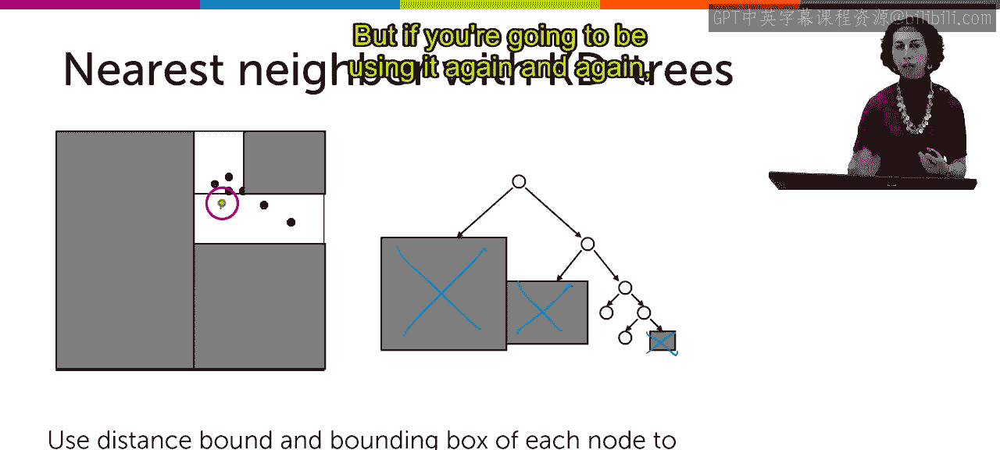

# 机器学习（分类，聚类和检索）：第3-4课：KD树的最近邻搜索




在本节课中，我们将要学习如何使用KD树来高效地执行最近邻搜索。我们将从查询一个点开始，逐步遍历KD树，并理解如何通过“剪枝”来避免不必要的距离计算，从而显著提升搜索效率。

---

## 高效搜索：从查询点到叶节点

上一节我们介绍了KD树的结构，本节中我们来看看如何利用它进行搜索。

首先，我们有一个查询点，在图中用绿色圆圈表示。搜索的第一步是**遍历**KD树，直到找到包含该查询点的**叶节点**。

这意味着我们需要将查询点的坐标与树中每个内部节点的分割条件进行比较。例如，第一个内部节点可能根据特征 `x1` 是否大于 `0.5` 进行分割。如果查询点的 `x1` 大于 `0.5`，我们就沿着“是”的分支向下遍历。这个过程会持续进行，直到我们到达一个叶节点。

```python
# 伪代码：从根节点开始，根据条件遍历至叶节点
current_node = root
while current_node is not internal_node:
    if query_point[split_feature] <= split_value:
        current_node = current_node.left_child
    else:
        current_node = current_node.right_child
```

---

## 局部搜索与距离计算

到达叶节点后，我们首先在该叶节点对应的数据点中进行局部搜索。

这个叶节点包含了一组数据点（例如图中的三个点）。我们计算查询点到该节点内**每一个点**的距离。

计算完这些距离后，我们记录下当前找到的**最近邻距离**，我们将其称为 `R`。`R` 代表了到目前为止找到的最近邻居的距离。

---

## 回溯与剪枝：优化搜索范围

一个自然的问题是：搜索到此结束了吗？最近邻一定就在这个初始的叶节点里吗？答案是否定的。

从图示的虚线圆可以看出，其他相邻的“盒子”（即其他叶节点对应的区域）里可能存在更近的点。因此，我们需要继续搜索。

搜索策略是**回溯**。我们从已检查的叶节点开始，沿着树向上回溯，并检查之前未探索的其他分支。

当我们回溯到一个新的内部节点并准备探索其另一个子分支时，我们会先评估该子节点对应的整个区域（即其“包围盒”）。关键步骤来了：我们计算查询点到这个**包围盒**的最近可能距离（例如，到盒子边界的距离）。

如果这个**到包围盒的距离**已经**大于**我们当前记录的最近邻距离 `R`，那么就意味着这个包围盒内的**所有点**都不可能比我们已找到的最近邻更近。

```python
# 伪代码：剪枝条件判断
if distance_to_bounding_box(box, query_point) > current_best_distance_R:
    prune_this_branch()  # 跳过该分支下的所有点
```

在这种情况下，我们可以安全地**剪枝**——即跳过对该分支下所有点的距离计算，直接继续回溯。这个过程会持续进行，直到我们检查完所有可能包含更近点的分支。

---

## 总结：KD树的优势

本节课中我们一起学习了KD树最近邻搜索的全过程。

我们从一个查询点出发，遍历至一个叶节点并进行局部搜索。然后通过**回溯**和**剪枝**策略，系统地检查其他可能区域，同时避免了对大量不可能成为最近邻的点进行冗余计算。




与需要计算查询点到数据集中**所有点**距离的暴力方法相比，KD树通过其层次结构和对空间的划分，能够**显著减少需要计算的实际距离数量**。这在数据集非常庞大或需要执行大量查询时，能带来巨大的效率提升。虽然构建KD树本身需要一定的计算成本，但对于重复使用的场景，它提供的性能收益是非常可观的。