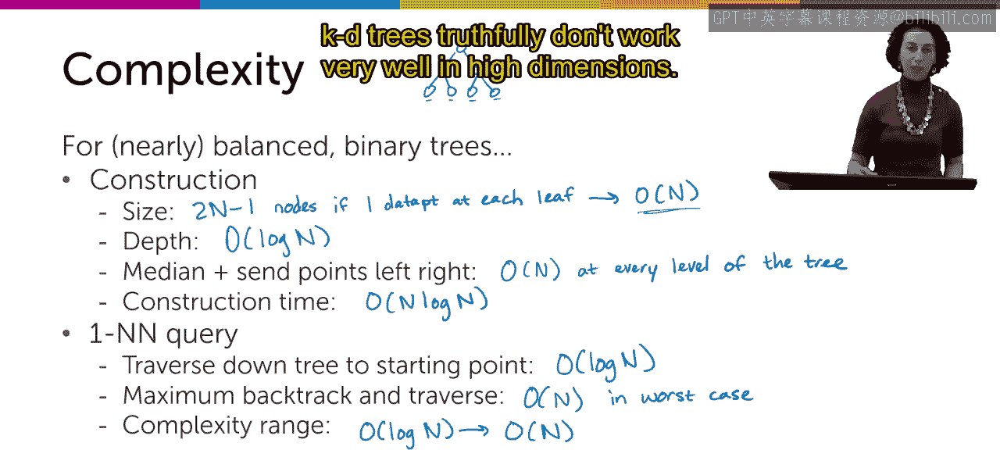
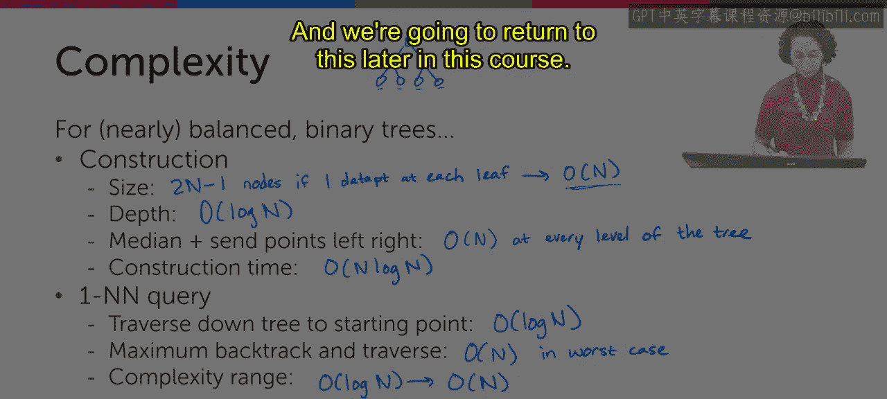

# 华盛顿大学《机器学习（分类，聚类和检索，第3-4课⧸共4课）｜Machine Learning》中英字幕 p137 15_KD树最近邻搜索的复杂度.zh_en -BV1Sr421F7N7_p137-

。

So if we end up with a nearly balanced binary tree。

 so a nearly balanced binary tree is something that。Looks， mostly。So this is a binary tree。

 a balanced binary tree， this would be a balanced binary tree。

 they're the same number of leaves on the left and right- hand side。

 so we could start talking about what is the size and the depth of this tree。

 So if theyre n total data points and let's assume that we end up with is one observation at each leaf node。

 then how many nodes are there total in this tree。You can show that there are two n minus1 nodes。

 And so let's see if we had four data points， we have1，2，3，4，5，6，7 nodes。

 and that's exactly2 times 4 minus1 to 7。 Okay， so at least that little example checks out there。

 So this is2 n minus1 nodes。If。One data point。At each leaf。

And assuming that it's a balanced binary tree， but the point is that there's on the order of n nodes in our tree。

And how deep is the tree。Well， the tree has depth that's on the order of。Log。

And that's also pretty straightforward to show。So， when N is。4， we end up with a depth to tree。Okay。

So now let's talk a little bit about the complexity of constructing this tree。

And so what do we have to do， well， if we use our median heuristic for how to set the split value。

 then at every level of our tree， we have n observations that we either have to send to the right or to the left。

So in the first case， it's just one split left and right at the second level， you have two splits。

 but there are splits of smaller numbers of points and you know this goes on and on and on。

 but what you can show is that if you do an efficient implementation of this again using a priority queue like we talked about earlier。

 then you end up with complexity that's order。And。At every level of the tree。So together。

 the construction time would be order。N log N， because I have an order N operation at each of。

On the order of log N levels of the tree。Okay， so that's our construction time。

But now we have to think about the complexity of doing our nearest neighbor query and see if we get gains that offset the cost of constructing this tree。

Okay， so to begin with the first thing we have to do when we have a query point。

 Remember is we traverse all the way down to a leaf node。

 So we're going to go all the way down the depth of the tree。 So that's。Order log N because remember。

 the depth is on the order of log n， and then we have to do this backt inverse and backt introverse。

And in the worst case。How many different points do we have to consider。

 How many different nodes do we have to visit。Well。

How many nodes are there in total there on the order of n nodes， So n nodes in the worst case。

So the worst case being when because of the structure of the problem。

 we're not able to prune anything at all， so the complexity range。

Is anywhere from on the order of log N。 If we can do lots of pruning。

 everything gets pruned all the way to。On the order of N， if we can't do any printing， remember that。

Order N was the same complexity as our brute force search。

So if we were just going to do a single nearest neighbor query and if we got really unlucky about the structure of the data or how we chose to construct the Kd tree。

 we might actually take a penalty over brute forest search， but in some cases。

 as we're going to show， you can actually have significant gains in efficiency。Okay。

 so under some assumptions about the distribution of points。

 so things that don't look like that really elegant circle that we had before。

 we can get things that have on the order of log N number of queries that we have to do or distance computations per que that we're looking at。

But。The number of inspections we have to do can be exponential in D。

 the number of dimensions so for all the examples， all the pictures we're showing are just two dimensional examples I think of two words in our vocabulary but we might be interested in much higher dimensions in Kaie trees truthfully don't work very well in high dimensions and we're going to return to this later in this course。

