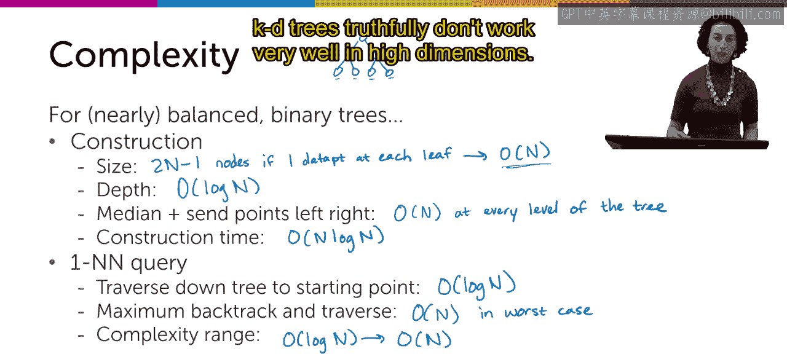
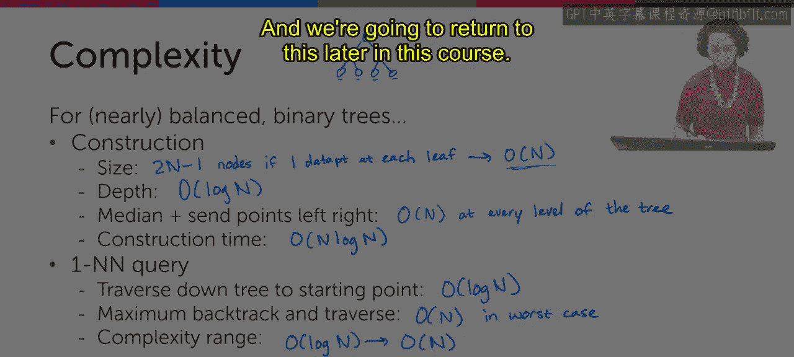

# 机器学习（分类，聚类和检索）：第3-4课：KD树最近邻搜索的复杂度分析 🧮

在本节课中，我们将要学习KD树（K-Dimensional Tree）在构建和进行最近邻搜索时的计算复杂度。我们将分析其最佳与最坏情况下的性能，并理解数据结构与数据分布对效率的影响。

## 构建KD树的复杂度

上一节我们介绍了KD树的基本结构，本节中我们来看看构建这棵树需要多少计算量。构建KD树的核心步骤是递归地选择分割维度和分割值（例如中位数），将数据点划分到左子树或右子树。

如果最终我们得到一棵近似平衡的二叉树，并且每个叶节点只包含一个数据点，那么整棵树的节点总数与数据点数量 `n` 有关。

以下是关于树结构的关键公式：
*   总节点数：`2n - 1`
*   树的高度（深度）：`O(log n)`

现在，我们来分析构建过程的复杂度。在树的每一层，我们都需要处理当前节点下的所有数据点以确定分割点。如果使用中位数启发式方法并进行高效实现（例如使用优先队列），那么每一层的操作复杂度是 `O(n)`。

由于树有 `O(log n)` 层，因此构建KD树的总时间复杂度为：
`O(n log n)`

## 最近邻查询的复杂度

构建KD树需要前期成本，其收益体现在查询阶段。现在，我们分析在KD树中进行一次最近邻搜索的复杂度。

查询的第一步是**遍历**：从根节点开始，根据查询点的坐标与节点分割超平面的比较，递归地向下遍历，直到到达一个叶节点。这个过程的复杂度是 `O(log n)`，因为树的深度是 `O(log n)`。

到达叶节点后，我们得到了一个候选最近邻。但搜索并未结束，我们还需要进行**回溯**，检查其他分支中是否存在更近的点。这是KD树查询效率的关键。

以下是查询复杂度可能出现的范围：
*   **最佳情况**：如果数据结构良好，回溯过程可以大量“剪枝”（即排除整个分支），那么我们可能只需要检查 `O(log n)` 个节点。
*   **最坏情况**：如果数据结构不理想或查询点位置特殊，导致无法进行任何有效的剪枝，那么我们可能不得不检查树中几乎所有的 `O(n)` 个节点。

值得注意的是，最坏情况下的复杂度 `O(n)` 与暴力搜索（线性扫描所有点）相同。这意味着，如果只进行单次查询，并且数据分布或树的结构不理想，使用KD树可能反而会带来额外开销。

## KD树的局限性与维度灾难

然而，KD树的效率高度依赖于数据的维度。我们之前展示的所有例子都基于二维空间（例如两个词汇特征）。但在实际机器学习中，我们常常需要处理成百上千维的高维数据。

KD树在**高维空间**中的表现并不理想。随着维度 `D` 的增加，回溯过程中需要检查的节点数量可能呈指数级增长。这种现象常被称为“维度灾难”（Curse of Dimensionality）。我们将在本课程后续部分再次讨论这个问题。

## 总结

本节课中我们一起学习了KD树复杂度的核心内容。我们了解到：
1.  构建一棵平衡KD树的时间复杂度为 `O(n log n)`。
2.  进行最近邻查询时，复杂度在最佳情况下可降至 `O(log n)`，但在最坏情况下仍为 `O(n)`。
3.  查询效率极大地依赖于数据分布和树的结构，有效的剪枝是提升性能的关键。
4.  KD树在处理高维数据时面临挑战，其效率可能因“维度灾难”而显著下降。

理解这些复杂度特性，有助于我们在实际应用中判断何时使用KD树是合适的，并为学习其他更适用于高维空间的近似最近邻算法打下基础。