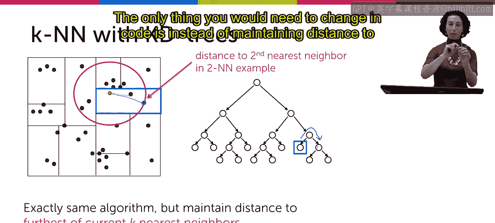

# 华盛顿大学《机器学习（分类，聚类和检索，第3-4课⧸共4课）｜Machine Learning》中英字幕 p138 16_可视化KD树的缩放行为.zh_en -BV1Sr421F7N7_p138-

。

Okay， but let's go back to this idea that depending on the structure or rather the distribution of data in this space。

 you can actually get things looking closer to log N。

 so here's an example where we have fairly uniform distribution of points across the space and for a given query。

 we've pruned a huge amount of the search space and just had to search two different boxes here。

 whereas in that more contrived example where our data li on a circle。

And based on that center heuristic that we had for how to create the splits。

 we end up having to search almost every node in the tree。 So this looks a lot closer to order N。

 So not much savings in this case。 Okay， so like I said。

 to really offset the cost of creating this data structure。

 It's useful to use these things in cases where you're doing lots and lots of queries。

 So let's imagine asking for the nearest neighbor for every article in our corpus。

 So let's assume that we're doing capital N queries。And let's look at the complexity of this。

 So under brute force search， remember per query， it was border n complexity。 So for n queries。

 we're going to have something that's border n squared。But on the other hand， for Kd trees。

 it's going to be somewhere in the range of order N， log N。If we get lucky。And if we get unluckily。

 it's going to be on the order of n square just like the brute force search。But。Just to note。

 this represents potentially very large savings for large an。Okay， so let's look at a。

Little empirical study of the number of inspections we have as a function of the number of observations。

 and then as a function of the dimension of the space that we're working in。

So here we're increasing the number of observations。 And， and in this case。

 we see roughly a log and trend。 But on the other hand， here。

 when we're looking at going to higher and higher dimension。 So just to be clear。

 we're saying that our observations， X I live in some。R to the D space。 so that's what D represents。

 We get a trend where we have an exponential increase in the number of inspections we have to do the number of distance calculations or really nodes in the tree。

To find our nearest neighbor。So for large D。This is really a regime where using Kd trees becomes pretty pointless and we'll return to this to talk about it a little bit more and also to think of an alternative approach that will be more helpful to us in high dimensional scenarios。

But before that， I just want to mention how we can think about using Kd trees to do K nearest neighbor search instead of one nearest neighbor search。

And the extension is very intuitive and straightforward。

 So instead of just maintaining the distance to the nearest neighbor。

What we're going to do is we're going to mean。Tamme the distance to our cafe nearest neighbor that we found so far。

So in this example， this is our distance， we're looking at a two nearest neighbor task。

And here this is our distance to our second nearest neighbor found so far in this first search that we've done。

 the search of this first box here。And then just as before。

Based on the distance that we found so far， we'd backtrack。

 go and search other nodes and prune them if the distance to that cake nearest neighbor。

Is smaller than the distance to the bounding box of the node that we're looking at。

So the algorithm is almost identical。 The only thing you would need to change and code is instead of maintaining distance to the nearest neighbor。

 maintain distance to the Kaith nearest neighbor found so far。

你。

