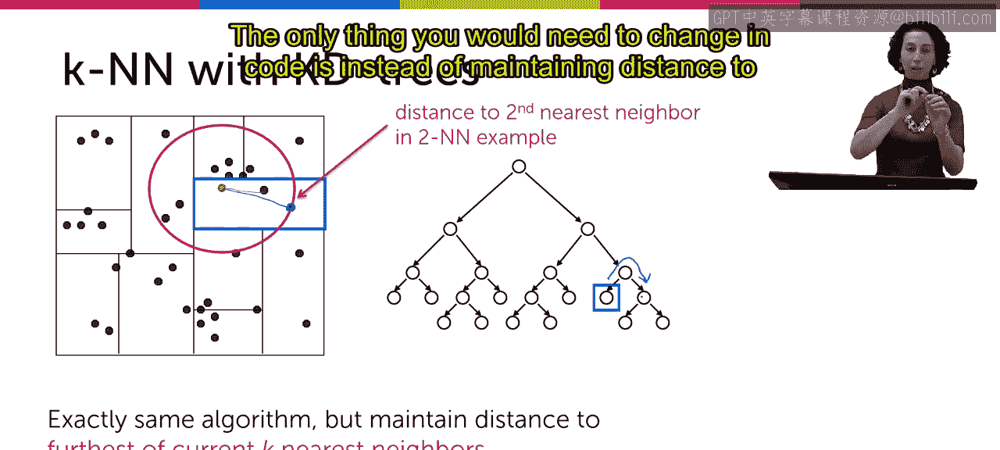

# 机器学习（分类，聚类和检索）：第3-4课：可视化KD树的缩放行为

在本节课中，我们将学习KD树（K-Dimensional Tree）在最近邻搜索中的性能表现。我们将探讨数据分布如何影响搜索效率，分析KD树在不同维度和数据量下的复杂度，并了解如何将其扩展用于K近邻搜索。

---

## KD树搜索效率与数据分布

上一节我们介绍了KD树的基本构建与搜索过程。本节中我们来看看数据分布如何影响KD树的搜索效率。

根据数据在空间中的分布结构，KD树的搜索效率可能接近 **O(log N)**，也可能接近 **O(N)**。

以下是两种典型情况：

*   **均匀分布**：当数据点在整个空间内均匀分布时，对于一个给定的查询点，KD树可以修剪掉大量的搜索空间。例如，可能只需要搜索两个不同的子区域（“盒子”）。这种情况下，搜索效率接近 **O(log N)**。
*   **特殊分布（如环形）**：如果数据点呈现特殊的分布（例如近似分布在一个圆环上），并且我们采用基于中心的启发式方法进行空间划分，最终可能不得不搜索树中的几乎每一个节点。这种情况下，搜索效率接近 **O(N)**，相比暴力搜索没有太大优势。

因此，为了抵消构建KD树数据结构的成本，最好在需要执行大量查询的场景中使用它。

---

## 多查询场景下的复杂度分析

假设我们需要为语料库中的每篇文章都找到其最近邻，即执行 **N** 次查询。

以下是两种方法的复杂度对比：

*   **暴力搜索**：每次查询的复杂度为 **O(N)**。因此，执行 **N** 次查询的总复杂度为 **O(N²)**。
*   **KD树搜索**：其复杂度取决于数据分布。
    *   在理想（均匀分布）情况下，总复杂度约为 **O(N log N)**。
    *   在最坏（特殊分布）情况下，总复杂度可能达到 **O(N²)**，与暴力搜索相同。

需要指出的是，对于大规模数据 **N**，KD树在理想情况下能带来显著的性能提升。

---

## 经验性研究：维度与数据量的影响

接下来，我们通过经验性研究，观察需要检查的节点数量如何随数据量 **N** 和空间维度 **D** 变化。

以下是核心发现：

1.  **增加观测数据量 (N)**：当增加观测点数量 **N** 时，所需检查的节点数量大致呈现 **对数增长 (log N)** 趋势。这与理论预期相符。
2.  **增加空间维度 (D)**：当增加空间维度 **D**（即观测点 **X_i** 所在的 **R^D** 空间）时，情况则不同。为了找到最近邻，所需进行的距离计算次数（或搜索的树节点数量）会呈 **指数级增长**。

对于高维度 **D** 的场景，使用KD树可能变得没有意义。我们后续将讨论这个问题，并介绍一种在高维场景下更有效的替代方法。

---

## 扩展：使用KD树进行K近邻搜索

在讨论高维替代方案之前，我们先了解如何将KD树从单一最近邻搜索扩展到K近邻搜索。

这个扩展非常直观且简单。核心修改如下：

*   **原算法（1-NN）**：在搜索过程中，维护一个变量记录 **当前找到的最近邻的距离**。
*   **扩展算法（K-NN）**：在搜索过程中，维护一个变量记录 **当前找到的第K近邻的距离**。

算法流程几乎完全相同。唯一需要在代码中修改的是：不再维护到最近邻的距离，而是维护到当前已找到的第K近邻的距离。

在回溯和剪枝时，判断条件也相应改变：如果一个树节点的边界框与查询点的距离 **大于** 当前第K近邻的距离，那么该节点内的所有点都不可能是更近的邻居，因此可以安全地剪枝该节点。

---

## 总结

本节课中我们一起学习了KD树性能的关键方面。我们了解到，KD树的搜索效率高度依赖于数据分布，在均匀数据下接近 **O(log N)**，在特殊分布下可能退化至 **O(N)**。通过分析多查询复杂度，我们认识到KD树适用于大量查询的场景以摊销构建成本。经验研究表明，KD树在低维空间中表现良好，但随着维度 **D** 增加，其性能会因“维度灾难”而指数级下降。最后，我们掌握了如何通过简单修改距离维护策略，将KD树算法从最近邻搜索扩展到K近邻搜索。