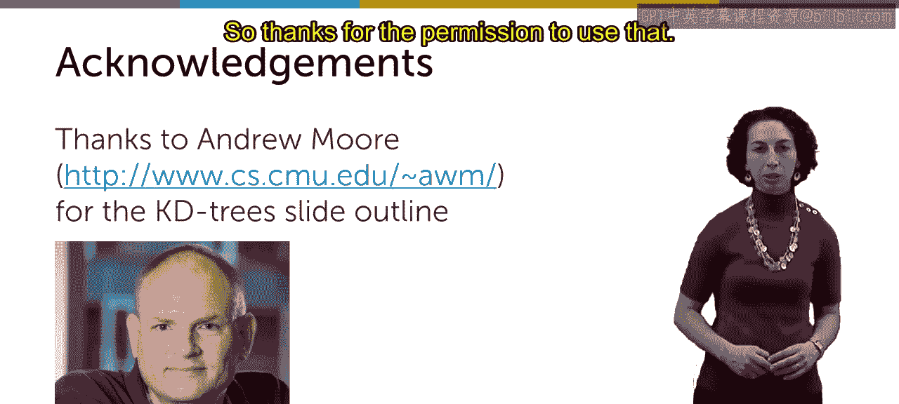

# 机器学习：3.4：使用KD树进行近似k近邻搜索


在本节课中，我们将学习如何使用KD树进行**近似k近邻搜索**。这是一种在牺牲少量精度的情况下，大幅提升搜索效率的方法。我们将探讨其工作原理、优势以及在高维数据中面临的挑战。

上一节我们详细介绍了KD树在精确最近邻搜索中的应用。本节中，我们来看看如何通过调整搜索策略，实现更高效的近似搜索。

## 近似搜索的核心思想

到目前为止，我们讨论的所有方法都旨在从所有数据点中找到**精确的最近邻**。但这个假设依赖于两个前提：一是找到精确最近邻非常重要，二是我们完全信任数据的表示方式和用于计算相似度的距离度量。

如果对数据表示或距离度量没有百分之百的信心，那么找到精确最近邻与找到一个“非常接近”的邻居之间，实际差异可能并不大。因此，一个关键问题是：如果我们不严格要求找到精确最近邻，而只满足于一个相当好的近似，能否让搜索效率变得更高？

在KD树的框架下，实现近似最近邻搜索的方法如下。

## 实现方法：更激进的剪枝

回忆一下，在精确搜索中，我们会维护一个变量 `R`，它代表**当前已找到的最近邻的距离**。

```python
R = distance_to_nearest_neighbor_so_far
```

在近似搜索中，我们将进行**更激发的剪枝**，以此换取效率提升，代价是结果变为近似值。具体做法是，不再基于距离 `R` 进行剪枝，而是基于一个更小的距离 `R / α` 进行剪枝，其中 **α** 是一个大于1的数。

这意味着我们使用的搜索半径更小。因此，一个边界框到查询点的距离超过 `R / α` 的可能性，会比超过 `R` 的可能性更大，从而更早地被剪枝，减少需要搜索的节点数量。

## 近似搜索的性质

使用这种更激进的剪枝策略进行搜索，会得到以下性质：

如果我们最终返回的邻居距离为 `R`，那么可以保证**在距离 `R / α` 的范围内没有其他数据点**。

为了更清晰地说明，假设 `Xq` 是我们的查询点，`R` 是返回的最近邻距离。那么，在以 `Xq` 为中心、半径为 `R / α` 的超球体内，不存在任何数据点。否则，我们就会找到它，并且 `R` 的值会更小。我们剪枝掉了所有距离超过 `R / α` 的区域。

通过这种方式，我们得到了一个相当好的近似解。实际上，这里陈述的界限（`R / α`）是比较宽松的，在实践中，我们找到的邻居通常比这个界限更接近最优解。最重要的是，这节省了大量的搜索工作。

当然，如果参数 **α = 1**，那么该方法就退化回我们之前讨论的**精确最近邻搜索**。

## 近似搜索的实用价值

在许多实际应用中，进行近似最近邻搜索的效果与暴力搜索几乎一样好。这是因为在计算距离时，数据表示本身存在大量“噪声”，并且这个距离是否真的能完美反映相关性（例如，对于一篇我正在阅读的文章，推荐一篇“相当接近”的文章可能就完全能满足我探索相关文献的需求）也存在不确定性。

因此，近似搜索在保持结果实用性的同时，提供了显著的效率优势。

## KD树的总结与局限

首先，KD树确实是一种非常巧妙且高效的数据结构。但我们也需要讨论它的其他方面和一些局限。

以下是关于KD树及其变体的一些要点：

*   **多种变体**：我们讨论了一些启发式方法，例如如何选择分割维度和分割值。实际上，存在大量KD树的变体。
*   **其他空间划分方式**：除了进行坐标轴对齐的分割，还有其他构建类似树结构的方法，例如**球树**，它使用超球面而非超平面来划分空间。我们接下来要讨论的方法，就可以被视为这些坐标轴对齐分割的替代方案之一。

## 高维空间的挑战

无论是对于KD树还是最近邻搜索，当处理**高维数据**时，事情都会变得极具挑战性。

对于KD树：
我们曾提到，需要检查的节点数量可能随着维度 `D` 呈指数级增长。一个经验法则是，通常只有当数据点的数量 `N` 远大于 `2^D`（2的D次方）时，KD树才是有用的。在高维情况下，我们往往没有足够多的数据点来让KD树发挥价值。

对于最近邻搜索：
高维空间带来的挑战不仅仅是KD树效率下降。从一个非常高维的特征向量来看，很多特征可能基本上是噪声，这些噪声会淹没距离计算中有意义的部分。导致的结果是，在高维空间中，**所有点彼此之间都显得非常遥远**。

因此，我们真正需要的是能够**学习哪些特征是重要的**，或者如何**权衡不同特征**的技术。正如之前提到的，这是一项极具挑战性的任务，需要大量的领域知识或深入的思考和探索。

***
> 最后，衷心感谢安德鲁·摩尔（Andrew Moore）允许使用其关于KD树的精彩演示文稿大纲，本节幻灯片的内容在很大程度上借鉴了他的成果。

***

### 本节课总结

本节课中，我们一起学习了：
1.  **近似最近邻搜索**的核心思想：通过接受近似结果来大幅提升搜索效率。
2.  在KD树中实现近似搜索的关键技术：使用 **`R / α`** （α > 1）进行更激进的剪枝。
3.  近似搜索的性质：返回距离为 `R` 的邻居，并保证在 `R / α` 范围内没有其他点。
4.  KD树的优势与多种变体。
5.  KD树和最近邻搜索在**高维空间**中面临的主要挑战，包括效率下降和“维度灾难”问题。



通过理解近似搜索，我们为处理大规模、高维数据下的相似性检索问题提供了一个实用的工具。在接下来的章节中，我们将继续探索其他可扩展的近似最近邻搜索方法。