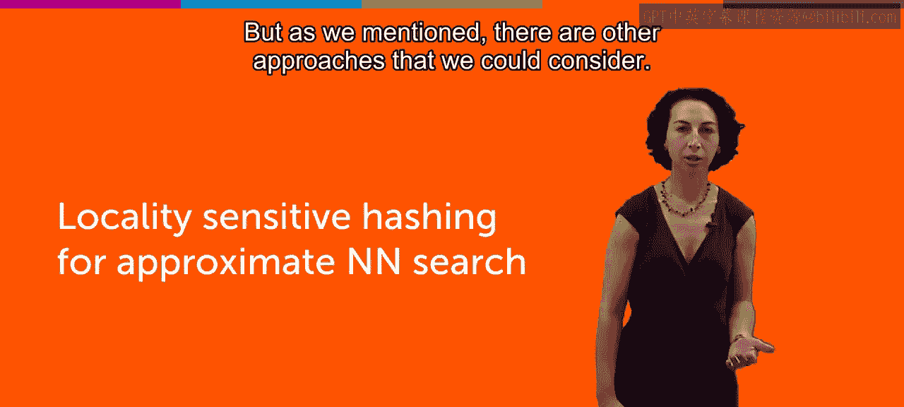
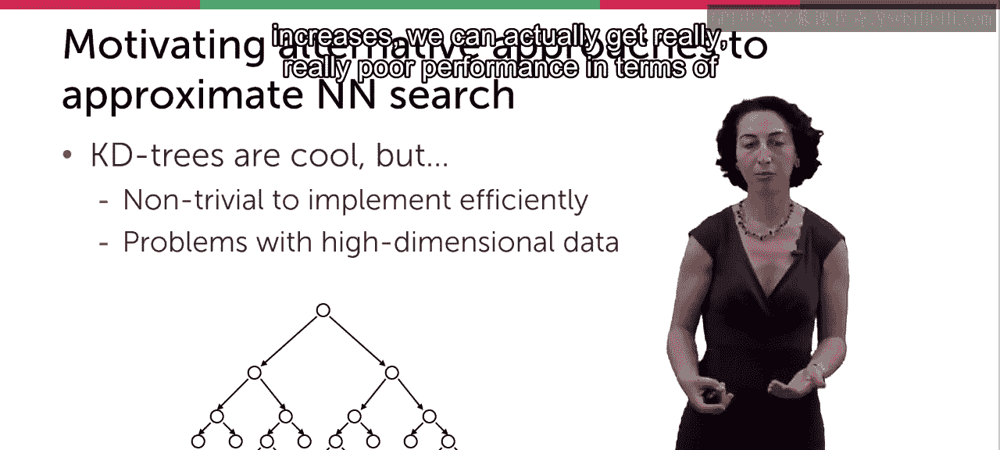
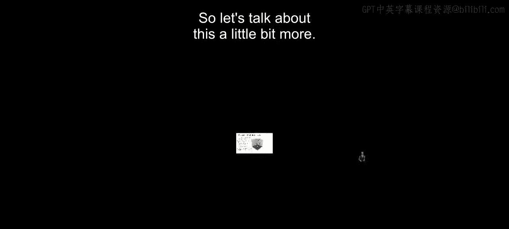

# 华盛顿大学《机器学习（分类，聚类和检索，第3-4课⧸共4课）｜Machine Learning》中英字幕 p140 18_KD树的局限性.zh_en -BV1Sr421F7N7_p140-

。

KD trees are one approach for efficient nearest neighbor search， but as we mentioned。

 there are other approaches that we could consider。

 so let's look at one of these called locality sensitive hashing。

So why might we want to consider an approach other than kd trees Well Kd trees are really cool they're a very intuitive way to think about storing data and as we saw they could lead to some efficiencies and actually some significant efficiencies in performing nearest neighbor search but there are a few issues One is the fact that Kd trees are not the simplest things to implement you have to structure out this tree and it can be pretty challenging to do that the other is something that we saw that as the dimensionality of our data increases we can actually get really really poor performance in terms of the efficiency of nearest neighbor search using Kd trees so let's talk about this a little bit more。

So what happens in high dimensions is basically every point is far away from any other point。

 so this is something that we mentioned before， so if we think about taking our KD tree partitioning。

 remember in a high dimensional space we're going to think of these hypercus that form the different partitions。

Then if we have our query point， it's unlikely there's going to be any point within the given hypercuer even close by。

 so we're going to be searching around finding some point and that will be considered our nearest neighbor so far in the algorithm that we specified and remember what we do is we draw a radius to that nearest neighbor so far and we think of now in high dimensions this big sphere。

 this hypersphere and we can only prune bins。If the distance to that bin is greater than the distance to the nearest neighbor so far。

 but what happens in these high dimensions is that this big sphere。

 this radius to our nearest neighbor so far intersects lots and lots and lots of these hypercubes in at least one dimension and so we can't prune them and what ends up happening is you have to search many。

 many， many， many partitions and you can show under some conditions that you actually need to search over2 to the D different hypercubes or little partitions which completely defeats the purpose of or the efficiencies gained by kd trees unless N the number of observations is just enormously large much。

 much greater than2 to the D so what can we do Well one thing we can think about doing is moving away from performing exact nearest neighbor search and this is something that we discuss when we talked about kd trees。

 we showed how we could use Kd。to perform approximate nearest neighbor search and that's going to be the focus of this section because we're going to assume that we don't fully fully trust our distance metric as being exactly the way that we want to characterize distances and often in a lot of applications you just want to find a neighbor that's pretty close to the given query point it doesn't necessarily have to be exactly exactly exactly the nearest neighbor and so for a lot of retrieval tasks that will actually provide enough performance for the given task but here in contrast to what we did for Kd trees for approximate nearest neighbor search。

 we're going to look at methods where we can provide a probabilistic guarantee on the approximation that we're making。

