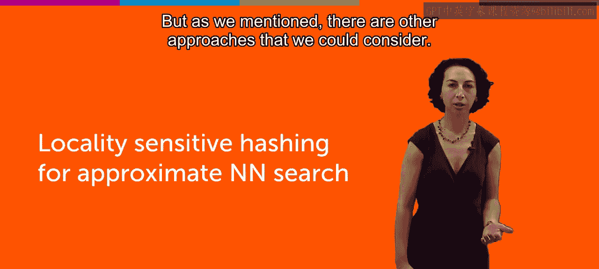
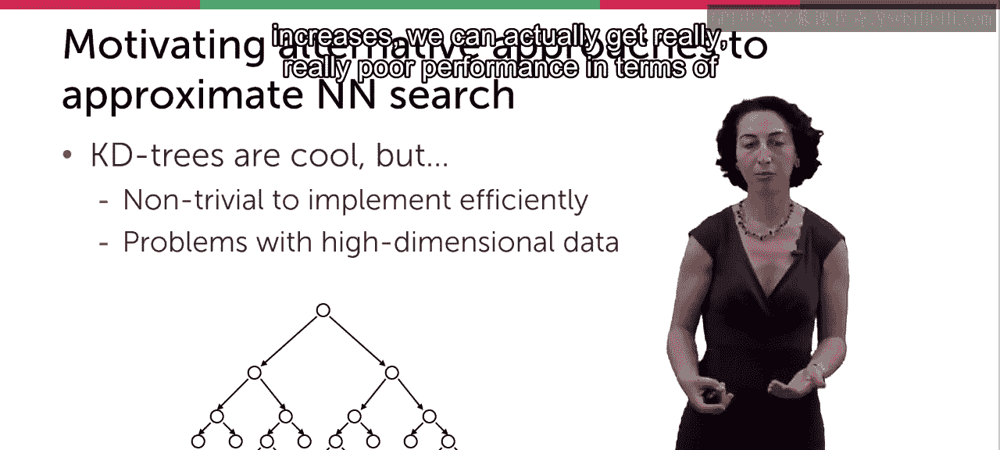
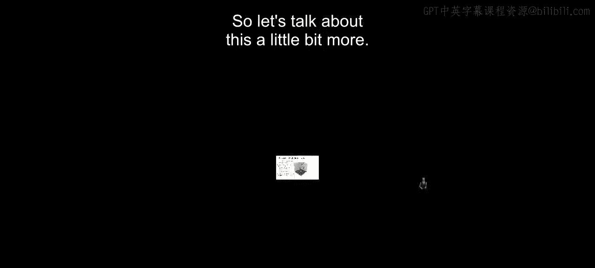

# 机器学习（分类，聚类和检索）：3-4：KD树的局限性

在本节课中，我们将要学习KD树这一高效近邻搜索方法的局限性，并探讨为何在高维数据场景下需要考虑其他替代方案。

## KD树的优势与挑战

上一节我们介绍了KD树如何通过递归划分空间来组织数据，从而实现高效的最近邻搜索。KD树是一种非常直观的数据存储和查询方式，并且确实能带来显著的搜索效率提升。

然而，KD树也存在一些挑战。

以下是KD树面临的两个主要问题：

1.  **实现复杂度高**：构建和结构化KD树本身可能颇具挑战性。
2.  **高维性能下降**：随着数据维度的增加，使用KD树进行最近邻搜索的效率可能会变得非常低。

接下来，让我们更深入地探讨高维空间带来的问题。

## 高维空间的“维度灾难”

在高维空间中，一个基本现象是：**每个点都与其他点相距甚远**。

回想一下KD树的划分过程，在高维空间中，我们得到的是由超矩形构成的不同分区。当我们有一个查询点时，在给定的超矩形分区内，不太可能找到任何距离很近的点。因此，算法会先找到一个当前最近邻点，并以其距离为半径画一个高维超球体。

算法的剪枝规则是：只有当某个分区（bin）到查询点的距离**大于**当前最近邻距离时，才能将其排除。但在高维空间中，这个以当前最近邻距离为半径的大球体，会在至少一个维度上与**大量**的超矩形分区相交，导致我们无法剪枝这些分区。

最终结果是，你不得不搜索海量的分区。在某些条件下，可以证明你需要搜索超过 **2^D** 个不同的超矩形分区（D为维度）。这完全抵消了KD树带来的效率优势，除非观测数据的数量N远远大于2^D。

## 转向近似最近邻搜索

那么，我们能做什么呢？一个可行的思路是放弃进行**精确**的最近邻搜索。

实际上，我们在讨论KD树时已经提到过，可以用它来进行**近似**最近邻搜索。这也将是本节的重点。因为我们通常并不完全信任距离度量能百分之百精确地刻画我们想要的“距离”。在许多应用场景中，我们只需要找到一个与查询点**相当接近**的邻居，而不必是严格数学意义上的**最近**邻居。对于很多检索任务来说，这已经能提供足够的性能。

但是，与之前使用KD树进行近似搜索不同，接下来我们将关注一类新方法。这类方法能为我们所做的近似提供**概率性保证**。

## 总结

本节课中，我们一起学习了KD树在高效近邻搜索中的局限性。我们了解到，尽管KD树直观且有效，但其实现较为复杂，并且在处理高维数据时，由于“维度灾难”导致搜索效率急剧下降，甚至可能退化为近似暴力搜索。为此，我们引入了转向**近似最近邻搜索**的必要性，并指出下一节将探讨能提供概率性近似保证的新方法。