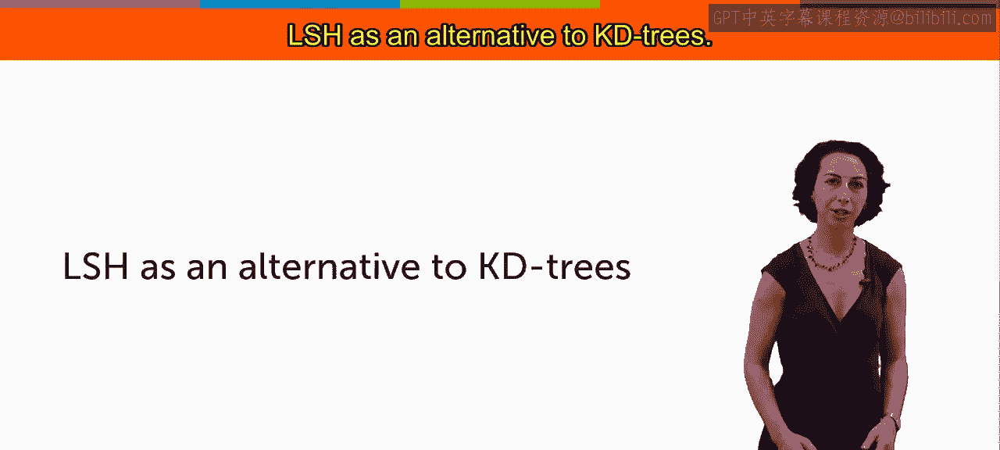
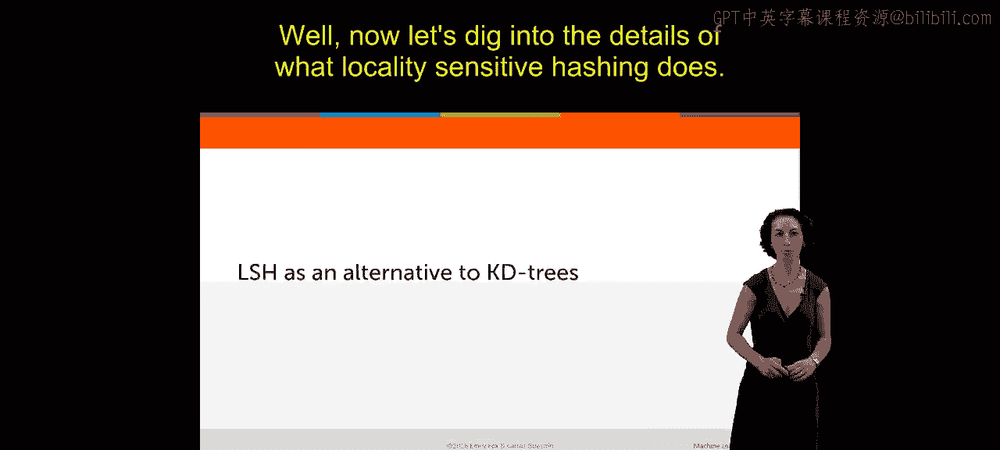
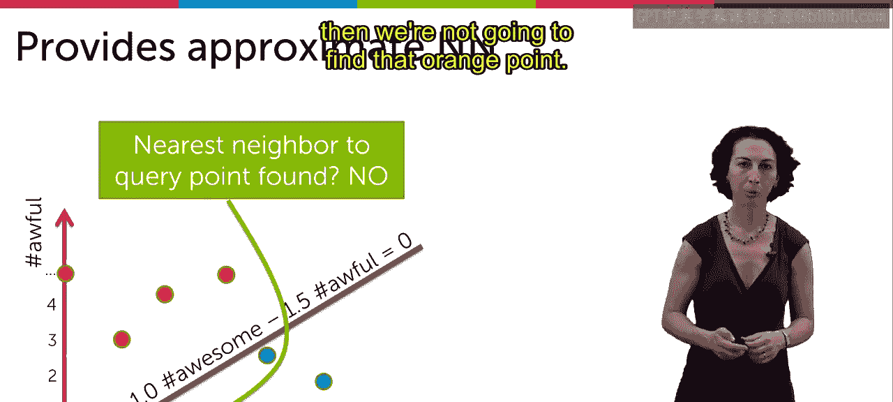

# 华盛顿大学《机器学习（分类，聚类和检索，第3-4课⧸共4课）｜Machine Learning》中英字幕 p141 19_作为KD树替代方案的LSH.zh_en -BV1Sr421F7N7_p141-

。

So we mentioned that we're going to look at locality S of hashing or LSH as an alternative to Kd trees。

 well now let's dig into the details of what locality sensitive of hashing does。

And just like Kd trees， we're going to think of partitioning our data into bins。

 but the way in which locality sensitive hashing does this is just fundamentally different than the types of access aligned cuts made by Kd trees。

And in this section we're going to return to an example that we used in the classification course。

 which is imagine we have reviews of restaurants， so we have text from those reviews and we're just going to count how many times we see the wordA versus the word awful and when we're thinking about retrieving similar types of reviews we're just going to look at these counts。

嗯。Okay well， just like in classification we can think of dividing these set of points just using a simple line。

 so this is like the decision boundary we saw in the classification course and here I'm just writing the equation of this line and we're defining this term which we call the score so it says for any input in terms of counts of the number of awesome and the number of awful。

 I'm going to score that review。And everything that falls below this line has a negative score。

 and everything that's above this line has a positive score。

But we're going to be using these scores in a different way than we did in the classification course here if we're going to say that if the sign of the score is negative。

 then all of these points fall into what we're calling the zero bin， but if the sign is positive。

 then all of those points are going to be assigned to bin one。

So we're going to translate the sign of the scores into a binary index。

And then we can use this for nearest neighbor search in the following way。

 so if we get this green query point here， then we're only going to search for nearest neighbors in its bin so all these other orange points。

 so here we're only searching for nearest neighbors with the points whose score is less than zero and in terms of these bin indices that corresponds to all the points that were labeled as having bin index zero。

Alternatively， if the query were to have fallen into this other region， this blue region。

 we would have looked over all the points that had been index1 because all of their scores were greater than zero。

In practice， the way we're going to do this， search over all data points that have the same bin index as the query point is using something called a hash table and what a hash table does is for each of our bin values。

 bin zero or bin1， we're going to call that the key， and then we're going to associate with that key。

 a set of values， a list of points that are the indices of the data points that have that bin value。

Set another way we're taking all of the data points that have been value zero and we're going to list those data indices in the first element of this table and we're taking all the data points that have been value1 and we're going to list those indices in the second element of this table。

 then when we get a given query point and we look at the bin value of that query based on looking at the score the sign of the score and determining the bin index。

 then we're just going to search along the list of points that are in that bin。

So this provides a really， really simple way of doing nearest neighbor search。

Very simple idea of throwing down a line and then just simply searching the other points that either fall above or below this line。

 But the question is does this return an exact nearest neighbor And the answer is no。

 So for example here we have this green query point and let's say that this orange point which is just above the line very close to that green point is actually the true nearest neighbor。

 Well， if we look at this green point and we're only searching all the blue points which have the same bin value as this green point。

 then we're not going to find that orange point。

