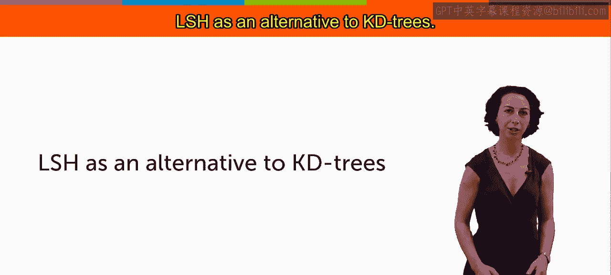
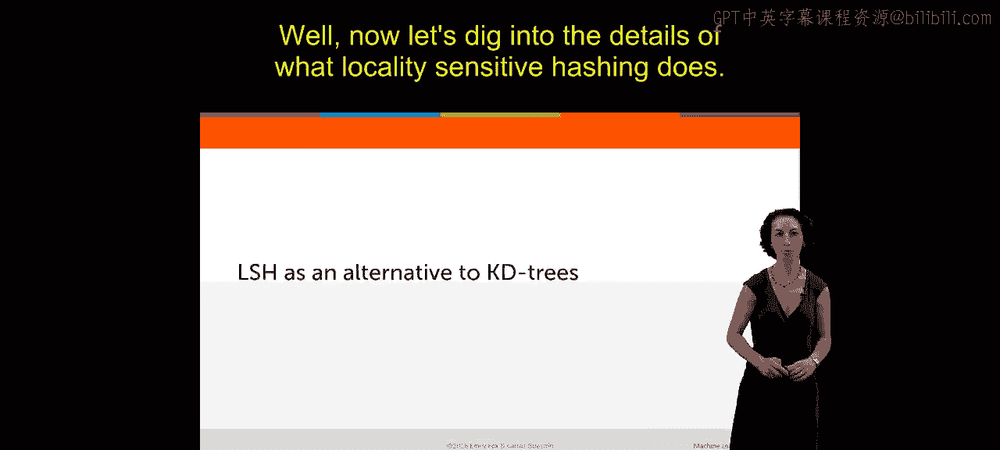
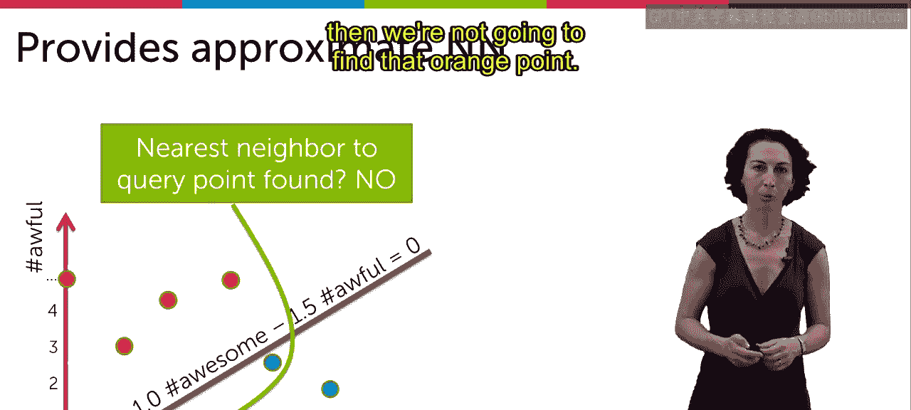

# 机器学习（分类，聚类和检索）：第3-4课：作为KD树替代方案的LSH 🧭

在本节课中，我们将学习局部敏感哈希（Locality Sensitive Hashing，简称LSH），这是一种与KD树不同的、用于高效近邻搜索的数据分区方法。我们将通过一个简单的文本数据示例，了解LSH的基本原理、实现方式及其与精确搜索的区别。

---

## 从分区数据到哈希表

上一节我们介绍了KD树通过坐标轴对齐的切割来划分数据。本节中我们来看看局部敏感哈希（LSH）如何以另一种根本不同的方式进行数据分区。

我们回到分类课程中使用过的一个例子：假设我们有一些餐厅评论，我们统计每条评论中“awesome”（很棒）和“awful”（糟糕）两个词出现的次数。当我们需要检索相似的评论时，就基于这两个计数来操作。

与分类课程中类似，我们可以用一条简单的直线来划分这些数据点。这条直线就像一个决策边界，其方程可以表示为：

**score = 1 * (count of awesome) + 1 * (count of awful) - 5**

这里我们定义了一个“分数”项。对于任何以“awesome”和“awful”计数作为输入的评论，我们都可以计算其分数。落在这条线下方的点具有负分数，上方的点则具有正分数。

但在这里，我们使用这些分数的方式与分类课程不同。我们将根据分数的符号，将数据点分配到不同的“桶”中：

*   如果分数的符号为负，所有这些点都被分配到我们称为“0号桶”中。
*   如果分数的符号为正，所有这些点则被分配到“1号桶”中。

这样，我们就将分数的符号转换成了一个二进制索引。

---

## 基于哈希表的近邻搜索

在实际操作中，我们使用一种称为“哈希表”的结构来搜索所有与查询点具有相同桶索引的数据点。

哈希表的工作原理是：对于每个桶值（桶0或桶1，我们称之为“键”），我们关联一个“值”的集合，即属于该桶的所有数据点的索引列表。

换句话说，我们取所有桶值为0的数据点，将其索引列在表的第一个元素中；取所有桶值为1的数据点，将其索引列在表的第二个元素中。

当我们获得一个查询点，并根据其分数的符号确定其桶索引后，我们只需在该桶对应的索引列表中搜索近邻即可。

这为近邻搜索提供了一种非常简单的实现方式。其核心思想是画一条线，然后只搜索落在该线同一侧的其他点。

---

## LSH的近似性与权衡

但问题是：这种方法能返回精确的最近邻吗？答案是否定的。

例如，这里有一个绿色的查询点。假设这个恰好在线之上、非常接近绿点的橙色点才是真正的最近邻。如果我们只搜索所有与该绿点具有相同桶值（此处为桶1）的蓝色点，那么我们将无法找到那个橙色的最近邻点。

因此，局部敏感哈希是一种近似近邻搜索方法。它通过牺牲一定的精确度，换取了在大规模数据集中极高的搜索速度。其核心优势在于，能够快速将搜索范围缩小到可能与查询点相似的一个数据子集中。

---

## 总结

本节课中，我们一起学习了局部敏感哈希（LSH）的基本原理。我们了解到LSH通过将数据点基于某个随机超平面（在示例中是一条线）的投影符号分配到不同的“桶”中，并使用哈希表来管理这些桶。当进行近邻搜索时，只需在查询点所在的桶内进行查找，从而极大地提高了搜索效率。虽然LSH是一种近似方法，不一定总能找到精确的最近邻，但它在处理高维、大规模数据时，在速度与准确性之间提供了一个优秀的权衡方案。