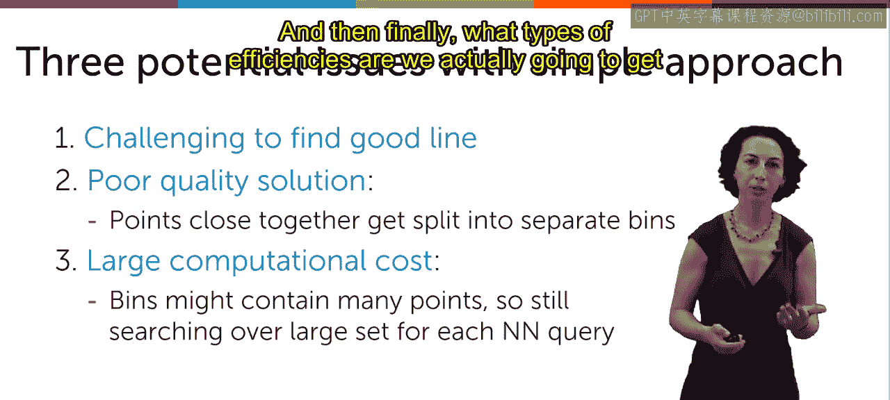
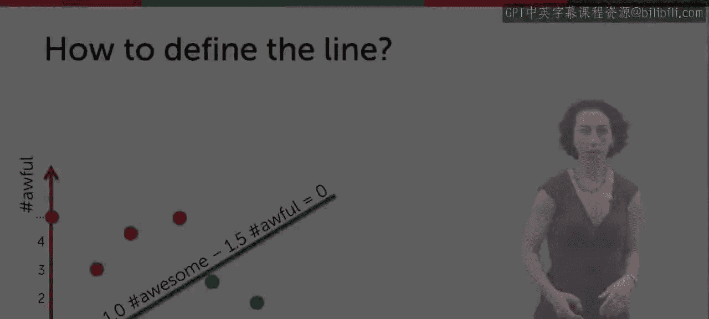
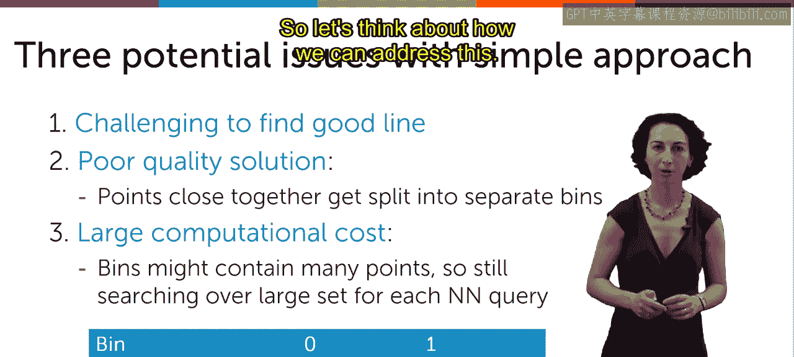

# 华盛顿大学《机器学习（分类，聚类和检索，第3-4课⧸共4课）｜Machine Learning》中英字幕 p142 20_使用随机线划分点.zh_en -BV1Sr421F7N7_p142-

。

So up to this point we've described just the concept of partitioning our data just using these simple lines and I should have mentioned that in everything we're going to describe here。

 we're just going to assume that there's no intercept term to the line so it's always going to go through the origin so it's a very simple structure a very simple way to think about partitioning our data into two separate bins and then it's a very simple way that we can just search along the points that fall into each of these partitions but there are a number of questions that we might be faced with so one of these questions is how do we think of defining a good line to split the points and associated with that question is what's the result in quality of this type of nearest neighbor search we said that it's provides an approximate nearest neighbor search but what are the chances that we're actually going to find the nearest neighbor to a given query point。

And then finally， what types of efficiencies are we actually going to get from this simple partitioning of data points？

Well， let's start with the question of how are we going to define this line？And for this。

 let's propose something that sounds really， really crazy。 What if we just draw the line randomly。

 just randomly throw it down a line that goes through the zero zero point。Well。How bad can this be？

It sounds like it could actually be really， really bad， but let's think through this a bit。

And remember that our objective is if two points are close together and here we're going to be focusing on cosine similarity when we're talking about the distance between two different points。

 Well， our goal is that if they're close together according to cosine similarity。

 then we want those two points to fall into the same bin。To formalize this a bit。

 let's just say that the angle， remember that cosine similarity is defined in terms of the cosine of the angle between two points。

 so let's say that there are two points x and y and the angle between x and y is theta x Y。Okay。

 now let's just start drawing lines randomly， so here's one line。

 and this line happens to put both x and y into bin zero。

Because the score of both of the points is less than zero。

Here's another line and another and another another。

 and here's a whole bunch of lines that all place x and y into the same bin， bin zero。Well。

 here's a line that places is both x and y into bin1， since both of their scores are greater than0。

And here's another one， another one， another one， another one， another one。

 whole bunch of lines that all place X and y into the same bin， bin one。But we can make mistakes。

 of course， here's one line that separates x and Y so that they will be put into different bins because the Y point has a negative score。

 so that's going to be in bin0。 The x point has a positive score is going to be in bin1。

 And here are some other lines that would do the same thing。Okay。

 so what we're saying is that this whole range of points here that I'm showing in blue。

Place both X and Y into the same bin， bin one。And all of these points or all of these lines that would fall into this orange region that I'm showing here place both x and y into pin zero。

 but then there's this green range。Where any line that falls in that space is going to put X and Y into separate bins。

But a question is， what's the chance of that happening？Well， if theta X Y is really small。

Then there's just a small chance that a random line。

Pla let's say uniformly random from zero to pi over2。

 there's just a small chance that it's going to fall within that theta range。

So what that means is that there's just a small probability that。

X and y are going to be put in different bin， so if x were our query。

 then we wouldn't find its nearest neighbor Y， which was in some other bin。So in summary。

 this idea of just throwing down a random line。It's actually not that crazy。

 we're saying that it provides good performance in terms of a probabilistic statement of providing exact nearest neighbors for lots and lots of queries。

Okay， so far what we've done is we've talked about the first two points。

 we showed how we can just very simply throw it down a line。

 nothing challenging to how we have to think about defining that line。

 and we also showed that we can get very good performance in terms of nearest neighbor search with this very simple approach。

However， there's this really， really problematic last third point。

 which is what are the efficiencies that we get from this approach and if we think about just throwing down one line。

Then what happens is that we often end up with bins that still have lots and lots of data points if we assume we have lots and lots and lots of data points to begin with。

 if we just partition them into two sets， we're probably going to end up with two bins。

 each of which have lots and lots of data points and a query is going to have to search over lots and lots of points。

Okay， so it seems like we've gained something in terms of efficiency， but not that much。

 so let's think about how we can address this。

🎼。