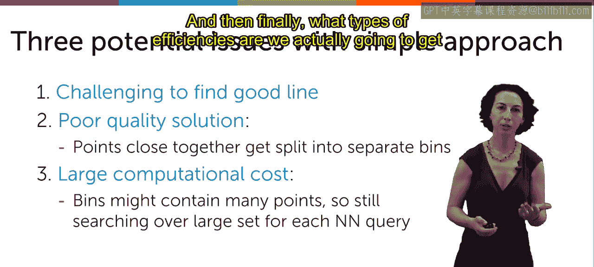
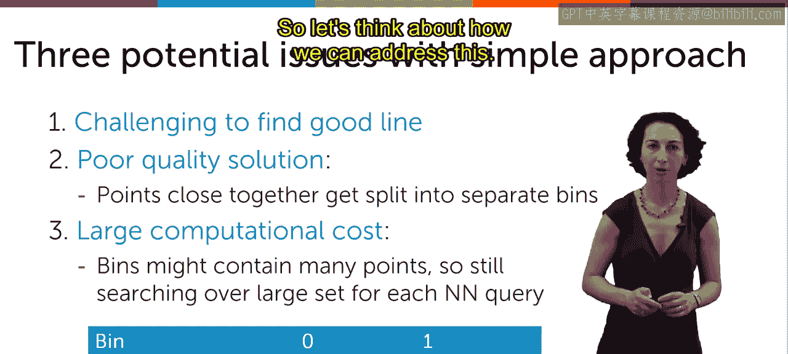

# 机器学习（分类，聚类和检索）：第3-4课：使用随机线划分点

在本节课中，我们将学习一种使用随机线划分数据点的方法，以实现高效的近似最近邻搜索。我们将探讨如何定义划分线、这种方法的搜索质量以及其带来的效率提升。

---

## 🎯 核心概念：随机线划分

到目前为止，我们描述了使用简单直线划分数据点的概念。需要说明的是，在本节讨论的所有方法中，我们假设直线没有截距项，即直线始终通过原点。这是一种非常简单的结构，也是一种将数据划分为两个独立区域的简单方式。通过这种方式，我们可以轻松地搜索落入每个区域的数据点。

然而，我们可能会面临几个问题。其中一个问题是：如何定义一条好的直线来划分数据点？与此相关的问题是：这种最近邻搜索的质量如何？我们说过它提供的是近似最近邻搜索，但实际找到给定查询点的最近邻的概率是多少？最后，这种简单的数据点划分方法能带来何种效率提升？

---

## 🧠 如何定义划分线？

让我们从如何定义这条线的问题开始。为此，我们提出一个听起来非常疯狂的想法：如果我们只是随机画一条线呢？即随机放置一条通过原点的直线。这听起来可能非常糟糕，但让我们仔细思考一下。

我们的目标是：如果两个点彼此接近（这里我们关注的是余弦相似度），我们希望这两个点落入同一个区域。为了形式化这一点，假设有两个点 **x** 和 **y**，它们之间的夹角为 **θ_xy**。余弦相似度就是通过这个夹角的余弦值来定义的。

现在，我们开始随机画线。有些线会将 **x** 和 **y** 都放入区域0（因为它们的得分都小于0），有些线会将它们都放入区域1（因为得分都大于0）。但我们也可能犯错：有些线会将 **x** 和 **y** 分开，放入不同的区域（例如，**y** 得分为负进入区域0，**x** 得分为正进入区域1）。

关键问题是：这种情况发生的概率有多大？如果 **θ_xy** 非常小，那么一条在0到π/2之间均匀随机的直线恰好落入那个小角度范围内的概率也很小。这意味着，**x** 和 **y** 被放入不同区域的概率很小。因此，如果 **x** 是我们的查询点，我们不太可能错过其最近邻 **y**，因为 **y** 很可能在同一个区域。

总结来说，随机画线的想法实际上并不疯狂。它在概率意义上提供了良好的性能，能够为大量查询找到精确的最近邻。

---

## ⚡ 效率问题与改进思路

到目前为止，我们已经讨论了前两点：展示了如何简单地随机画线，以及这种方法在最近邻搜索中能提供良好的性能。然而，还存在一个非常棘手的第三点：这种方法能带来多大的效率提升？

如果我们只画一条线，结果往往是：当我们有大量数据点时，划分出的两个区域可能仍然包含非常多的数据点。查询仍然需要在这大量的点中进行搜索。因此，我们在效率上似乎有所提升，但提升并不显著。

那么，我们该如何解决这个问题呢？下一节我们将探讨通过使用多条随机线来创建更精细的划分，从而进一步提高搜索效率。

---

## 📝 总结

本节课中，我们一起学习了使用随机线划分数据点以实现近似最近邻搜索的基本方法。我们了解到，随机选择通过原点的直线是一种简单有效的划分策略，并且从概率上看，它能很好地保持邻近点在同一区域内。然而，单条划分线在数据量巨大时带来的效率提升有限，这引导我们去思考如何使用多条线来创建更高效的索引结构。