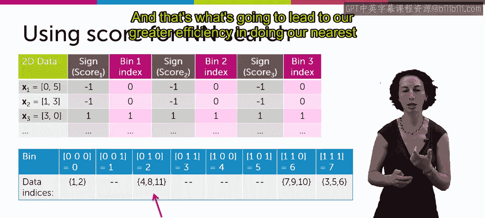

# 华盛顿大学《机器学习（分类，聚类和检索，第3-4课⧸共4课）｜Machine Learning》中英字幕 p143 21_定义更多的桶.zh_en -BV1Sr421F7N7_p143-

。

To state this more formally， let's think about how can we reduce the number of points we have to examine for every query made。

Naturally we can think about doing this by just throwing down more lines which creates more partitions and fewer points per partition so then when we go to do our query of a given point。

 we just need to search over a smaller set of points to return an approximate nearest neighbor okay so let's think about this approach a little bit more and what we're going to do here iss very similar to what we did when we just threw down one line we're going to take each one of our data points and we're going to score it under in this case each of the lines that we threw down and then we're going to use the sign of that score to create a binary vector that's going to index which bin that point falls in so in particular what we see is that for example here all the orange points have negative scores under line1 line2 and line 3 and so that's going to form a binary vector that has indices 000 or value 000 and then all these pink points。

They have scores that are positive underline 2 but negative underlines1 and three。

 so that binary vector is going to have values 010。

 the blue points have values that are positive underlines1 and 2 but negative underline 3。

 so it's going to have a binary vector 110， and finally these green points have values that are positive under all three lines。

 and so the binary vector is going to have values 111。Okay。

 then we're going to take these bin values per line。So this is the。

This bit vector that we were talking about and we're going to think about using it to encode an index or a value in a hash table。

 so for example the the points that have these binary vectors with value 000 are going to have key values that are0。

 the points that have， for example， let's say a binary vector 011 are going to have a key value that's three。

 so it's going to take the fourth location in this table。And just as before。

For each one of these key values， we're simply going to list all the data points that have that specific binary vector so that specific set of scores under the lines that we threw down so it's a very natural generalization of the approach we talked about where we just threw down one line when we go to do our query。

 we're simply going to think about searching within the bin that that query point get scored as and so relative to what we're doing before though。

 just to reiterate， we're expecting that there are fewer points in that bin。

And that's what's going to lead to our greater efficiency in doing our nearest neighbor search。

 than if we just threw down one line。

