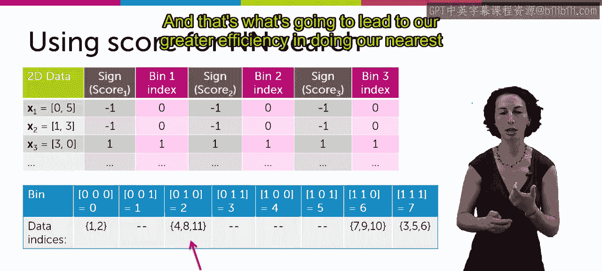

# 机器学习（分类，聚类和检索）：第3-4课：定义更多的桶 🪣

在本节课中，我们将学习如何通过定义更多的“桶”（即分区）来提升近似最近邻搜索的效率。我们将探讨如何利用多条随机线对数据空间进行更精细的划分，从而减少每次查询时需要检查的数据点数量。

---

上一节我们介绍了使用一条随机线划分空间的方法。本节中，我们来看看如何通过增加随机线的数量来创建更多、更小的分区。

为了更正式地阐述，让我们思考如何减少每次查询时需要检查的数据点数量。一个自然的想法是，通过绘制更多的线来创建更多的分区，使得每个分区包含的数据点更少。这样，当对给定查询点进行搜索时，我们只需要在一个更小的点集中寻找，以返回一个近似的最近邻。

以下是实现这一想法的具体步骤：

1.  **生成多条随机线**：与之前类似，我们在数据空间中随机生成多条线（或超平面）。每条线由一个随机向量 **w** 和一个随机偏置 **b** 定义，其方程为 **w·x + b = 0**。
2.  **为每个数据点计算二进制向量**：对于数据集中的每一个点 **x**，我们计算它在每条线下的“分数”：`score_i = w_i·x + b_i`。然后，我们取每个分数的符号（正或负），生成一个二进制向量。例如，如果某点在三条线下的分数符号分别为负、正、负，则其二进制向量为 `[0, 1, 0]`（这里约定负为0，正为1）。
3.  **将二进制向量映射为哈希表键值**：每个唯一的二进制向量对应一个“桶”或分区。我们将这个二进制向量转换成一个整数键值（例如，通过二进制转十进制），用作哈希表的索引。
4.  **构建哈希表**：对于哈希表中的每个键值（即每个桶），我们存储所有具有相同二进制向量的数据点。

当进行查询时，流程如下：
1.  对查询点 **q** 执行相同的操作：计算它在所有随机线下的分数，生成其二进制向量。
2.  将此二进制向量转换为键值，并在哈希表中查找对应的桶。
3.  仅在该桶包含的数据点集合中进行最近邻搜索。

相对于只使用一条线的方法，我们期望每个桶中包含的数据点更少。这正是提升我们最近邻搜索效率的关键。

---

本节课中，我们一起学习了如何通过引入多条随机线来定义更多的数据桶。这种方法是对单线划分的自然推广，它通过创建更精细的分区，显著减少了每次查询时需要处理的数据量，从而在保持近似精度的同时，提高了搜索速度。核心在于利用二进制向量对数据点进行快速哈希分桶。