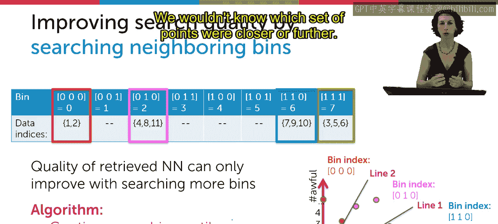
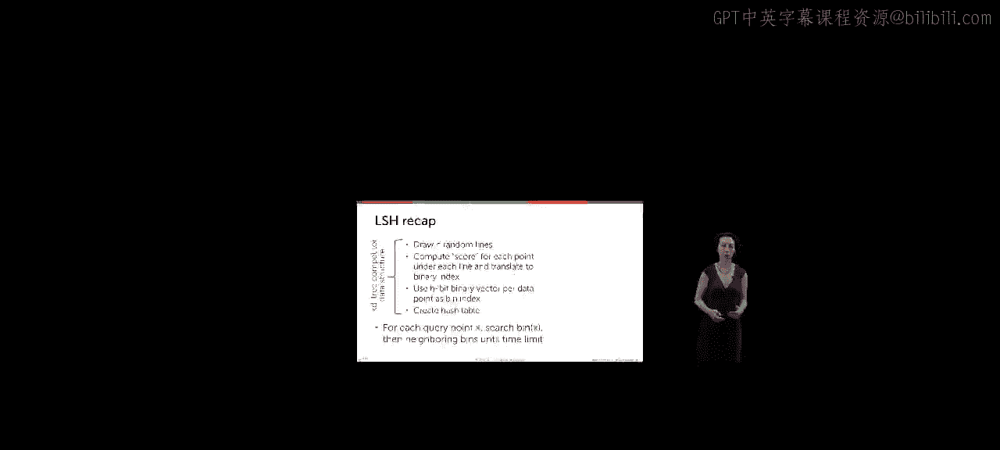
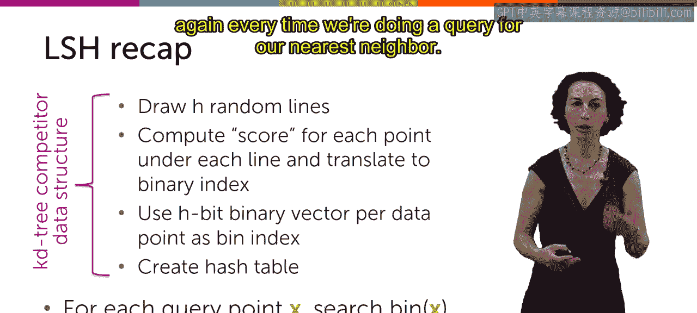

# 华盛顿大学《机器学习（分类，聚类和检索，第3-4课⧸共4课）｜Machine Learning》中英字幕 p144 22_搜索相邻的桶.zh_en -BV1Sr421F7N7_p144-

。

So if our query point falls in this bin here。Meaning it gets scored as 010， so maybe。

Maybe our query point is right here。Um。And so according to the lines that we threw down。

 it would have a binary vector 010， and then what we do is just go and look within this box and look at the distances to data points4。

 data point8 and data。11， the question is，Do we know we're going to find the nearest neighbor？

And so hopefully this shouldn't be such a trick question at this point or such a challenging question。

 the answer is no， we know that we're just thinking about returning an approximate nearest neighbor because the nearest neighbor could very well be in some other bin。

And have been split from the bin that our query point was put into。

But the important thing here is that the situation is even worse than what we mentioned before when we just threw down one line because the chance of splitting our query point and its nearest neighbor is even higher when we're throwing down multiple lines because there's more of a chance that one of these lines or multiple of these lines will split our query point from its nearest neighbor。

 So what we see is that when we think about throwing down multiple lines。

 what we're trading off is accuracy for speed， because there's a greater chance that searching within a single bin or're not going to find our true nearest neighbor。

But we can search much more efficiently。But there's actually even better news。

 which is we have some control over this approximation that we're making。

 and we have control over how much computation that we are going to perform to perform our nearest neighbors search。

Because in particular we don't have to just search the one bin that our query point falls into。

 we can also search nearby bins， so what does it mean to be a nearby bin？Well， let's look at this。

 okay， so remember our query point was， let's say somewhere around here。对。

Bin that it falls into is 010， so what are the nearby bins， there bins 00，0 and110。And what we see。

 which makes sense if you think about how these vectors were actually defined。

 is that the nearby bins are the ones that are just one bit off。From our current bin indices。 So。

 for example， going from。One flipping that bit to a zero， we get to the orange bin。

 or if we take our zero， flip it to a one， we get to this blue bin。

So it's just changing the score of the point。By saying that it just fell on the other side of the line that defines the current bin。

Okay， so what we can do in practice if we go back to our hash table is instead of just searching bin two。

You can't see that at all with this color， let me switch colors。Instead of just searching bin2。

 we're going to look at the binary encoding of two， and then we're going to go flip bits。

And search these nearby bins， so then we're going to search。Ben zero and bin six in this case。Okay。

 so we're going to compute not just distances to these points here。

 but we're also going to compute distances to these other data points and we're going to hope that if our nearest neighbor didn't fall into this pink bin here。

 maybe it was in the orange or maybe was in the blue。

And so what that assumption is saying is that we're assuming。

If our nearest neighbor fell in one of these other orange or blue bins。

 is that relative to our query point， there was only one line that split the nearest neighbor from the query point。

But there might have been two lines that split our query point and its nearest neighbor。

So if that were the case， so let's just draw a little picture over here and let's say this is our query point。

And this here is its nearest neighbor。Well， it could be that。We threw down。Two lines。That split。

These two points， and in this case， we'd have to search two bits off。

So we'd have to search now flipping two bits， taking our zero。

Turning it into a1 and taking our other zero and also turning it into a one to search bin7 and then also consider the distances to all of these data points here。

And again， if we found a nearest neighbor， that was in this bin7。

What that would mean is that we had exactly this case where two lines separated our query point from the nearest neighbor so just to make sure it's very clear the quality of the nearest neighbor that we return can only improve as we search more and more neighboring bins so what can we do in practice well typically when we go and use locality sense hashing to perform nearest neighbor search we think about running the algorithm。

 keeping searching nearby bins， flipping bits， more and more bits and searching all of those bins。

Until we've run out of our computational budget that we've set for that search。

 or alternatively maybe you have a standard for how good the nearest neighbor should be from the query point so you know as long as the point we find is within some epsilon distance of the query point we're going to say that's good enough so then in that case you would just keep searching。

Until you found that neighbor within that epsilon ball of the query point。

 even if you hadn't run out of your computational budget so far。So the cool thing here。

 relative to the approach of just throwing down one line is we can actually control this approximation versus the complexity of search tradeoff that we're making。

 because we can get better and better approximations， the more bins we search。

 but we can cut off that process at some point， if we've searched too many points。

 we've run out of time in performing this search， whereas if we just threw down one line。

We wouldn't know where to stop the search， we wouldn't know which set of points were closer or further。

 so that's part of the benefit of throwing down multiple lines。

Okay， so just to recap what we've seen so far about locality sensitive hashing well the way that we partition our data points is we throw down some h different lines and then we're going to score every data point under every line and use that to create this binary bit vector and then we're going to take that and we're going to use that to encode a bin index or really that's going to serve as the key informing a hash table that lists all the data points that have that specific binary vector or bin number and so this data structure is going to serve as basically the direct analog of what we did for kD tree so this is going to be a fixed partitioning of our data points into different bins and then when we go to perform our nearest neighbor search when we have a given query we're going to use this data structure that we've created which is just simply a hash table and we're going to search bins in nearby bins to return our。

Neighbor really approximate nearest neighbor and so we're going to use this same hash table for every query we have。

 so although there's a cost to forming this hash table which we'll discuss a little bit later。

 we can reuse it again and again and again every time we're doing a query for a nearest neighbor。

