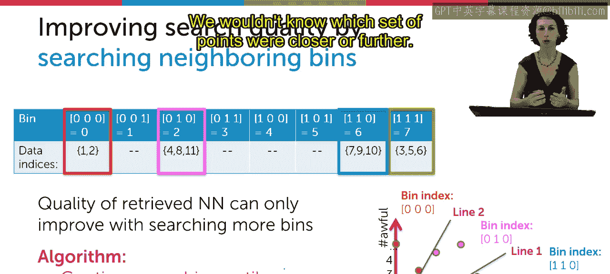
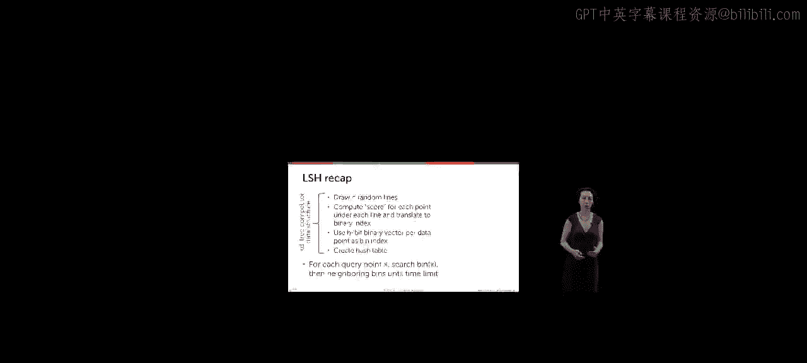
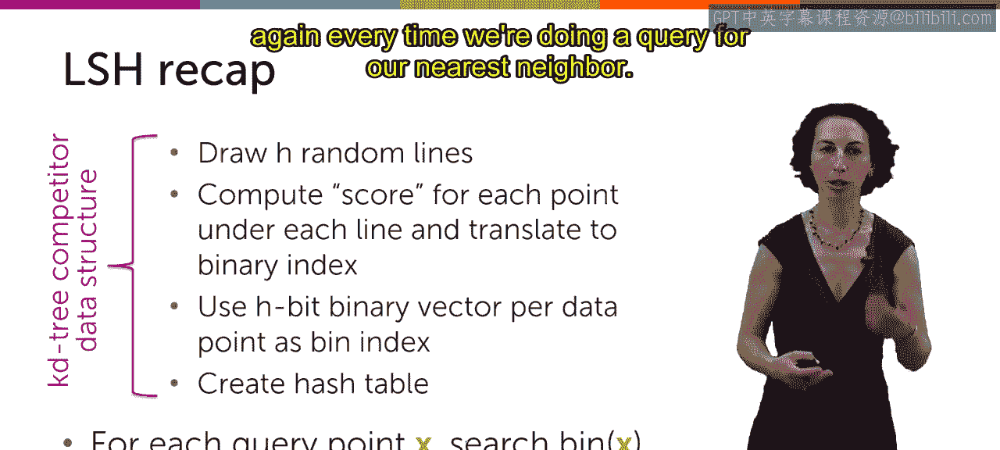

# 机器学习（分类，聚类和检索）：第3-4课：搜索相邻的桶

在本节课中，我们将要学习局部敏感哈希（LSH）中一个重要的优化技巧：搜索相邻的桶。我们将了解为什么仅搜索查询点所在的单个桶可能不够，以及如何通过搜索附近的桶来提升找到最近邻的概率，同时还能在搜索精度和计算效率之间进行灵活的权衡。

## 概述

上一节我们介绍了通过投掷多条随机线来划分数据空间，并将数据点分配到不同的“桶”中。本节中我们来看看，当进行最近邻搜索时，为什么以及如何搜索查询点所在桶的“邻近”桶。

## 为什么需要搜索邻近桶？

假设我们的查询点落在下图所示的这个桶中，其二进制编码为 `010`。

根据我们投掷的线，查询点被编码为 `010`。我们接下来会在这个桶内（包含数据点4、8和11）计算查询点到这些数据点的距离。

问题是：我们**能保证**在这个桶里找到**真正的**最近邻吗？

答案是否定的。我们只能期望返回一个**近似最近邻**。因为真正的最近邻很可能位于其他某个桶中，并且由于我们投掷的线，它被与查询点分割开了。

更重要的是，当我们投掷多条线时，查询点与其最近邻被分割开的风险**比只投掷一条线时更高**。因为线越多，其中某一条或多条线将这两个点分开的可能性就越大。

因此，我们看到，投掷多条线实际上是在用**精度**换取**速度**。虽然搜索单个桶的效率很高，但找到真正最近邻的概率降低了。

## 如何定义“邻近”桶？

但这里有一个更好的消息：我们可以控制这种近似程度，也能控制搜索所花费的计算量。因为我们不必只搜索查询点所在的桶，还可以搜索**邻近的桶**。

那么，什么是“邻近的桶”呢？让我们来看一个例子。

假设查询点位于下图位置，它所在的桶编码是 `010`。

哪些是邻近的桶呢？它们是编码为 `000` 和 `110` 的桶。如果你思考一下这些二进制向量是如何定义的，就会发现：**邻近的桶就是那些与当前桶索引仅有一位不同的桶**。

例如：
*   将 `010` 的第一位 `0` 翻转为 `1`，我们得到 `110`（蓝色桶）。
*   将 `010` 的第二位 `1` 翻转为 `0`，我们得到 `000`（橙色桶）。

这相当于让查询点“跨越”了定义当前桶的某一条线，落到相邻的区域。

## 实践中的搜索策略

回到我们的哈希表结构。假设查询点落在桶2（二进制 `010`）。我们不仅搜索桶2，还会查看其二进制编码，然后**翻转其中的位**，去搜索那些邻近的桶。

以下是具体步骤：
1.  确定查询点所在的桶索引（例如 `010`）。
2.  搜索该桶本身。
3.  生成所有**汉明距离为1**的桶索引（即仅翻转一位）：
    *   翻转第一位：`110` -> 桶6
    *   翻转第二位：`000` -> 桶0
    *   （翻转第三位：`011` -> 桶3，如果存在）
4.  搜索这些新生成的桶。
5.  计算查询点到所有这些桶内数据点的距离。

这样做的假设是：如果真正的最近邻不在查询点所在的桶，那么它很可能只被**一条线**与查询点隔开，因此会落在这些汉明距离为1的邻近桶中。

## 处理更复杂的分割情况

但是，查询点与其最近邻有可能被**两条或更多条线**分割开。

假设查询点在这里，其最近邻在这里。我们投掷的两条线恰好将这两个点分开了。

在这种情况下，我们需要搜索**汉明距离为2**的桶（即翻转两位）。对于桶 `010`，翻转两位可能得到 `100`、`001` 或 `111` 等。我们需要搜索这些桶，并计算其中数据点的距离。

**核心概念是：我们搜索的邻近桶范围越广（翻转的位数越多），找到的最近邻质量就越高，但需要计算的距离也越多。**

## 控制精度与计算的权衡

在实践中，使用局部敏感哈希进行最近邻搜索时，我们通常采用以下策略之一：

以下是两种常见的停止搜索条件：

*   **设定计算预算**：持续搜索邻近的桶（先翻1位，再翻2位，以此类推），直到用尽为该次搜索设定的计算资源（例如，时间限制或最大计算距离数）。
*   **设定质量阈值**：持续搜索，直到找到一个与查询点距离在某个 **ε** 范围内的数据点。一旦找到，即认为足够好，停止搜索。

相对于只投掷一条线的方法，这种方法的优势在于我们可以**主动控制**近似精度与搜索复杂度之间的权衡。我们可以通过搜索更多桶来获得更好的近似结果，也可以在必要时提前终止搜索。而如果只投掷一条线，我们无法知道该搜索哪些点集，也无法在精度和效率之间做出灵活选择。

## 总结与回顾

本节课中我们一起学习了局部敏感哈希中搜索邻近桶的核心思想。让我们来回顾一下整个流程：

1.  **数据分区**：我们投掷 `h` 条随机线，根据每条线对每个数据点进行打分（0或1），形成一个 `h` 位的二进制向量。
2.  **构建哈希表**：这个二进制向量作为键，将所有具有相同向量的数据点放入哈希表的同一个“桶”中。这形成了一个对数据点的固定划分。
3.  **最近邻搜索**：对于一个给定的查询点：
    *   用同样的 `h` 条线为其生成二进制编码。
    *   以此编码作为键，定位到初始桶。
    *   **不仅搜索该初始桶，还系统地搜索其“邻近”的桶**（通过翻转二进制位实现）。
    *   在搜索到的所有数据点中，返回距离查询点最近的那个作为（近似）最近邻。

这个哈希表数据结构一旦构建完成，就可以为**每一个**新的查询重复使用。虽然构建哈希表本身需要成本（我们稍后会讨论），但后续的每次查询都能高效地复用这个结构，这是局部敏感哈希的一大优点。

