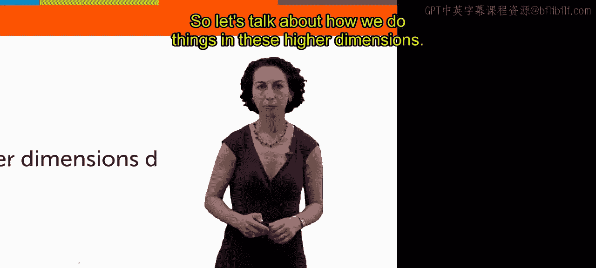
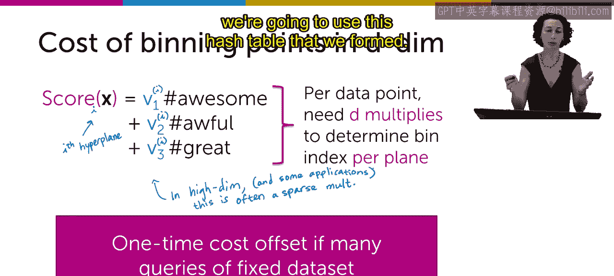

# 华盛顿大学《机器学习（分类，聚类和检索，第3-4课⧸共4课）｜Machine Learning》中英字幕 p145 23_高维度中的LSH.zh_en -BV1Sr421F7N7_p145-

。

So all the illustrations we've given so far assume that we're working in just two dimensions。

 but in most of the examples that we're interested in。

 we might have a very large vocabulary or very high dimensional space that we're interested in partitioning and performing nearest neighbor search on。

 so let's talk about how we do things in these higher dimensions。

Well， if we have more than just two dimensions， let's say we have three dimensions。

 instead of throwing down a line， we're going to think about throwing down planes or hyperplanes。

This plane， again， we're going to assume that it goes through the 0，00 point。

 even though this illustration might not look exactly like it。

 but where we're going to say is that the score of any point X is simply given by。V1 times。

 in this case， the number of times we see the word awesome。

 v2 times the number of times we see the word awful and v3 times the number of times we see the word great。

 so there are three different coefficients that define our plane and three dimensions and if we had some D dimensions we would have D different coefficients that multiply each of our D different features and that defines our score and then we simply look at whether that score is positive or negative and use that to define the bin index。

And just like in the two dimensional case， when we're thinking about throwing down these hyperplanes。

We're just going to draw these coefficients， these V1， V2 V3， all the way up to VD。

 completely at random， and that's going to define a random hyperplane that we're going to use for our partitioning。

And so now I want to talk about what's the cost of binning our points in this D dimensional space Well remember that for each one of our data points。

In D dimensions， we need to determine the bin index per plane that we're throwing down。

 So that means for each one of our。Let's say we're looking at the。Eth。Hyperplane。

And it's going to have coefficients。 let's say， V1， I， V2， I， V3， I。Well。

 we have to do demplications between these coefficients。

And our features to define the score just for that one hyperplane。

 and then we have to repeat that for each of the hyperplanes that we've thrown down。Okay。

 so there is some cost to doing this， but one thing that I want to mention is that。

In high dimensions。And some applications。This is。Often。A sparse。Mulipplication that we're doing。

Let me just write down some applications because this is not generically true。

 but we can think about this especially being true when we're thinking about the number of dimensions being the vocabulary and looking at documents and counts of how many times you see words in that vocabulary out of all possible words in the vocabulary。

 we often see only a few of those words in any given document。

 so even though generically we're saying we're doing d different multiplies per hyperplane in practice we often would only need to compute a smaller subset of those multiplications。

But the other thing that's really， really important and is generically true is that this one time cost of forming this hash table is offset when we're doing many。

 many queries Okay， so every time we query。And look for our nearest neighbor。

We're going to use this hash table that we formed and we don't have to redo all these multiplications that we're talking about here。

