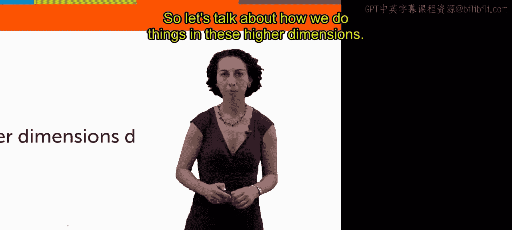
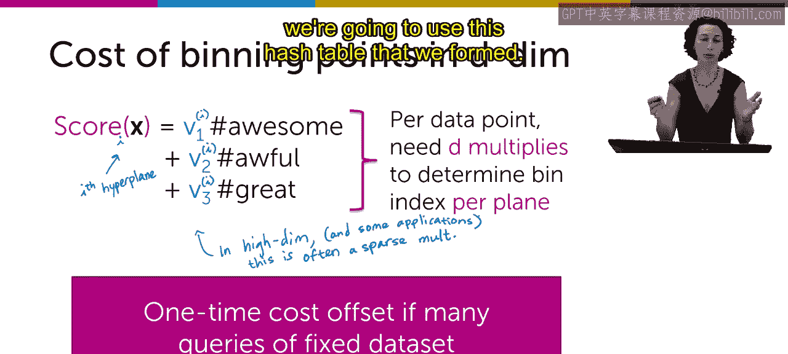

# 机器学习（分类，聚类和检索）：第3-4课：高维空间中的局部敏感哈希

在本节课中，我们将要学习如何将局部敏感哈希（LSH）技术应用于高维空间。我们将探讨当特征维度（例如词汇表大小）非常大时，如何有效地划分空间并进行最近邻搜索。

---

## 从二维到高维的扩展

上一节我们介绍了在二维空间中使用随机线进行空间划分的方法。本节中我们来看看当数据存在于更高维度（例如三维或更多维）时，LSH 应如何操作。

如果维度超过两个，例如在三维空间中，我们不再使用随机线，而是考虑使用随机平面或超平面来划分空间。这个平面同样被设定为穿过原点 `(0,0,0)`。

对于任意数据点 `X`，其“分数”由以下公式计算：
`分数 = v1 * x1 + v2 * x2 + v3 * x3`
其中 `(x1, x2, x3)` 是点的坐标（例如，分别代表词语“awesome”、“awful”和“great”的出现次数），而 `(v1, v2, v3)` 是定义该平面的随机系数。我们根据该分数的正负来决定点的哈希桶索引。

扩展到 D 维空间时，公式变为：
`分数 = v1*x1 + v2*x2 + ... + vD*xD`
我们通过随机生成 D 个系数 `(v1, v2, ..., vD)` 来定义一个随机超平面，用于空间划分。

---

## 高维空间中的计算成本

接下来，我们分析在高维空间中对数据点进行分桶的计算成本。

对于每一个数据点，我们需要为每一个随机超平面计算其分数，以确定其在该超平面下的桶索引。这意味着，对于第 `i` 个超平面及其系数 `(v1_i, v2_i, ..., vD_i)`，我们需要进行 D 次乘法运算（系数与对应特征值相乘）。如果有多个超平面，这个计算需要重复多次。

然而，在高维空间的某些特定应用中，这种乘法运算通常是稀疏的。以下是一些关键应用场景：

*   **文本数据与词汇表**：当维度是词汇表大小，数据点是文档的词频向量时，任何一篇文档通常只包含词汇表中的一小部分词语。因此，对于大多数维度，特征值 `xj` 为零，对应的乘法 `vj * xj` 无需实际计算。这大大减少了实际运算量。

尽管存在计算成本，但一个非常重要的通用事实是：构建哈希表的这一次性成本，会被后续大量的查询操作所抵消。每次进行最近邻查询时，我们直接使用已构建好的哈希表，而无需重新进行上述所有的乘法运算。这使得 LSH 在处理大规模、高维数据的重复查询时非常高效。

---

## 总结

本节课中我们一起学习了局部敏感哈希（LSH）在高维空间中的应用。我们了解到，可以通过随机超平面来划分高维空间，每个数据点的归属由超平面系数与特征向量的点积结果决定。虽然在高维下计算点积存在成本，但在像文本处理这样的稀疏数据场景中，计算可以得到优化。更重要的是，一次性的哈希表构建成本，能够为后续大量的快速最近邻查询提供支持，这是 LSH 技术的核心优势之一。