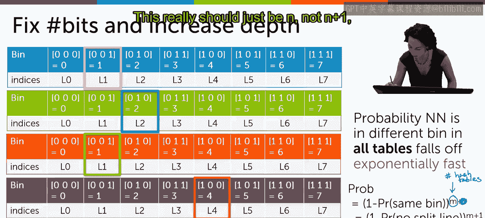
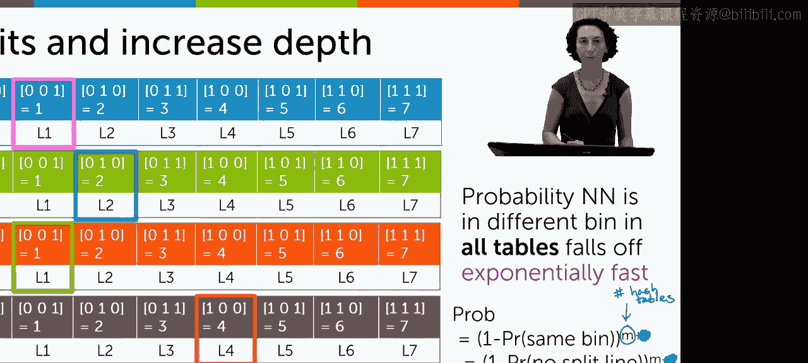
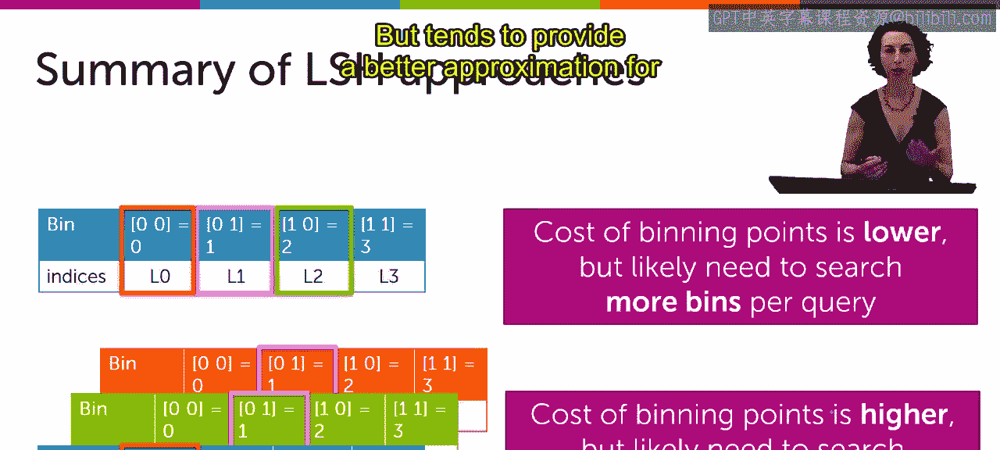

# 华盛顿大学《机器学习（分类，聚类和检索，第3-4课⧸共4课）｜Machine Learning》中英字幕 p146 24_可选：通过多个表提高效率.zh_en -BV1Sr421F7N7_p146-

。

To wrap up this module， we're going to talk about a way to perform even more efficient nearest neighbor search using localative sense of hashing using something that are called multiple tables。

 so these are multiple hash tables and this is going to be advanced material。

I actually think you could watch the video and get out the high level concept of what's going on and the importance of it。

 but it's going to include some content that's quite advanced in terms of looking at probabilities of different events and assessing the relative probabilities of different setups and so we're putting this as an optional video but I would encourage you to at least look at it and think through these different ideas。

 even if you don't follow all the details mathematically of what's going on here。Okay。

 so let's look at a specific example of locality sense of hashing where I'm just going to throw down two lines。

And for simplicity， I'm going to assume an algorithm where we search。

The bin that the query point falls into， as well as just 1 bit off。 So in the case of。

Throwing down two lines， we would search， for example， let's say。That this is our query point here。

And it has been index 00， then we would also search bins 01 and 10。

 so these are cases where we've taken。Switching colors again。We've taken one bit。And flipped it。

And search those two neighboring bins。And the other thing we're going to assume is that we're just going to call delta the probability of putting a line between two points that are theta angles apart。

 so if we had two points，Living in this space。And they were。Theta radiians apart。

Then we're going to say that the probability that。A randomly placed line。Divs these points。

So this happens。With probability。Delta。And so we can think through what delta is。

 so if this line is just uniformly placed between， let's say， zero and pi。

So once we get to the other side， we start wrapping around if you think about visualizing it。

 but you can say that the probability of falling within some little region theta。

It's just theta divided by pi。So that would be one example of this probability delta。

 but let's just generically say that。That we have probability of delta falling in this range Okay。

 then what we're saying here is that in this case we're going to search three bins。

 we're going to search our query bin and the two neighboring bins where we flipped just one bit。

And the chance that we're not going to find a nearest neighbor。Within these three bins is。

Delta squared。Because it's the chance that。Two lines， not just one line。

 divide our query point from its nearest neighbor， and what's the chance of getting two lines within a region theta？

Well， these two lines are drawn independently and each had probability delta of falling between in that range。

 that theta range， so we have deelta times delta， which is delta squared。

But what would happen if I just repeated this process multiple times of throwing down two lines at random。

 so here's the example that we showed before where we threw down our two lines and here I'm using L0。

 L1， L2， L3 just generically to refer to the list of data points that fall into this bin 01，2 and 3。

Okay， so now let's say we throw down two other random lines。

 so it's these two lines and that creates a different partitioning of our data and then we throw down two more lines and we get a different partitioning and so what we've done is we've ended up with three different hash tables。

If we repeat this process three times。And now let's make an assumption that we're only going to search the。

The box or sorry， the bin in which our query point falls so in particular。Here's。

Our query point and for this first case。We know that it has been at index 0 zero。

 so we're going to search this bin zero。And in the second case。

 this is our same query point here has been it。Index 01。 So we're going to search the01 bin。

 and then likewise， in this case， it also has。Bin index 01。

 so again we're going to search the 01 bin。So I've constructed this example。

 I've created three different hash tables and said， we're only searching。

The bin that the query point falls in so that in this case。

 we're still searching three bins just like we did before when we search the query point and then the two neighboring bins。

 so we're still searching three bins but a question is now what's the probability that we're not going to find our nearest neighbor so let's work through this。

So what this statement is equivalent to is what's the chance that the query point and the nearest neighbor are in different bins that they get split in all of these different hash tables？

So what's the probability that a line falls between the query point and its nearest neighbor in this first example。

 this second example， and this third example？Well， we can work through this mathematically or probabilistically。

So in particular， the probability of this event， if we look。

 let's just look at this first setup here to begin with and the probability that the nearest neighbor is in a different bin than the query point in this first example。

Is one minus the probability that they fell into the same bin？

And what's the probability that the query point and the nearest neighbor fall into the same bin？Well。

 it's the probability that neither the first line nor the second line separated these two points。

So what's the probability that neither line or sorry。

 what's the probability that one line does not split the two points？

We know that delta is the probability that it splits it。

 So one minus delta is the probability that there's no split from one line， but we have two lines。

 So let me just write this down。 So we have one minus delta equals probability。That。1 line。Does not。

Split。Quary。And nearest neighbor。And then the reason we get this squared is because these lines are thrown down independently。

 so one minus delta squared is probability。That。Two lines。Don't split these points。

So what we have here is we have one minus the probability that neither line split our query and its nearest neighbor。

 and if you rewrite this here，You can rewrite it as two delta minus delta squared。Okay。

So now that was just the probability of。嗯。Having our query point and the nearest neighbor in different bins for this one example here。

 but what's the probability that that happens in all three cases Well again all three cases are completely independent events and so。

We can write the probability as just raised to the power of the number of hash tables that we have。

So we have this two delta minus delta squared probability of splitting in any one of these cases and we have three cases that we're going to look at。

 so the probability of splitting in each of them。Is that probability we looked at before raised to the third power？

Okay， so to recap。If we looked at three bins in one hash table。

Then the probability of not finding our nearest neighbor after completing the search of those three bins was Dlta squared。

But if we defined three hash tables and only in each one searched one bin。

 so still a total of three bins searched overall， the probability of not finding a nearest neighbor is2 delta minus delta squared cubed。

Okay， well， it's a little bit hard to compare these two functions just written as they are。

 So I made a plot of them for you。 And what the X axis is is Delta。

 It's the probability of a split of points that are an angle theta apart。

And the Y axis is the probability of not finding a nearest neighbor after performing the search of three bins that I described。

 So again， let me just be clear that this is under the scenario of。Throwing down。Two lines。Searching。

Three bins。Just to make sure the setup is clear。Okay， and what we see is that here this pink case。

Let me switch colors， maybe there's a pink color。No， nothing very pink， we'll just go with red。

So this case here。Is the。Multiple hash table。Scenario and this blue line。Is the。Single。

Hash table scenario。And what we see is that we have a lower probability of not finding our nearest neighbor。

When we use multiple hash tables， still searching the same number bins in almost all of this。

All of the cases， there is this crossover point。Somewhere around here。嗯。Where one method。

 the single hash table starts outperforming the multiple hash table， but that's when。

The angle between our nearest neighbor， the query and its nearest neighbor becomes larger。

 but we're going to assume in a lot of cases that the distance between our query and its nearest neighbor is small。

 and so in these cases we definitely got to benefit from looking at multiple hash tables。

But the benefit is even larger if I think about throwing down more points than just or more lines than just two。

嗯。Restrict。Exactly what the algorithm is going to be doing here， so in this case。

 we're going to think about throwing down some H lines。And then we're going to search。As before。

 the bin that the query point falls into， as well as all bins that are 1 bit off。 But remember。

 when we have more lines， we have more bits。 And so flipping just one bit。

 there are going to be more bins that we end up searching。 So in particular。

 even when we're still searching bins that are just  one bit off from the query。

We're going to have to look at。The probability of our nearest neighbor being more than one bit away。

 okay， so this is equal to one minus the probability that the points fall into the same bin because then we would have found them。

Minus the probability that there're more than this one in away search that we're doing。Okay。

 and so this is equivalent to saying it's one minus the probability that there are no splits。

 so no line split or query in its nearest neighbor minus the probability that。There was one line。

 exactly one line that split the two points。And so here。What we have。So。Probability。Of no split。

Is1 minus delta？And we。Have。H。Lines that we're throwing down。So this implies the probability。That。

No or none。Of H lines。Split。Is1 minus delta to the H？Okay， now let's talk about this other one。

 which is a little bit more complicated because we need to compute。

 what's the probability that a single line， only a single line splits our query and its nearest neighbor。

 not two lines or three lines or four lines or H lines， just one。So that's the probability。So here。

 Delta is the probability。Of one line splitting。And then here。We have the probability。Of。H minus1。

Lines。Not splitting the points。But there are eight different ways we can have just one line and not the other lines。

So that's why we have to multiply by the H here。So in summary。

We're going to search h+1 bins and not find a nearest neighbor with probability 1 minus1 minus delta to the H。

 minus H delta 1 minus delta to the H minus1。Okay， well now let's consider the alternative using multiple hash tables。

Again， just to keep the number of comparisons the same。

 remember that if we throw down eight different lines and we search the query bin and all the bins that are one bit off。

 we're going to end up searching h plus1 bins well。Now。

When we're thinking about multiple hash tables， again。

 to make make it as much apples and apples type of comparison that we can do。

 we're going to think about defining。H plus one different hash tables。

 and then just searching the query bin in each of these different tables。

And so then what we're going to calculate is what's the probability that my nearest neighbor is in a different bin in all H plus one of these hash tables。

Well， it's1 minus the probability that the query point and the nearest neighbor are in the same bin。

For a given hash table， but then we have that。To the H plus one because we're looking at h plus one different hash tables。

 so it's one minus the probability that there's no split line。And repeating that h plus1 times。

 and so that's minus1 minus delta to the H to the h plus1。Okay， just to be very clear， this is。

Probability。Of。No。Spread。In any。Sorry。Split from any of the H different lines that we threw down。

So one minus that is the probability。That they fall into separate bins rather than the same bin。

 and we need this to hold for all hash tables。I want to say this one other way in case the way I was presenting it wasn't clear。

 so in particular what we're computing here per hash table is what's the probability that one or two or three or all the way up to h different lines split our query point from its nearest neighbor and one simple way of calculating that it' just one minus the complement of that event。

 which is the probability that there are no lines， none of the H lines that we throw down split these two points。

Okay， and so that's what we have to calculate per hash table。

 and we just multiply those together to get the overall probability that this。

Doesn't happen or rather that there is a split of points in each one of our different tables。Okay。

 so now let's summarize in this slightly more generic setting where we're going to assume that we're throwing down H lines。

And in the first case， we're going to search h plus1 bins and the probability of not finding a nearest neighbor is written here。

 not going to repeat that equation and in the case of。

Balttable hash tables in particular looking at H plus1 different hash tables。

 but always searching just the bin where the query point falls in。

 we have this probability of not finding a nearest neighbor， again。

 not very straightforward to think about comparing these two different equations so let's look at some plots。

And we're going to look at plots in two different scenarios， one is for throwing down three lines。

 the other one is for throwing down 10 lines， and what we see is here this top case is the one hash table。

Scenario and this。Fusia line。Is the multiple hash table？Scenario。

And what we see in these plots is that now there's a much larger difference between the benefits that we have using multiple hash tables over a single hash table。

 and that's especially true as we increase the number of lines that we're throwing down。

And I want to mention that。The setup that I created here was really for the sake of comparing looking at one hash table versus multiple hash tables。

 but in general the way people really use this in practice is you don't have to create as many exactly as many hash tables as lines throw down you can actually create many。

 many more hash tables than the number of lines you throw down so in particular you can think of keeping the number of bits fixed。

 the number of lines you throw down fixed and think about increasing the number of hash tables so we're going to call M the number of hash tables。

And H。Here。Is the number of lines or number of bits？

And so people sometimes refer to this as the width and the depth of a table。

 so the width being the number of bits， the depth being the number of hash tables that we're looking at。

 and what you can show is that the probability of not finding the nearest neighbor。

 so the probability that the query point in the nearest neighbor in different bins in all of these M different hash tables。

Falls off exponentially fast。 So in particular， the probability calculation is。

Exactly what we went through before， but instead of having H。

Plus one different hash tables we here we're looking at M plus1。

 or I guess sorry this really should just be M not M plus1 because we're not looking at that specific。

Contrived example， but the point still holds that as you increase the number of hash tables because you're raising some probability。

 so it's some number less than one to higher and higher powers。

 you're getting lower and lower probability at this exponentially fast rate of not finding our nearest neighbor。

And typically， in many different setups， we're going to consider， you can show that。

The probability of finding a nearest neighbor after searching one bin in M different hash tables。

 so again in total M different bins is higher than if we were to search M bins in a single hash table okay so to summarize what we've shown in this optional video is that when we think about searching multiple bins within a single hash table the cost of binning the points is lower。

 you only have to form one hash table， but typically you tend to have to search more bins to have the same quality approximation as if you performed multiple binnings of points。

 so look at multiple hash tables which costs more you have to create all of these different hash tables。

 but tends to provide a better approximation for our nearest neighbor search。

