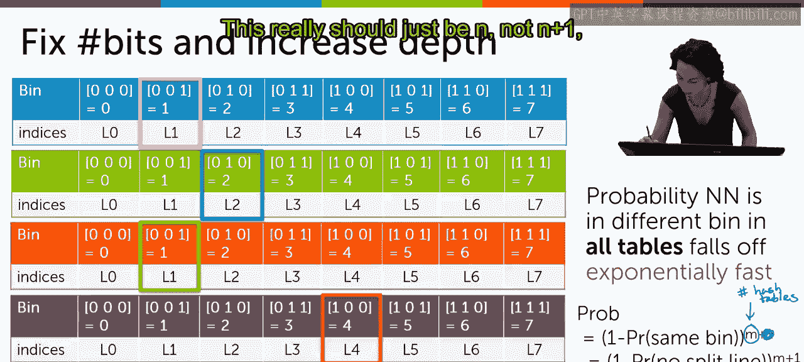
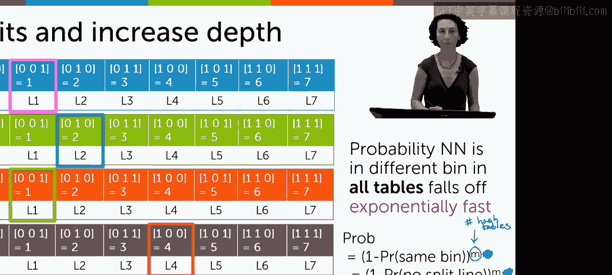
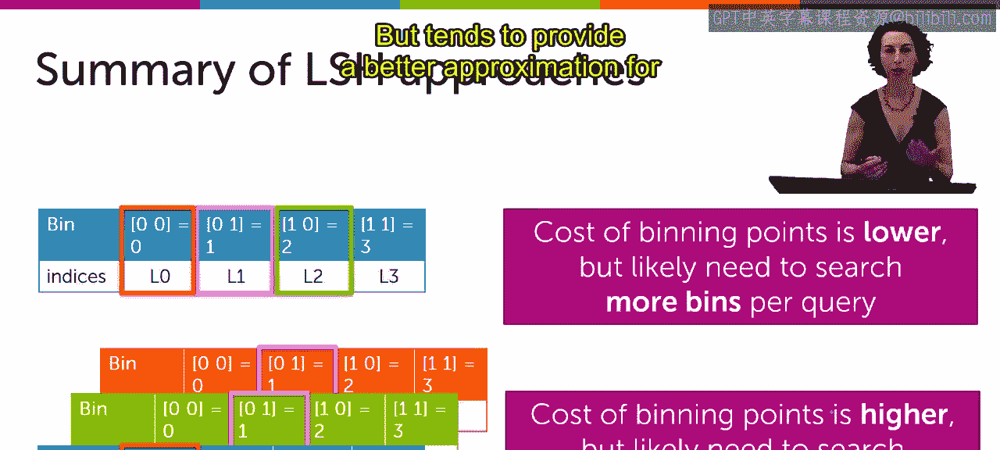

# 机器学习（分类，聚类和检索）：第3-4课：可选：通过多表提升效率 🚀

在本节课中，我们将探讨一种使用局部敏感哈希（LSH）进行更高效最近邻搜索的方法，即使用多个哈希表。虽然这部分内容涉及一些概率分析，属于进阶知识，但我们将尽力用简单直白的方式解释其核心概念和重要性。

## 概述

之前我们介绍了使用单一哈希表进行最近邻搜索。本节中，我们将看到，通过创建并使用多个哈希表，即使搜索的总桶数相同，我们也能显著提高找到真正最近邻的概率。这种方法的核心在于利用概率的“乘方效应”来降低遗漏目标点的风险。

## 单表与多表搜索对比

为了理解多表方法的优势，我们先从一个简单的例子开始。

### 单哈希表场景（搜索多个桶）

假设我们投下两条随机线（`H=2`），将数据空间划分为4个桶。对于查询点，我们不仅搜索它所在的桶，还搜索所有与之**仅相差1比特**的相邻桶。

*   **搜索桶数**：查询点所在桶 + 2个相邻桶 = **3个桶**。
*   **未找到最近邻的概率**：这要求**两条线**都恰好将查询点与其最近邻分开。如果单条线分开两点的概率是 `δ`，那么两条线都将其分开的概率是 `δ²`。
    *   公式：`P_miss_single = δ²`

### 多哈希表场景（每个表只搜一个桶）

现在，我们创建三个独立的哈希表（`M=3`），每个表都由两条随机线生成。对于每个表，我们**只搜索查询点所在的那个桶**。

*   **搜索总桶数**：3个表 × 1个桶/表 = **3个桶**（与单表场景相同）。
*   **未找到最近邻的概率**：这要求查询点与其最近邻在**所有三个表中**都被分到了不同的桶。在单个表中，两点被分到不同桶的概率是 `1 - (1-δ)²`（即至少有一条线分开了它们）。这个概率可以简化为 `2δ - δ²`。由于三个表独立，总概率是这个概率的三次方。
    *   公式：`P_miss_multi = (2δ - δ²)³`

以下是两种方法在 `δ`（两点被分开的概率）变化时的性能对比图。`δ` 越小，意味着两点越接近。

如图所示，在 `δ` 较小（即最近邻离查询点很近）的大部分区域内，**多哈希表方法（红色线）的未命中概率远低于单哈希表方法（蓝色线）**。这说明，在搜索相同数量桶的前提下，多表策略能提供更高的召回率。

## 推广到更一般的情况

上一节我们以两条线为例。本节中我们来看看当使用更多哈希线（`H` 更大）时，情况会如何变化。

### 单哈希表场景（搜索 H+1 个桶）

当我们投下 `H` 条线时，哈希码有 `H` 比特。搜索“查询桶及其所有1比特差异的邻居桶”，总共需要搜索 `H+1` 个桶。未找到最近邻的概率计算更复杂，它等于1减去（两点在同一桶的概率）再减去（两点恰好被一条线分开的概率）。

*   **公式**：`P_miss_single = 1 - (1-δ)^H - H * δ * (1-δ)^(H-1)`

### 多哈希表场景（创建 M 个表，每表搜1桶）

我们创建 `M` 个独立的哈希表（通常令 `M = H+1` 以保持总搜索桶数可比）。在每个表中，只搜索查询点所在的桶。未命中的条件是：在所有 `M` 个表中，两点都被分到不同桶。

*   **单个表中两点在不同桶的概率**：`1 - (1-δ)^H`
*   **所有 M 个表均未命中的概率**：`[1 - (1-δ)^H]^M`

下图对比了当 `H=3` 和 `H=10` 时，两种方法的性能差异。

可以清楚地看到：
1.  随着哈希线数量 `H` 增加，两种方法的未命中概率整体都下降了（因为编码更精细）。
2.  **多哈希表方法（品红线）的优势随着 `H` 增大而变得更加显著**，其曲线始终远低于单哈希表方法（蓝色线）。

## 实践中的权衡

在实际应用中，我们通常固定哈希码的**宽度**（即比特数 `H`），然后调整哈希表的**深度**（即表的数量 `M`）。

*   **单哈希表（深度=1）**：
    *   **优点**：构建成本低，只需维护一个表。
    *   **缺点**：要达到高召回率，需要在同一个表内搜索大量相邻桶，计算开销大。
*   **多哈希表（深度=M）**：
    *   **优点**：通过指数衰减的概率 `[1 - (1-δ)^H]^M`，可以用相对较少的**总搜索桶数**（`M` 个桶）获得极高的召回率。
    *   **缺点**：构建和存储 `M` 个独立的哈希表需要更多的内存和预处理时间。

以下示意图概括了这种权衡：

## 总结

本节课中我们一起学习了利用多个局部敏感哈希表来提升最近邻搜索效率的原理。核心结论是：**与在单个哈希表中搜索多个桶相比，在多个哈希表中各搜索一个桶（保持总搜索开销相近）通常能提供更好的搜索质量（更高的召回率）**。这是因为多表策略利用了独立事件的概率乘法原理，使未命中概率随表数量增加而指数级下降。在实际系统中，需要在索引构建成本、存储开销和查询精度之间进行权衡，选择合适的哈希表宽度（`H`）和深度（`M`）。