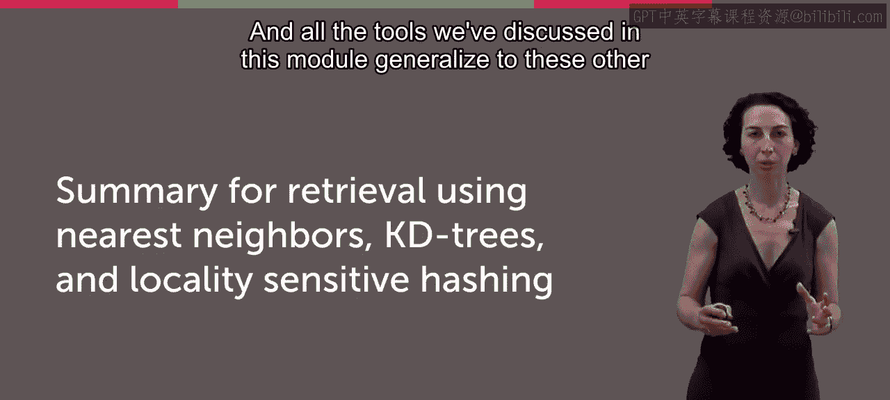

# 机器学习（分类，聚类和检索）：第3-4课：模块回顾与总结 📚

在本节课中，我们将回顾本模块所涵盖的核心内容。本模块聚焦于**文档检索**任务，并将其形式化为**最近邻搜索**问题。我们将总结讨论过的算法、数据表示方法、距离度量以及高效搜索技术，并列出学完本模块后应掌握的关键技能。

---

## 模块内容回顾

上一节我们介绍了高效近似最近邻搜索的局部敏感哈希方法。现在，让我们对整个模块的学习内容进行一次系统的梳理。

本模块的核心任务是**检索感兴趣的文档**，我们将其构建为执行**最近邻搜索**的问题。

我们回顾了用于执行**1-最近邻搜索**和**K-最近邻搜索**的算法。我们深入探讨了这些算法的细节，特别是**如何表示数据**。我们重点讨论了文档的不同表示方法。

一个非常关键的概念是**如何计算两个不同数据点之间的距离**。我们学习了一系列计算这类距离的不同方法，并讨论了它们之间的权衡。事实上，对于“什么是最佳数据表示”和“应该使用哪种距离度量”，并没有唯一的答案。这很大程度上依赖于**领域知识**，并且对算法的性能有重大影响，因此需要审慎思考。

当数据观测点数量极大时，暴力搜索的计算开销会非常高昂。因此，在模块的后半部分，我们讨论了实现**高效最近邻搜索**的方法。

我们介绍了**Kd树**，这是一种可用于执行最近邻搜索的高效数据结构。我们展示了它的适用场景，但也指出了它在高维空间中可能遇到的困难。

于是，我们转向了**局部敏感哈希**的概念。它只提供**近似最近邻**，但我们论证了这在大量实际应用中是完全合理且可行的。局部敏感哈希实现起来非常简单，效率很高，并且能提供具有概率保证的良好近似结果。

学完本模块，你将掌握一些非常强大的工具，这些工具不仅适用于文档检索，还能广泛应用于海量的其他检索任务中。在许多应用中，你都有一个查询点，并希望找到相似的对象，本模块讨论的所有工具都能推广到这些其他应用场景。

---

## 学习成果总结

以下是学完本模块后，你应该能够完成的事项：

*   将检索任务形式化为最近邻搜索问题。
*   为文档检索等任务实施并应用不同的数据表示方法。
*   计算各种距离度量，例如**欧几里得距离**（公式：`distance = sqrt(sum((x_i - y_i)^2))`）和**余弦相似度**（公式：`similarity = (A·B) / (||A|| * ||B||)`），并理解其权衡。
*   解释Kd树的工作原理及其在高维数据中的局限性。
*   实施局部敏感哈希进行近似最近邻搜索，并理解其概率保证。
*   将本模块的概念应用于文档检索之外的广泛相似性搜索问题。

---

本节课中，我们一起学习了机器学习中关于分类、聚类和检索的核心模块。我们从文档检索任务出发，深入探讨了最近邻搜索的算法基础、数据表示与距离度量的重要性，并学习了Kd树和局部敏感哈希这两种应对大规模数据搜索挑战的高效技术。这些工具为你解决广泛的相似性匹配与检索问题奠定了坚实的基础。