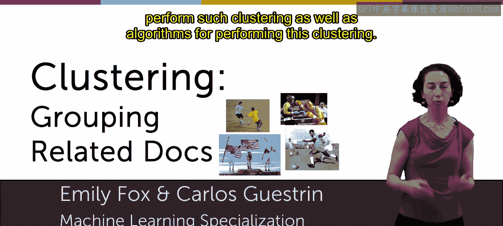
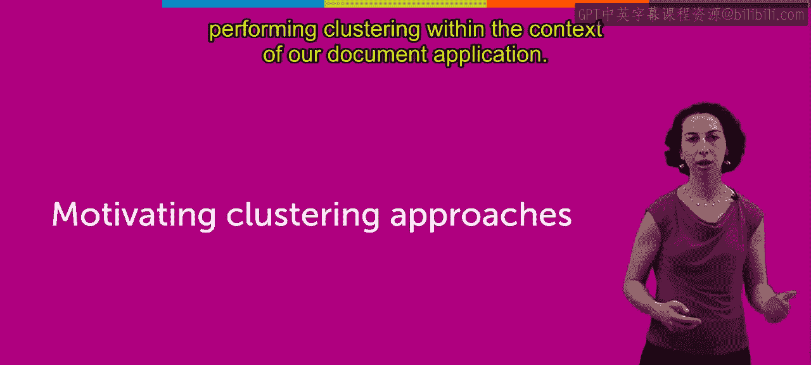
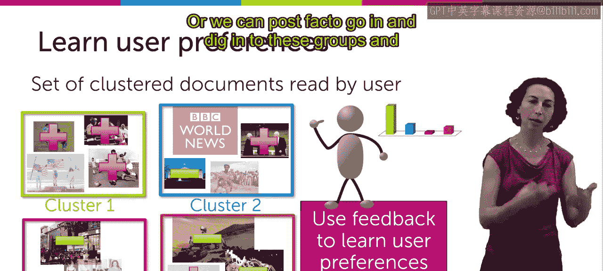

# 华盛顿大学《机器学习（分类，聚类和检索，第3-4课⧸共4课）｜Machine Learning》中英字幕 p148 26_聚类的目标.zh_en -BV1Sr421F7N7_p148-

🎼。

So far we've been focusing on a document retrieval task where somebody is reading an article and we just want to search over all other articles in the corpus to find one that's most similar or very similar to the article that the person's reading。

in a lot of cases we're actually interested in discovering a structured representation of our data of all the articles out there。

 so one example of a structured representation we might be interested in is discovering a clustering of articles so discovering groups of articles that are related to one another and we're going to discuss both reasons why we'd want to perform such clustering as well as algorithms for performing this clustering。

So let's dig into the objective of clustering， as well as some motivating applications for performing clustering within the context of our document application。

So the goal of clustering is to discover groups of related articles， so for example。

 maybe there's a group where all the articles within this group relate to subjects related to sports and maybe there's another group where all the articles are about world news。

If we can discover this type of structure in our data。

 then if we're doing something like the document retrieval task that we talked about before。

 then if a person's reading an article， we can look at what group that article falls in。

 and then when we go to retrieve another article for that reader。

 then we can simply search over the articles within that given group。

 so if the person's reading a sports article， maybe we can recommend another sports article just by searching for the nearest neighbor within this group of sports articles。

But we can actually use clustering to do even fancier things。 So as an example。

 maybe we're interested in learning the preferences of a user over a set of different topics in this case。

 we're assuming that the person isn't just interested in sports they might have other interests as well and when we're going to present an article to that user maybe we'd want to explore some of these other preferences。

 So in this case， if we imagine that we have a clustering of our articles into these groups of related articles。

 then a user is going to read some subset of the articles in the corpus and so these are the articles that are not grayed out here So those are all the articles that the user read and then we can imagine that the user gives us some feedback about the articles。

 whether they like the article or not so plus sign is going to say yep like the article minus sign is going to be that they did not like the article so this user liked those two articles in cluster1。

 that green cluster as well as this article in cluster 4。😊。

Orange cluster didn't like the article that they read in this blue cluster cluster2。

 did not like this other article read in cluster4， liked this article in this blue cluster。

 cluster two and so on。And after we get this feedback or as we're getting it over time。

 we can use this to learn this type of preference vector over topics。

 One thing that we're going to discuss is that we don't actually have topic labels like sports。

 world news and so on， but we do know that there are groups of articles and we can use it to。

Select articles from these groups， or we can post facto go in and dig into these groups and put labels on them ourselves。

