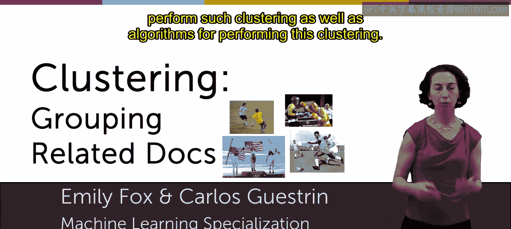
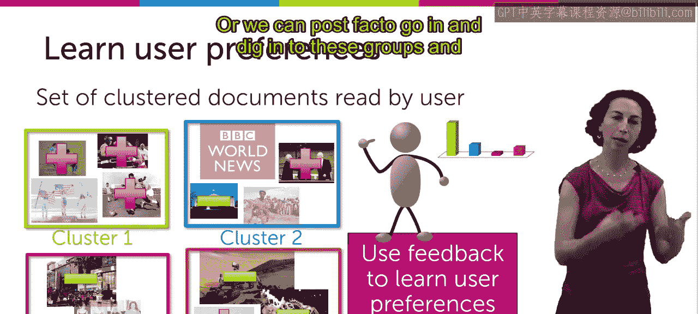

# 机器学习（分类，聚类和检索）：第3课：聚类的目标 🎯

在本节课中，我们将要学习聚类的核心目标及其在文档分析中的应用。我们将探讨为什么需要发现数据中的分组结构，以及这种结构如何帮助我们改进文档检索和用户偏好学习等任务。

---

## 聚类的目标

上一节我们介绍了文档检索任务，即根据用户正在阅读的文章，在语料库中寻找最相似的文章。然而，在许多情况下，我们更感兴趣的是发现数据本身的结构化表示。

本节中，我们来看看聚类的具体目标。聚类的目标是发现**相关的文章组**。例如，可能有一组文章全部与体育相关，而另一组文章则全部关于世界新闻。如果我们能在数据中发现这种结构，就可以更高效地处理后续任务。

---

## 聚类在文档检索中的应用

如果我们能发现数据中的这种分组结构，那么在进行之前讨论的文档检索任务时，就可以利用它。具体步骤如下：

1.  当一个人正在阅读一篇文章时，我们先确定这篇文章属于哪个分组。
2.  当我们需要为该读者检索另一篇文章时，我们只需在该特定分组内进行搜索。

例如，如果用户正在阅读一篇体育文章，我们可以通过在这个“体育文章”分组内寻找最近邻，来推荐另一篇体育文章。这种方法可以缩小搜索范围，提高检索的效率和相关性。

---

## 聚类在用户偏好学习中的应用

实际上，我们可以利用聚类做更复杂的事情。例如，我们可能对了解用户在一系列不同主题上的偏好感兴趣。在这种情况下，我们假设用户不仅对体育感兴趣，可能还有其他兴趣。当我们向该用户推荐文章时，我们可能希望探索他的其他偏好。

以下是利用聚类学习用户偏好的一个示例流程：

1.  首先，我们假设已经将文章聚类成不同的相关文章组。
2.  用户会阅读语料库中的一部分文章（下图中未变灰的文章）。
3.  用户会给出对文章的反馈：“+”表示喜欢，“-”表示不喜欢。

根据上图示例：
*   用户喜欢**聚类1**（绿色）中的两篇文章。
*   用户喜欢**聚类4**（😊橙色）中的一篇文章。
*   用户不喜欢在**聚类2**（蓝色）中阅读的那篇文章。
*   用户不喜欢在**聚类4**中阅读的另一篇文章。
*   用户喜欢在**聚类2**中阅读的这篇文章。

随着时间推移，我们可以利用这些反馈来学习用户在不同主题（即不同文章聚类）上的偏好向量。需要说明的是，我们最初可能没有“体育”、“世界新闻”这样的主题标签，但我们知道存在文章分组。我们可以利用这些分组来选择文章，或者事后深入分析这些分组并为其手动添加标签。

---

本节课中，我们一起学习了聚类的核心目标是发现数据中的自然分组。我们探讨了聚类如何应用于文档检索，通过缩小搜索范围来提高效率；以及如何用于学习用户偏好，通过分析用户在不同文章组上的反馈来构建偏好模型。理解这些目标是应用后续聚类算法的基础。