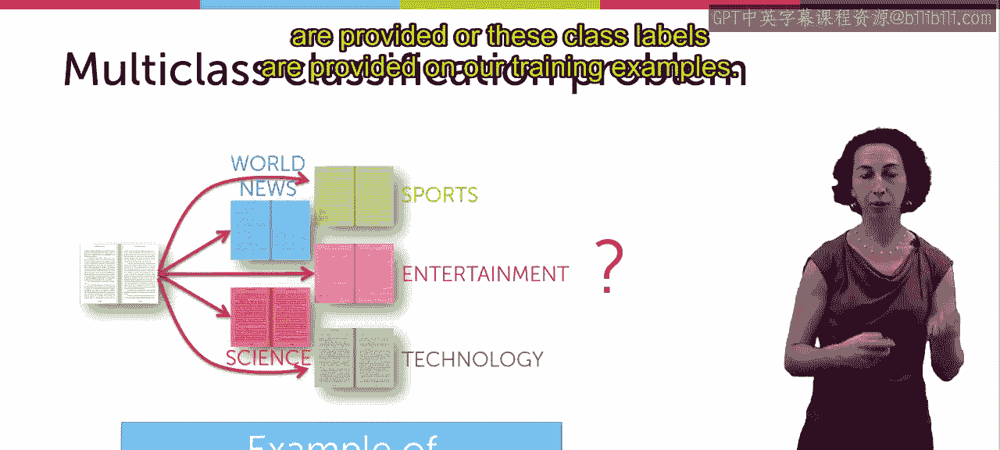
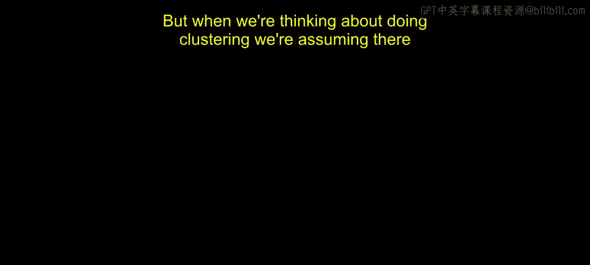
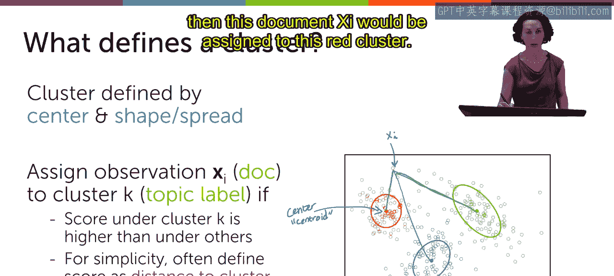

# 华盛顿大学《机器学习（分类，聚类和检索，第3-4课⧸共4课）｜Machine Learning》中英字幕 p149 27_无监督任务.zh_en -BV1Sr421F7N7_p149-

。

So this leads directly into this discussion that clustering is an unsupervised task。

 so let's talk a little bit about what this means。Because so far in the specialization we've assumed that we've been presented with a set of outputs associated with our inputs。

 so for example， in the regression course when we're talking about predicting house prices in our training data。

 we assumed that not only do we have the features of the house， which are the input。

 but we also had the price， the sales price of the house。

 which was the output in the classification course， we assume that we had restaurant reviews。

 we had the text of those restaurant reviews which are our input， and then we also had the output。

 whether it was a positive or negative review for the reviews in our training set。嗯。

So if we were to imagine that we had labels in this application。

 maybe we would have labels of articles in terms of topics。

 so these articles where the input again would be the text of the article just like with reviews。

 but the output would be a topic like。Sports or world news or entertainment or science and so this in this case we can think of the problem as a multiclass classification problem where imagine you get some new article and you want to label what topic that article is about well then you just go into your training set and based on the classifier that you've learned from that training set where labels were provided you can then think about labeling this document as one of these five different topics presented here。

So this is an example of a supervised learning problem because outputs are provided or these class labels are provided on our training examples。

But when we're thinking about doing clustering， we're assuming that there are no labels provided or that the labels are really really unreliable and the goal here is to uncover this grouping structure directly from the data。

 the input values alone， so in particular here we might imagine that we have documents with just two words in the vocabulary。

 so let's say。Here's。Word1。Counts。And here's。Word two counts。

And each one of these points is a given document。Yeah， document。X， I。And so in particular。

 our input to the algorithm is going to be documents represented as vectors XI。

But then the output are going to be cluster labels。So in particular。

 maybe we'll label this red cluster as cluster  one， this green cluster as cluster 2。

 and this blue cluster as cluster3， then associated with Xi。

The output might be Z I equals1 that is' associated with cluster 1。

 and we are going to output this for every observation。In our data set， just to be clear。

 maybe this red cluster corresponds to articles about world news。

 this green cluster corresponds to articles about science and this blue cluster corresponds to articles about entertainment。

So we're not provided with those labels， but we're going to group articles。

 color them as we're doing in this picture based on similarities in the observed input space。

 so in the simple 2D example， this would be similarities between articles based on a simple2word vocabulary and counting how many times those words appear in each of these articles。

Okay， well， this is an example of an unsupervised learning task because all we're presenting。

Our algorithm width are the inputs and the algorithm is supposed to output a set of labels as the output。

Well， how can we think about learning such labels？Well。

 a key component of that question is thinking about what defines a cluster。

And once we've defined what a cluster means， then we need to define algorithms for inferring these clusterings。

Okay， but a cluster is defined by。It's center。Which is often called centroid。

As well as the shape of the cluster and in this application here。

 the clusters are defined by ellipses， so here this red circle is an example of an ellipse in this green cluster has this elongated ellipse that's at one angle and the blue cluster has another smaller ellipse at a different rotation。

So these are the family of shapes that we're exploring our ellipses。

 different rotations and stretchings of these ellipses。

 but that's what we're using to define a cluster。And then when we have a given observation， again。

 observation XI， which is a specific document， the way we think about assigning that document to a given cluster is based on something we'll call the score。

Under each cluster。 So often we just think about defining the score as the distance to the cluster center so we can think about。

I mean。Choose another color just for fun to make this stand out a little bit more。On this slide。

So the distance。To the cluster centers。Are these distances here？

And what we see is that the smallest distance is the distance to this red cluster。

 so if the distance to cluster alone is what defines the score。

 then this document XI would be assigned to this red cluster。

