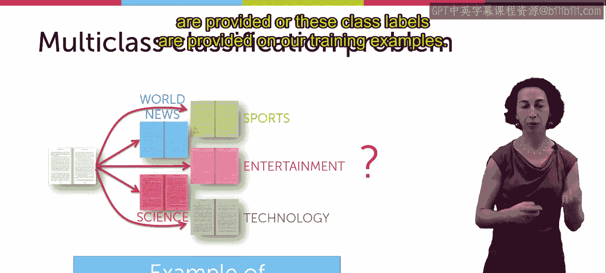
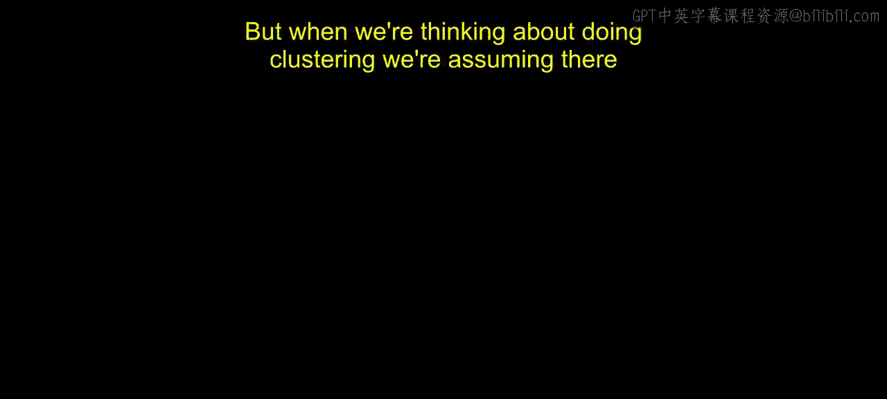
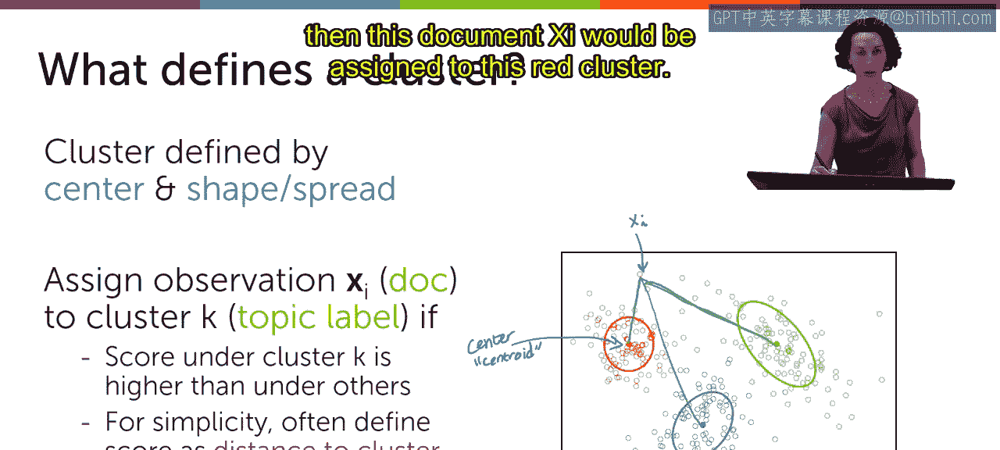

# 机器学习：第3课：无监督任务

在本节课中，我们将要学习什么是无监督学习任务，特别是聚类。我们将通过与监督学习进行对比，来理解聚类任务的核心概念、目标以及如何定义和推断聚类。

## 从监督学习到无监督学习

上一节我们介绍了监督学习的基本设定。在监督学习中，我们的训练数据同时包含输入（特征）和对应的输出（标签）。例如，在回归任务中，我们根据房屋特征预测其价格；在分类任务中，我们根据评论文本预测其情感倾向。

然而，聚类是一种**无监督任务**。这意味着在训练过程中，我们**没有**被提供任何输出标签。我们的目标是从**输入数据本身**中发现其内在的**分组结构**。

## 一个具体的例子：文档聚类

为了更好地理解，让我们看一个文档聚类的例子。假设我们有一个文档集合，每个文档只包含两个词汇（Word1和Word2）。我们可以将每个文档表示为一个二维向量，其坐标是这两个词在文档中出现的次数。

*   **输入**：每个文档 `X_i` 的向量表示。
*   **输出**：我们希望算法为每个文档 `X_i` 分配一个**聚类标签** `Z_i`（例如，1， 2， 3）。

在下面的图示中，每个点代表一个文档。算法需要根据文档之间的相似性（在二维空间中表现为点的距离远近），将它们自动分成不同的组（用不同颜色表示）。

也许红色组对应“世界新闻”主题，绿色组对应“科学”主题，蓝色组对应“娱乐”主题。但关键在于，**算法在开始时并不知道这些主题标签**，它必须自己发现这些分组。

## 如何定义和推断聚类？

既然没有标签指导，我们如何让算法学会聚类呢？这涉及到两个核心问题：**如何定义一个聚类**，以及**如何推断出这些聚类**。

### 定义一个聚类

一个聚类通常由两个要素定义：
1.  **中心**：也称为**质心**，是聚类中所有点的平均位置。
2.  **形状**：描述了聚类中点的分布范围。在上图中，每个聚类被一个**椭圆**所定义。不同的椭圆有不同的旋转角度和拉伸程度，这代表了数据在不同方向上的分布差异。

### 为数据点分配聚类

对于一个给定的数据点 `X_i`（例如一个文档），我们如何决定它属于哪个聚类呢？这基于一个称为**得分**的概念。

最常见的方法是计算该点到各个聚类中心的**距离**。得分可以简单地定义为这个距离。点会被分配到**距离其中心最近**的那个聚类。

在图中，对于标记的 `X_i` 点，到红色、绿色、蓝色聚类中心的距离分别用线段表示。可以看到，到红色中心的距离最短。因此，如果仅以距离作为得分标准，`X_i` 将被分配到红色聚类。

## 总结

本节课中我们一起学习了无监督学习中的聚类任务。我们了解到：
*   聚类是一种无监督任务，其训练数据**只有输入，没有输出标签**。
*   聚类的目标是直接从数据中发现其内在的**分组结构**。
*   一个聚类由其**中心（质心）** 和**形状（如椭圆）** 定义。
*   为数据点分配聚类的基础是计算其到各聚类中心的**距离**，并将其归入距离最近的那个簇。

理解这些基本概念是学习具体聚类算法（如K-Means）的重要基础。在接下来的课程中，我们将深入探讨如何实现这些想法。