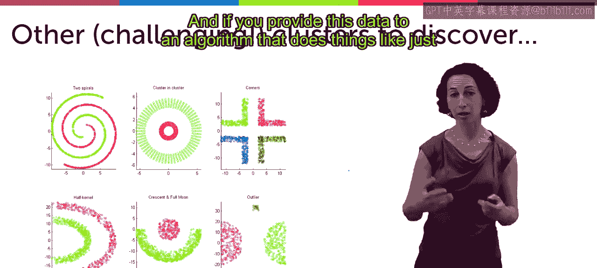

# 华盛顿大学《机器学习（分类，聚类和检索，第3-4课⧸共4课）｜Machine Learning》中英字幕 p150 28_无监督学习的希望和一些挑战案例.zh_en -BV1Sr421F7N7_p150-

。

So this idea of performing unsupervised learning sounds really crazy， so we're given no labels ever。

And somehow we're supposed to output labels。Well， there are two things that allow us to sometimes do this。

 One is by the definition of what a cluster is。 So what is the structure that we're trying to extract from the data。

 So， for example， maybe we're looking for these elliptical clusters。

 And the second thing that allows us to sometimes do this is just the structure of the data itself。

 So in some cases， the problem is fairly easy。 So here's an example of an easy problem where the data they're pretty。

Pretty well separated， I could go in there and kind of say， okay， I'm going to call this one cluster。

 this another one and this another one。And so you could imagine an algorithm that could uncover this structure from the data。

嗯。But in other cases， it's really basically pretty impossible here。

I really don't know how I would want to cluster this data if I had to choose three different clusters。

 maybe I would do something like like this if I had to question mark turns out that would be very wrong in this case。

 if we look at the true labels so these are the。Colorors are the data points here。

 they're all mixed together， and it's just really not clear how we could extract that from this data without some other information informing what distinguishes the blue cluster。

 the green and the pink。but then there are cases where it's a little bit more plausible， so maybe。

My guess would have been fairly reasonable， something like this。

 and indeed that's what the data actually tells us so often in most applications that we're interested in。

 we're in this in- between scenario where it's not immediately clear just by visualizing the data。

 but you know we can't hope to successfully perform an unsupervised learning if we're in scenarios that look like this impossible case。

But regardless of。Of the data structure， the thing that's really。

 really crucial to what the performance is， is how we think about defining a cluster。😊。

So for example， here are six different very popular toy examples of challenging clustering problems where visually it just jumps out at us。

 especially since in this case， things were colored， but even if they weren't colored。

You would probably say， okay， you could draw out what are the observations you would say that went together in one group versus another group。

But these clusters sure don't look like simple ellipses like we saw in the previous few slides。

And if you provide this data to an algorithm that does things like just measuring distance from observations to cluster centers。

 then you get out results that don't match the kind of clusterings that jumped out at you visually。

 so for each one of these different examples we show we're showing what a clustering might look like under just distance to nearest cluster center type of objective。

So the point of these slides here is that clustering can be really challenging。

 even when the data look really clean and nice and well separated。

 sometimes it can be hard to define what it means to be a cluster and to devise algorithms to discover that。

So you have to think very carefully about what are the implications of the data that you're providing in the model that you're specifying or the algorithm that you're specifying。

 so as we go through the next set of algorithms in this module and the coming modules。

 it's just useful to think about the challenges that we might be faced with based on the structure of our data。

