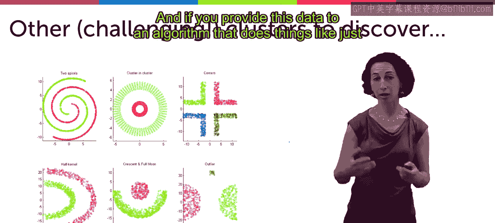

# 机器学习（分类，聚类和检索）：第3-4课：无监督学习的希望与挑战案例 🎯

在本节课中，我们将探讨无监督学习的基本概念，特别是聚类任务。我们将了解在没有任何标签的情况下，如何从数据中提取结构，并审视在实际应用中可能遇到的各种挑战性案例。

## 无监督学习的核心思想

执行无监督学习的想法听起来非常大胆，因为我们从未获得任何标签。然而，我们却需要输出标签。有时我们能够做到这一点，主要基于两个因素。

第一个因素是**聚类的定义**。即我们试图从数据中提取的结构是什么。例如，我们可能正在寻找椭圆形的聚类。

第二个因素是**数据本身的结构**。在某些情况下，问题相当简单。

## 聚类问题的难易程度

以下是不同难易程度的聚类问题示例。

### 简单案例

在某些情况下，数据点分离得相当好。我们可以直观地将其划分为不同的组。例如，可以想象一个算法能够从数据中揭示这种结构。

### 困难案例

但在其他情况下，这几乎是不可能的。例如，如果必须选择三个不同的聚类，我们可能不知道如何划分这些数据。如果我们查看真实的标签，会发现数据点完全混合在一起。在没有其他信息来区分不同聚类的情况下，很难从这些数据中提取结构。

### 中间案例

还有一些情况则更为合理。我们的猜测可能相当合理，并且数据本身也证实了这一点。在我们感兴趣的大多数应用中，我们通常处于这种中间场景。仅通过可视化数据并不立即清晰，但如果我们处于类似“不可能案例”的场景中，也无法期望成功执行无监督学习。

## 聚类定义的关键性

无论数据结构如何，真正**关键**的是我们如何定义聚类。例如，这里有六个非常流行的、具有挑战性的聚类问题示例。从视觉上看，聚类结构非常明显。但这些聚类看起来并不像我们在前几张幻灯片中看到的简单椭圆。

如果你将这些数据提供给一个仅测量观测点到聚类中心距离的算法，得到的结果可能与视觉上跳出的聚类结构不匹配。对于这些不同的示例，我们展示了在“到最近聚类中心距离”类型的目标下，聚类可能呈现的样子。

这些幻灯片的要点是，聚类可能非常具有挑战性。即使数据看起来非常干净、美观且分离良好，有时也很难定义聚类的含义，并设计算法来发现它。

因此，你必须仔细思考你所提供的数据、你指定的模型或算法所带来的影响。当我们学习本模块及后续模块中的下一组算法时，思考基于数据结构可能面临的挑战是非常有用的。

## 总结

本节课中，我们一起学习了无监督学习，特别是聚类任务的核心思想。我们认识到，聚类的成功与否高度依赖于对“聚类”本身的定义以及数据的内在结构。我们看到了从简单、清晰分离的数据到复杂、模糊混合数据的各种案例，并理解了仅依赖简单距离度量的算法在处理复杂聚类结构时的局限性。这提醒我们，在实际应用中需要谨慎选择模型和算法，并充分考虑数据的特点。