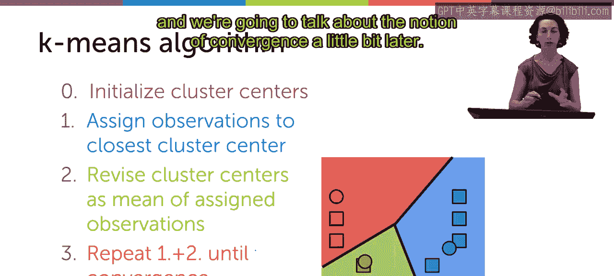

# 华盛顿大学《机器学习（分类，聚类和检索，第3-4课⧸共4课）｜Machine Learning》中英字幕 p151 29_K-means算法.zh_en -BV1Sr421F7N7_p151-

。

But let's start talking about clustering algorithms and to begin with。

 let's talk about the bread and butter clustering algorithm called k meanss。

So the K means algorithm assumes this simple definition of score that we described before where you just measure the distance between the observation and the cluster center as a way of associating data points to specific clusters。

 so in particular here these little gray boxes are going to be our data points to cluster。

 So this might be。Data point。Xi。And the first step of the algorithm is to initialize our cluster centers。

 So these circles are going to represent our cluster centers， and we're going to。

Notate the cluster centers with the Greek letter or mu so we have mu 1。

 mu 2 and mu3 here we're looking at an example。With K equals three clusters。

So we have three cluster centers。嗯。And then having defined those cluster centers。

 the next step of the algorithm is to assign observations to the clusters based on the minimum distance to the cluster center。

 So in equations that's written right here where。This is our Ja。Questster。Center。And Xi is our I。

Observation。This is the cluster label for。Observation I。

 so remember this is going to be our inferred cluster label for the Ith observation。

 whereas in supervised learning we were assuming we had a given label， Y I but。

What we're doing here with this function。Is this thing called Argmin。

 So let's describe what Argmin does。 So argmin is going to return the index J。Of the cluster。

Whose center is closest to observation Xi？And this is in contrast to men。

Whereas if we think about minimizing a function。Returns。The value of the objective， which would be。

Minimum。Value。Of。This。Distance calculation we're doing here。 So just to be clear by saying， Argmin。

 we're returning which index as we're searching over all cluster centers， mu J， mu 1， mu 2， mu 3。

 with the Ithe observation fixed。And varying。This cluster center were saying which was the index where this distance was the smallest。

 whereas if we had just written min， we would return the minimum distance itself rather than the index of the cluster that achieved that minimum distance。

Okay， so it's important to explain this equation because we're going to see this equation。

Throughout the rest of the module。 Okay， so the point here is that we're computing distances to cluster centers and。

All of these colored points were ones where the distance2。Okay， this blue is not visible at all。

Let me just for this one， switch colors。Where。The distances to these cluster centers were smaller than had we computed distances to any of the other cluster centers。

 so that's how they got assigned to these points。嗯。And。This year。This little。

Partitioning of this 2D space into these different colors is called a void tesslllation。

And what it represents is that if any point。Falls into for example。

 this blue region here that means that the distance to this cluster center is smaller than it is to the distance to any of the other cluster centers。

 so this is the region in which any observation here will get assigned to this blue cluster and any observation here will get assigned to the green cluster and finally any observation here will get assigned to the red cluster。

But I want to emphasize this is for。Visualization。Only。You don't need to compute this to DuK means。

Okay， so far we've initialized our cluster centers。

 we've assigned each one of our observations based on which cluster center it was closest to。

 and then the next step in the K means algorithm is we're going to update the positions of the cluster centers based on the points that were assigned to them in particular we're going to compute the mean of the data points in that cluster or equivalently we can think of this as the center of mass of these data points and that's going to be our new cluster center so in equations we're going to say that our new cluster center for the J cluster is equal to one of our NJ where NJ is the number of observations。

In。Quster J。And then we're going to sum over all observations so this is。All observations。I， such。

That。Z I equals J， which means that。Observation， I。Is in。Cluster。Jy。

So just to make sure this is clear， if we look。At this sum， how many terms are appearing in this sum？

NJ terms， that that's the size of this set， the size of the number of observations where the cluster indicator is J。

Okay， so this is just an equation to say we're summing over all of our observations in cluster J and then we're dividing by the total number of observations in the cluster and that gives us our average or the center of mass in that cluster finally the last step or it won't actually be the last step but the last stage of K means is to repeat the last two steps that we did so we're going to keep iterating between assigning observations to cluster centers then updating the cluster centers and going on and on and on until convergence and we're going to talk about the notion of convergence a little bit later。

。