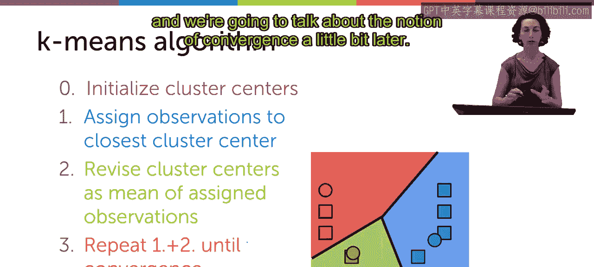

# 机器学习（分类，聚类和检索）：第3-4课：K-means算法 🧩


在本节课中，我们将要学习一种基础且广泛使用的聚类算法——K-means算法。我们将从算法的基本思想开始，逐步拆解其每一步的具体操作，并通过公式和图示帮助你理解其工作原理。

## 算法概述

K-means算法基于一个简单的评分定义：通过计算数据点与聚类中心之间的距离，将数据点分配到特定的簇中。算法的目标是找到一组聚类中心，使得所有数据点到其所属簇中心的距离之和最小。

## 算法步骤详解

上一节我们介绍了K-means算法的基本思想，本节中我们来看看其具体的执行步骤。K-means算法是一个迭代过程，主要包含以下四个步骤。

### 1. 初始化聚类中心

首先，我们需要指定聚类的数量K，并初始化K个聚类中心。这些中心点可以是随机选择的，也可以基于某些启发式方法确定。

在公式中，我们用希腊字母 **μ** 表示聚类中心。例如，当K=3时，我们有三个聚类中心：**μ₁**、**μ₂** 和 **μ₃**。

### 2. 分配数据点到最近的中心

初始化中心后，我们需要将每个数据点分配到距离它最近的聚类中心所在的簇。

以下是分配过程的数学描述：

```python
z_i = argmin_j || x_i - μ_j ||²
```

其中：
*   `x_i` 代表第 `i` 个观测数据点。
*   `μ_j` 代表第 `j` 个聚类中心。
*   `z_i` 是数据点 `x_i` 被分配到的簇标签（即簇的索引 `j`）。
*   `argmin` 是一个运算符，它返回的是使距离 `|| x_i - μ_j ||²` 最小的那个索引 `j`，而不是距离的最小值本身。

这个步骤将整个空间划分成了多个区域，每个区域内的点都会被分配到同一个簇。这种划分在几何上被称为 **Voronoi 剖分**。需要强调的是，这个剖分仅用于可视化理解，算法本身并不需要显式计算它。

### 3. 重新计算聚类中心

在将所有数据点分配到簇之后，下一步是更新每个簇的中心位置。新的中心被设定为该簇内所有数据点的平均值，也可以理解为该簇的“质心”。

更新聚类中心的公式如下：

```python
μ_j_new = (1 / N_j) * Σ_{i: z_i = j} x_i
```

其中：
*   `N_j` 是属于第 `j` 个簇的数据点数量。
*   `Σ_{i: z_i = j} x_i` 表示对所有满足 `z_i = j`（即属于簇 `j`）的数据点 `x_i` 进行求和。

这个公式的含义是：将簇 `j` 中所有数据点的坐标相加，然后除以该簇中数据点的总数，得到新的中心点坐标。

### 4. 迭代直至收敛

最后一步，也是算法的主体循环，是重复执行步骤2和步骤3。我们不断交替进行“分配数据点”和“更新中心”这两个操作，直到算法达到收敛状态。

收敛通常意味着聚类中心的位置不再发生显著变化，或者数据点的簇分配关系保持稳定。我们将在后续内容中更详细地讨论收敛的概念。

## 总结



本节课中我们一起学习了K-means聚类算法的核心流程。我们首先了解了算法通过最小化数据点到其簇中心的距离来工作的基本原理。接着，我们逐步拆解了算法的四个关键步骤：1）初始化聚类中心；2）根据最小距离将数据点分配到簇；3）根据簇内点的平均值重新计算聚类中心；4）迭代执行步骤2和3直至收敛。理解这些步骤及其对应的数学表达是掌握K-means算法的基础。