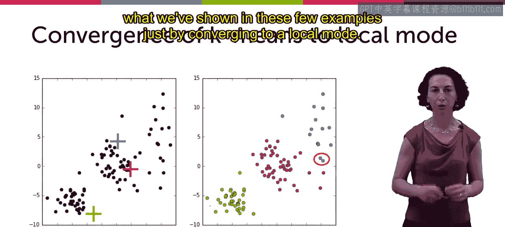

# 华盛顿大学《机器学习（分类，聚类和检索，第3-4课⧸共4课）｜Machine Learning》中英字幕 p152 30_K-means作为坐标下降.zh_en -BV1Sr421F7N7_p152-

。

Kmins might seem like a heuristic algorithm， but you can actually view it as an example of a coordinate descent algorithm。

In particular， K means iterates between two steps， one is assigning observations to the nearest cluster center。

 and the other is updating the cluster centers。Well this first step。

 where we assign observations to the nearest cluster center。

 we can clearly see from this equation is equivalent to minimizing a given objective。

For the second step， it's a little bit less clear。But we can actually rewrite this second step as follows in terms of this minimization of an objective。

 in particular， minimizing the sum of the square distances。

 because remember that computing the mean of a set of observations。

Is equivalent to computing in its center of mass。 And that's exactly what minimizing the sum of square distances is equivalent to。

 So now what we see is that we're iterating between。

Two different steps where we're where each step represents a minimization of some objective。

 And so from this we can see that this is an example of a coordinate descent algorithm and if the notion of a coordinate descent algorithm isn't sounding very familiar That's probably because you didn't take the regression course that's really。

 really sad go back take the regression course。 Now you don't have to take the regression course。

 but if you're not familiar with coordinate asscent or coordinate descent then you can refer to that course and the videos in that course to get a more detailed explanation of these types of algorithms but the idea here in particular is that we're iterating between minimizing our Z variables given our muse So minimizing。

An objective over our cluster indicators， given the cluster centers。

 and then we're looking at a minimization to find our cluster centers given our assigned cluster indicators。

Okay， so now let's get back to this idea of convergence of kine。So first。

 does this algorithm converge and？If it does， what does it converge to？Well。

 the first thing to note is that the K means objective landscape is this really complex noncomvex thing。

 so because of that we can rule out converging to a global optimum。Or at least being guaranteed。

 obviously to converge to a global optimum， but a question now is do we converge at least to a local optimum and because we can cast k means as a coordinate descent algorithm。

 then we know that we are indeed converging to a local optimum。

 but in a lot of problems like I said there is a really complicated landscape to this k means objective so there are lots and lots and local modes and the quality of the solutions between these local modes can vary quite dramatically so let's look at an example of this。

😊，嗯。Here's a data set， the black points are data points， and what we're showing by these crosses。

 these colored crosses are our initialized centers。

 so here's one initialization of ourK means algorithm and then what we're showing in the other plot with the colored circles are the labels of the clusters after convergence of this algorithm and convergence of this algorithm one way to assess that it's just when our assignments stop changing。

And what we've see is that we've taken this little group of observations in the bottom left hand corner。

 and we've divided those into two clusters， and then we have this big huge cluster。

 this blue cluster capturing everything else in the data。

But if we initialize our algorithm with different cluster centers。

Then we converge to a completely different solution。

 and this one visually might look a little bit more reasonable depending on what the structure of the data might be。

 where we end up with three clusters， each of which forms a bit tighter of a group。

But let's look at another initialization， we here the groupings actually look similar。

 so if we flip back and forth between these two initializations， the groupings look similar。

 but the cluster labels that we associated with each of these have swapped around。

 the pink clusters become the blue and the blue has become the pink。😊，Well。

 there's nothing specific to any of our cluster labels， cluster one， two。

 or three over different initializations。You know what observation gets assigned to cluster1 or cluster2 or cluster3 doesn't matter what actually is significant are the groups of observations that are grouped together。

 so what matters is is observation XI and XJ assigned to the same group。

 whether it's labeled group one， group two or group three。Okay。

 but the other thing to note here are these observations here highlighted with this orange circle where there's really a lot of uncertainty whether they should be in the blue cluster or this pink cluster。

 and if you look，Back at our other solution。 And we're going to flip back and forth between these。

 We see that。The assignment of those observations has changed。

 there's no longer consistency in which grouping those observations appear in one case here they're appearing in the second cluster。

 the middle cluster， and in the other case they're appearing in that top right hand side cluster。

And this notion of uncertainty in our clustering is really important and iss something we're going to come back to in the next module。

But the point that we want to emphasize here is that K meanss is very sensitive to initialization and you can actually get very crazy solutions。

 even crazier than what we've shown in these few examples just by converging to a local mode。

🎼。