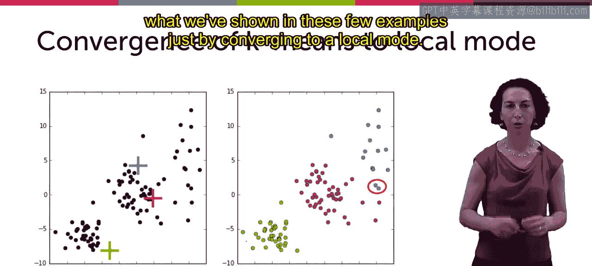

# 机器学习（分类，聚类和检索）：第3-4课：K-means作为坐标下降

在本节课中，我们将探讨K-means算法的一个更深层次视角：将其理解为一种坐标下降算法。我们将分析其迭代步骤如何对应目标函数的优化，并讨论算法的收敛性及其对初始化的敏感性。

---

## K-means作为坐标下降算法

K-means算法可能看起来像一种启发式算法，但实际上可以将其视为坐标下降算法的一个例子。

具体来说，K-means在两个步骤之间迭代：一是将观测点分配到最近的聚类中心，二是更新聚类中心。

上一节我们介绍了K-means的基本步骤，本节中我们来看看这些步骤如何对应目标函数的优化。

### 步骤一：分配观测点

在分配观测点到最近聚类中心的步骤中，我们可以清楚地从这个公式看出，它等价于最小化一个给定的目标函数。

以下是分配步骤的公式化描述：

**公式：**
\[
z_i = \arg\min_{k} \| x_i - \mu_k \|^2
\]

其中，\( z_i \) 表示观测点 \( x_i \) 被分配到的聚类索引，\( \mu_k \) 是第 \( k \) 个聚类的中心。

### 步骤二：更新聚类中心

对于第二个步骤，即更新聚类中心，其与目标函数最小化的关系可能不那么明显。但我们可以将这个步骤重写为以下形式，即最小化平方距离之和。

因为计算一组观测点的均值，等价于计算其质心。而最小化平方距离之和，正是计算质心所做的事情。

以下是更新步骤的公式化描述：

**公式：**
\[
\mu_k = \arg\min_{\mu} \sum_{i: z_i = k} \| x_i - \mu \|^2
\]

该公式的解就是属于聚类 \( k \) 的所有观测点 \( x_i \) 的均值。

---

## 坐标下降视角

现在我们可以看到，算法在两个不同的步骤之间迭代，其中每一步都代表了某个目标函数的最小化。

因此，从这个角度我们可以看出，K-means是坐标下降算法的一个例子。如果你对坐标下降算法不熟悉，可能是因为你没有学习回归课程。不过没关系，你不需要必须学习那个课程，但如果你想深入了解这类算法，可以参考该课程及其视频以获得更详细的解释。

这里的核心思想是，我们在给定聚类中心 \( \mu \) 的情况下，对聚类指示变量 \( Z \) 进行最小化；然后在给定分配的聚类指示变量的情况下，对聚类中心 \( \mu \) 进行最小化，如此迭代。

---

## K-means的收敛性

接下来，让我们回到K-means收敛性的讨论。

首先，这个算法会收敛吗？如果会，它收敛到什么结果？

需要注意的第一点是，K-means的目标函数景观是一个非常复杂的非凸曲面。因此，我们可以排除算法保证收敛到全局最优解的可能性。但问题是，它至少会收敛到一个局部最优解吗？

由于我们可以将K-means视为坐标下降算法，因此我们知道它确实会收敛到一个局部最优解。

然而，正如前面所说，K-means目标函数的景观非常复杂，存在大量局部极值点。这些局部解之间的质量差异可能非常巨大。

---

## 初始化敏感性与示例

让我们看一个例子来说明这一点。

以下是一个数据集，黑点代表数据点。图中彩色的“十”字表示我们初始化的聚类中心。

这是K-means算法的一种初始化方式。另一张图中彩色的圆圈表示算法收敛后各聚类的标签。判断收敛的一种简单方式是观测点的分配不再发生变化。

我们看到，算法将左下角的一小群观测点分成了两个聚类，然后用一个巨大的蓝色聚类捕获了数据中的所有其他点。

但是，如果我们用不同的聚类中心初始化算法，则会收敛到一个完全不同的解。

从视觉上看，这个解可能看起来更合理一些，它最终形成了三个更紧密的组。

让我们再看另一种初始化。在这里，分组看起来相似，但如果我们在这两种初始化之间来回切换，会发现聚类标签发生了交换：粉色聚类变成了蓝色，蓝色变成了粉色。

这说明了，在不同的初始化中，具体哪个观测点被分配到“聚类1”、“聚类2”或“聚类3”并不重要。真正重要的是哪些观测点被分到了同一组，无论这个组被标记为一组、二组还是三组。

另一个需要注意的地方是图中用橙色圆圈高亮显示的观测点。对于这些点，存在很大的不确定性：它们应该属于蓝色聚类还是粉色聚类？如果你回头看另一个解，并在它们之间来回切换，会发现这些观测点的分配发生了变化。在一个解中，它们出现在中间的聚类；在另一个解中，它们出现在右上角的聚类。

这种聚类中的不确定性概念非常重要，我们将在下一个模块中再次讨论。

但这里我们想强调的重点是，K-means对初始化非常敏感，你甚至可能得到比这些例子更不合理的解，这只是因为算法收敛到了一个局部极值点。

---

## 总结

本节课中我们一起学习了：
1.  **K-means的坐标下降视角**：我们分析了K-means的两个迭代步骤（分配和更新）如何分别对应目标函数在聚类标签 \( Z \) 和聚类中心 \( \mu \) 上的最小化，从而将其理解为一种坐标下降算法。
2.  **算法的收敛性**：K-means保证收敛到一个局部最优解，但由于目标函数非凸且存在大量局部极值，无法保证收敛到全局最优。
3.  **初始化的敏感性**：通过示例我们看到，不同的初始聚类中心会导致算法收敛到截然不同的局部解，这些解的质量和分组方式可能差异很大，并且聚类结果存在不确定性区域。

理解K-means的这些特性，对于在实践中有效应用和解释该算法至关重要。