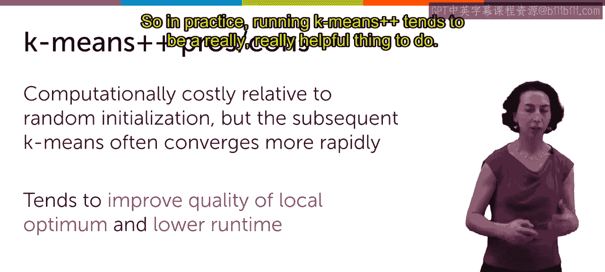

# 华盛顿大学《机器学习（分类，聚类和检索，第3-4课⧸共4课）｜Machine Learning》中英字幕 p153 31_通过K-means++进行智能初始化.zh_en -BV1Sr421F7N7_p153-

。

So we've discussed sensitivity to initialization， now let's turn to a method that provides a smarter and more reliable form of initializing our algorithm。

 and this is referred to as K means++。So how we think about initializing our K meanss algorithm is really。

 really， really critical to the quality of the solution found。

 and so one way to think about a smart initialization is as follows。

The first step is to select the first cluster center just randomly amongst all our data points。

 to find it to be one of those data points at random。

Then the second step is for each one of our observations。

Compute the distance to the nearest cluster center and so for the first pass through there's only one cluster center so it's just the distance to that cluster center。

 but if there are multiple cluster centers as we go through this initialization scheme。

 then we're going to maintain the distance to the closest cluster center。

And then when we go to sample our next cluster center。We're going to choose it。

Proportal to those distances squared。So we're going to bias towards selecting an observation that's far from existing cluster centers。

And then we're going to repeat the steps until we've sampled K different cluster centers。

So let's visualize what this means。So again， here are the data points that we wish to cluster the same example that we've been using。

And the first step of our K means++ algorithm is just to select one of these data points at random and call this the first cluster center。

Then the next step of the algorithm is to compute。Distances to this cluster center。

And then based on the square of these distances。We're going to sample a new cluster center。

So remember that we're going to be more likely。To select。A data point。As a cluster。Center。If。That。

Data point is far away。And the fact that in the algorithm。

 we're looking at the distant squares makes that even more exaggerated。

So we're very likely to sample one of the data points that's far from this cluster center as the next cluster center。

And so maybe we select this observation as the next cluster center。

 So that's going to be some green cluster。 Now we repeat this process where we compute distance to the nearest cluster center。

So。Maybe these are going to be。The distances that we compute gets a little bit hard to tell。

 I think this is a smaller distance than this， perhaps not。

 but you get the point and then based off of this。We're going to again compute the square of each of these distances and then sample a point and this one here is really far away from the nearest cluster center。

 so it's very likely to get selected and indeed in this example， we select that。

 So our initialization of three cluster centers for our Ka means algorithm。

Are going to be at these locations。So running K means++ to initialize our K means algorithm is definitely more computationally costly than just randomly selecting a set of cluster centers。

But the subsequent k means algorithm that we're going to run often converges much more rapidly。

 and so k meanss plus+ tends to improve the quality of the local optimum found and in addition。

 reduce the runtime because it converges more rapidly to that high quality solution。

 so in practice running K meanss++ tends to be a really really helpful thing to do。

