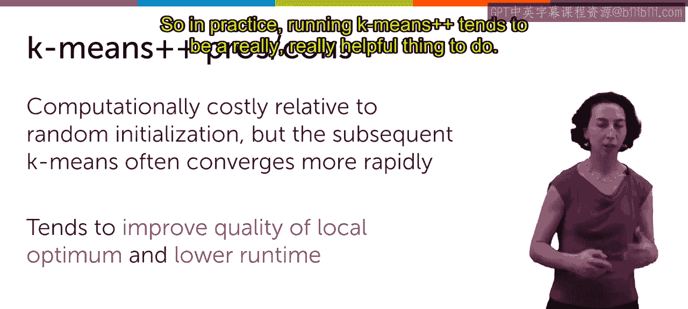

# 机器学习：第3-4课：通过K-means++进行智能初始化

在本节课中，我们将要学习一种名为K-means++的算法初始化方法。它旨在解决标准K-means算法对初始中心点选择敏感的问题，通过一种更智能的方式选择初始聚类中心，从而提高最终聚类结果的质量和算法的收敛速度。

上一节我们讨论了K-means算法对初始化的敏感性，本节中我们来看看一种能提供更智能、更可靠的初始化方法。

## K-means++ 初始化算法

K-means++的核心思想是，在选择初始聚类中心时，有意识地让它们彼此之间距离更远。这有助于算法找到一个更好的起始点，从而收敛到更优的局部最优解。

以下是K-means++初始化算法的具体步骤：

1.  **随机选择第一个中心点**：从所有数据点中随机选择一个作为第一个聚类中心。
2.  **计算距离并加权选择**：对于数据集中的每一个数据点，计算它与**当前已选出的所有聚类中心**的最近距离。然后，根据这些距离的**平方**作为权重，随机选择下一个聚类中心。这意味着距离现有中心越远的点，被选中的概率越大。
3.  **重复选择**：重复步骤2，直到选出K个初始聚类中心。

### 算法步骤详解

让我们通过一个简单的例子来可视化这个过程。假设我们有以下数据点需要聚类：

**第一步**：随机选择一个数据点作为第一个聚类中心（例如，图中红色的点）。

**第二步**：计算所有点到这个红色中心的距离。然后，根据距离的平方作为概率权重，随机选择下一个中心点。由于距离平方的权重，那些远离红色中心的点（例如，图中右上角的点）被选中的概率会非常高。假设我们选中了绿色的点。

**第三步**：现在，我们有两个中心点（红和绿）。对于每个数据点，计算它到**最近**的中心点的距离（即到红点或绿点的最小距离）。再次根据这些最小距离的平方作为权重，选择下一个中心点。此时，那些距离现有两个中心都较远的点（例如，图中左下角的点）被选中的概率最大。假设我们选中了蓝色的点。

至此，我们通过K-means++得到了三个初始聚类中心（红、绿、蓝），它们彼此分散，为后续的K-means算法提供了一个良好的起点。

### 算法优势与代价

运行K-means++初始化本身比完全随机选择初始中心需要更多的计算量，因为它需要多次计算所有数据点到当前中心的距离。

然而，这种代价通常是值得的，因为它带来了两大好处：
1.  **提升解的质量**：K-means++倾向于找到质量更高的局部最优解。
2.  **加速收敛**：由于起始点更好，后续的K-means迭代算法往往能更快地收敛到最终解，从而减少了总体运行时间。

因此，在实践中，使用K-means++进行初始化是一种非常推荐的做法。

## 总结

本节课中我们一起学习了K-means++智能初始化算法。我们了解到，通过有策略地选择彼此远离的点作为初始聚类中心，K-means++能够有效改善标准K-means算法的性能，帮助其找到更好的聚类结果并加快收敛速度。虽然初始化阶段稍显复杂，但其带来的收益在大多数应用场景中都非常显著。