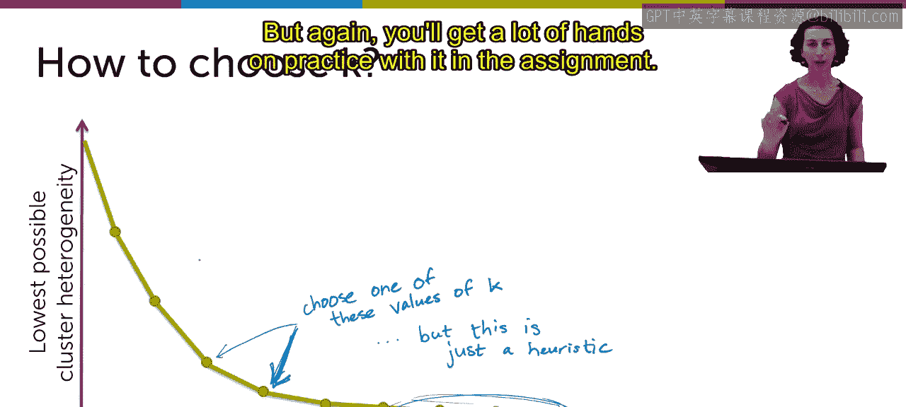

# 华盛顿大学《机器学习（分类，聚类和检索，第3-4课⧸共4课）｜Machine Learning》中英字幕 p154 32_评估质量和选择聚类数量.zh_en -BV1Sr421F7N7_p154-

。

So we've talked about the Ka means clustering algorithm and then a smart initialization to the algorithm。

 but now let's turn to assessing how do we measure the quality of the clustering and what's a method for choosing the number of clusters。

So as an example， here are two of the clusterings that we found based on two different initializations of our Ks algorithm。

 and a question is， which one do I prefer， which one is better？Well， to assess this。

 we can return to what is the Ka means objective。 What are we trying to minimize here， Well。

 Ka means is trying to minimize the sum of the square distances between our observations and the cluster centers。

 So we're minimizing over the set of all。Cster indicators for all of our observations。

 X I and the set of all cluster centers， muj， So all possible values of assignments of observations to clusters and all possible values of where we place those cluster centers the sum of these square distances。

 So here this sum is sum of。Squared。Distances。And。Cster。Jy。And here， we're summming。Over。

All clusters。So we can think about using this as a measure of quality for given clustering so in particular。

If the sum of the square distances is small， then that's going to represent。A better clustering。

 according to the Kaian objective than one that's large。 So to see this here， we have。

All these distances in the pink or fuia cluster and all of these little distances in the green cluster。

 But when we look at the blue cluster， we have really， really， really big distances that are getting。

We have some small distances， but a bunch of really big distances。

 so when we're summing over the square of all these distances。

This is going to be a very large number， whereas here。We're summing。In each case， for each cluster。

Over。Smaller numbers。On average。So we're going to say that。This cluster here is more。Hegeneous。

Meaning that there are。More。Disimilar。Objects。Within。A given cluster。

Whereas here we end up with tighter clusters。Where things are more homogeneous。

So we're going to refer to this metric as cluster heterogeneity。

So what's the sum of the heterogeneities over all of our different clusters and we want this to be small so that we're in examples like this one where we have these tight nice clusters。

And just to be clear， even though we're calling this a measure of quality。Lower is better。

 We want smaller sums of square distances。 Okay， so let's just spend some time thinking about what happens to this heterogeneity metric as K。

 the number of clusters increases。 Well， when there are more clusters available to the algorithm。

 we can refine these clusters more and more to our observed data。

 And so this can lead to our classic notion of overfitting。

 but not quite classic because now we're in this unsupervised setting。

 but as a similar kind of idea where the model is very， very。

Spified to the data in a way that might not be descriptive in general for what we're thinking about。

 so as an extreme case of this， imagine that we define the number of clusters as equal to the number of observed data points。

Then what we can do is for each one of our observations， we can define that to be a cluster center。

So what's the heterogeneity of that clustering？It's zero。And why is it zero？Because it's。

We're looking at the sum over all of our clusters of the square distance of the observation to the cluster center and what's the distance to the cluster center。

 it's zero， each cluster center is the observation itself。So in general。

 the lowest possible heterogeneity that we can achieve。Decreases as we increase K。

But I want to emphasize that for any given run of our k means algorithm。

 let's say we run it with K plus1 clusters。 Well， the heterogeneity for that converged solution could actually be larger than the heterogeneity for a converged solution where we ran the algorithm with just k clusters。

 But in general， when we're thinking about over the set of possible heterogeneities we have。

 The trend is that it decreases with K。 So a question is， how do we think about choosing。

The number of clusters。Well， we said that our heterogeneity metric or the lowest possible heterogeneity we can achieve decreases as we increase the number of clusters。

 and we said lower heterogeneity is better。 but then we also said， well。We don't want to。

Too many clusters because that won't really describe groupings that are very natural。

 We're just going to over partition the data into these little groups and get very low heterogeneity。

 but not a good description or not a good structure extracted from the data So somehow we need to trade off between these two things。

 And so what we can do is we can think about a heuristic where we're just going to look at something called the elbow of the curve where。

It's a little bit unclear whether the elbow is here or here。 So I'll just say。Choose。1。Of。

These values。Of K。Where。Maybe maybe I would prefer this value of k because the difference in heterogeneity relative to values much。

 much larger is not very big。But this should provide a more parsimonious description of my data than using this much。

 much larger K。But this。Is just a heuristic。So in general。

 there's really no answer for what's the right value of k and you're going to explore this in depth in the assignment associated with this module there's one last thing I wanted to mention here which is so far this plot is a plot of the lowest possible heterogeneity of course we're not going to compute all possible clusterings for every value of k to define this curve so in practice what people do is they just do multiple random restarts of our algorithm even if we're using k means plus plus or random initializations mix those in do a bunch of different restarts for every value of k and then just look at the clustering that provides the lowest measure of heterogeneity and plot that as a function of k and then choose k based on that。

But again， that itself is very computationally intensive。

 so in practice people do a wide range of things， but it's worth mentioning that how you choose K of course。

 really， really matters for what the resulting clusters represent if you choose K equals to you're just dividing in your data into two groups and if they're really inherently eight very clearly separated clusters you're not going to capture that but if you choose a million clusters。

 you're going to get very， very finet clusters obviously depending on the size of your data I'm trying to give an example that's very large so bear with me but the point is that you really need to look at the data think about what these things mean in your application and when it's hard to look at the data you can start doing things like the heuristic we're talking about here where you select the elbow of this curve but again you'll get a lot of handson practice with this in this assignment。

