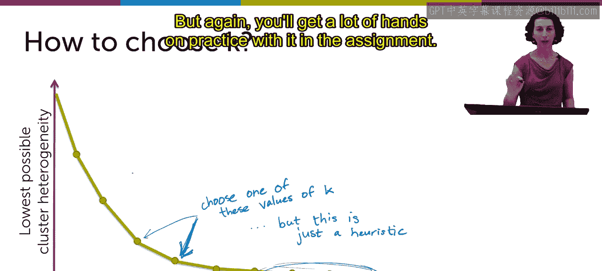

# 机器学习（分类，聚类和检索）：第3-4课：评估聚类质量与选择聚类数量 📊

在本节课中，我们将学习如何评估聚类结果的质量，以及如何为K均值算法选择合适的聚类数量K。我们将从回顾K均值的目标函数开始，理解其作为质量度量指标的含义，并探讨如何利用该指标来指导K值的选择。

## 回顾K均值目标函数

上一节我们介绍了K均值聚类算法及其智能初始化方法。本节中，我们来看看如何评估聚类结果的好坏。

K均值算法的目标是**最小化**所有数据点到其所属聚类中心的**平方距离之和**。这个目标函数可以用以下公式表示：

**目标函数：** `min Σ Σ ||x_i - μ_j||²`

其中，`x_i` 代表每个数据点，`μ_j` 代表第j个聚类的中心。我们通过最小化这个总和，来寻找最优的数据点分配方案和聚类中心位置。

这个总和被称为**聚类异质性**。异质性越小，意味着聚类内部的点越紧密、越相似，聚类效果就越好。因此，我们可以将**聚类异质性**作为衡量聚类质量的一个指标：**数值越低，质量越高**。

## 聚类数量K对异质性的影响

理解了质量度量指标后，一个自然的问题是：聚类数量K的选择如何影响这个指标？

随着K值的增加，算法可以将数据划分成更精细的组别，从而更好地拟合数据。这通常会导致**聚类异质性降低**。然而，这并非总是好事。如果K设置得过大，例如等于数据点的数量，那么每个点自成一类，异质性将降至零，但这显然失去了聚类的意义——我们只是“记住”了数据，而非发现了有意义的群组结构。这种现象类似于监督学习中的**过拟合**。

以下是K值增加时异质性变化的典型趋势：

*   **K值很小**：异质性很高，因为每个聚类内部包含了大量不相似的点。
*   **K值适中**：异质性显著下降，我们找到了数据中自然存在的、内部紧密的群组。
*   **K值很大**：异质性继续缓慢下降，但下降幅度变小，同时产生了许多细小而无意义的聚类。

## 如何选择聚类数量K

既然K值过小或过大都不理想，我们需要一种方法来权衡。一个常用的启发式方法是寻找**“肘部”**。

我们可以绘制一张图：X轴是K值，Y轴是对应K值下能获得的最小聚类异质性。随着K增大，曲线会快速下降然后趋于平缓。曲线拐弯最明显、形似“肘部”的那个点，通常被认为是一个较好的K值选择。在这一点上，增加更多的聚类（增大K）所带来的异质性改善（曲线下降）已经很小，因此选择这个K值能以更简洁（更少的聚类数）的方式描述数据的主要结构。

需要强调的是，**“肘部法则”只是一个启发式方法**，并非绝对真理。在实际应用中，选择K值还需要结合对数据本身的理解、业务背景以及后续分析目标。例如，如果你知道数据中大约有5个类别，那么从K=5开始探索就是合理的。

## 实践中的注意事项

在具体操作时，有几点需要注意：

1.  **计算最小异质性**：我们无法为每个K值穷举所有可能的聚类结果来找到绝对最小的异质性。通常的做法是，对每个K值，运行多次K均值算法（结合随机初始化和K-means++等方法），然后取其中异质性最低的结果作为该K值的代表。
2.  **计算成本**：上述方法计算量较大，尤其是在数据量大、K值尝试范围广的时候。实践中需要根据资源情况权衡。
3.  **K值的影响至关重要**：最终选择的K值直接决定了你从数据中提取出的结构。K=2会将所有数据强行分为两类，可能掩盖真实的细分群体；而K值过大则会得到过于琐碎、难以解释的群组。因此，仔细评估和选择K值是聚类分析中关键的一步。

## 总结

本节课中我们一起学习了如何评估聚类质量和选择聚类数量。我们了解到：

*   **聚类异质性**（所有点到其聚类中心的平方距离之和）是衡量K均值聚类质量的核心指标，值越小越好。
*   聚类数量K的增加通常会导致异质性降低，但可能引发过拟合，产生无意义的细小聚类。
*   选择K值需要在**低异质性**和**模型简洁性**之间取得平衡。**“肘部法则”** 是一种常用的启发式选择方法，即观察异质性-K曲线拐点处的K值。
*   在实践中，需要通过多次运行算法来近似每个K下的最小异质性，并且最终K值的选择应结合数据洞察与具体应用场景。

通过本模块的作业，你将获得大量关于评估聚类质量和选择K值的实践机会。