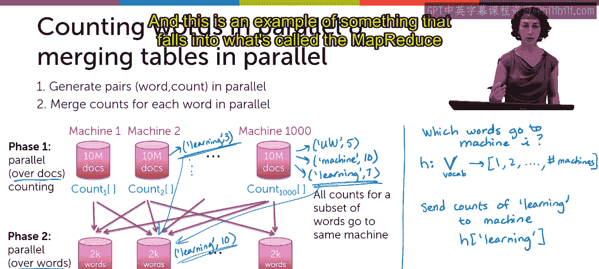

# 华盛顿大学《机器学习（分类，聚类和检索，第3-4课⧸共4课）｜Machine Learning》中英字幕 p155 33_MapReduce的动机.zh_en -BV1Sr421F7N7_p155-

。

We're going to use K meanss as an opportunity to present a really powerful and broadly used framework for parallel and distributed implementations of algorithms。

 and this framework is called MaRduce。

We'll start by describing MaRduce in the context of a really simple word counting example。

 which is the hello world example of MaRduce， and then we're going to get to how to apply the MaRduce framework to parallelze Kmes。

Okay， but for now， let's imagine that we have 10 billion documents and just a single machine。

 and we want to count the number of occurrences of every word in the corpus。

 So how are we going to do this？ Well， to begin with， we're going to initialize a hash table。

 which we call count。Gen。For every document D。In our corpus， which we'll call the set of documents。

And for every word。In document D。We're simply going to。Increment。Our count of this word。

But of course， cycling through 10 billion documents and every word in each one of those documents and then incrementing our count for each one of these words and maintaining this hash table is going to be a really。

 really intensive task。So instead， a question is， well。

 what if I had a thousand machines available to me？

Can I somehow paraze or distribute this operation across these different machines？So in particular。

 let's imagine that we are going to just evenly distribute our data。

So we're going to send 10 million documents to each one of our1 thousand machines。

And then what we can think about doing is we can think about counting words in the documents per machine separately。

 because when we're thinking about doing word counts。

 this is an operation that's independent across documents。

The word counts in another document don't influence the word counts in some separate document。

So this is an example of what's called a data parallel task， so some task that。

Can be done completely independently across the different data points。

 So what this implies is we can think about just counting the occurrences of words separately in each one of our documents。

And then merging these together。Okay， so we can do these counts per machine and then simply。

Add these counts together。So to be clear， per machine。

 we run exactly the code that we had on the previous slide。

 but now it's only over 10 million documents， not 10 billion documents。

 but then once we have these hash tables，We're going to combine them together。

So we have that the count， the total count to the entire corpus of a given word is summing over each one of our thousand machines。

 the local count of that word okay but here we've shown this just for a single word and remember we want to do this for every word in our vocabulary that's present in the corpus。

How do we do this， Well， it seems like we're now back to a sequential problem。

 We have to go through each one of our words and do this merge of these hash tables。

 So just to make sure that's clear， we have to。Cycle through。All words。In our vocabulary。

And I'm not happy about doing that。So can we do something even better？Well。

 let's imagine that we have。A whole bunch of machines available for this word counting and a whole bunch of words available when we're going to merge these hash tables and form our counts of all words in these vocabulary。

Okay， so what we can do is we can divide this into two different phases。

 one phase where we have an operation that's parallel over documents。

Which is counting the words that appear in each one of these documents。So， for example。

Maybe this machine is going to produce。Five counts of the word UW。1en counts of the word machine。And。

Seven counts of the word learning， and maybe this machine also has some counts of the word learning。

Maybe here we have three counts as well as counts of other words that appeared in the documents on this machine。

 so that's the step that we described in our previous slide。

But now what we're going to do is we're going to utilize multiple machines when we go to do the counts across the entire corpus。

 so in particular when we're going to merge these different counts that we've made and to do this。

 this is the really key step is we're going to send all counts of a given word to a single machine so。

All counts of the word learning that appear in any one of these thousand machines are all going to get sent to one machine。

 let's say。Learning。All goes to this。Machine here。 and so this is going to then sum these counts。

 and in this case， maybe it would output。Learning。And if these were the only two instances。

 it would output learning with a count of 10。And the important thing about being able to do this second phase in this distributed manner is the fact that the operation that we're doing when we're merging these different hash tables is。

Again， an operation that can be implemented independently over now words。

 so this is an operation that we'll call data parallel over words。

 and that's what allows us to have this efficient structure for merging the hash tables。Okay。

 but a critical component here is making sure that we send all counts of a given word to a single machine so that whatever this aggregation over these counts that's produced on this machine here。

Corresponds to all the count of that word in the entire corpus。And how are we going to do this？ Well。

 what we're going to do is use something that's called a hash function。

And let's describe this in a little bit more detaildo。So which words？Go to。Machine I。Well。

 our hash function H is going to be something that's defined over our entire vocabulary。

So over the indices， however many words we have in the vocabulary。

That's going to be the input to the function and the output is going to be in the range of one。

 two all the way to the number of machines that we have available。And so in particular， we'll send。

Counts。Of the word learning。2。Machine。H of。Learning。Okay， so to step back。

 what we've seen is that we had an operation that we could distribute across documents。

 which was simply to count how many words appeared。

How many instances of a given word appeared in that document。

 and then we had a step that could distribute it across the unique words。

 which was to add up all the counts that we had across these different documents to merge to get a total count of a given word in the corpus and this is an example of something that falls into what's called the mapreduce abstraction。

