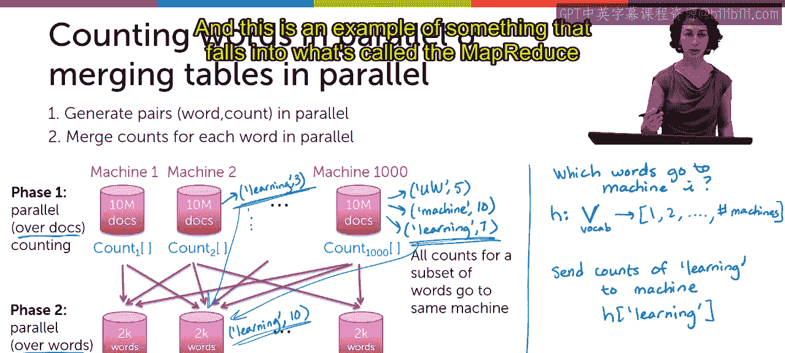

**机器学习：第3-4课：MapReduce的动机**


在本节课中，我们将学习一个用于算法并行和分布式实现的强大且广泛使用的框架——MapReduce。我们将从一个简单的词频统计示例开始，这是MapReduce的“Hello World”示例，然后探讨如何将MapReduce框架应用于并行化K-means算法。

---

### **概述：从单机到分布式计算的挑战**

假设我们有一台机器和100亿份文档，需要统计整个语料库中每个单词的出现次数。我们可能会初始化一个哈希表，然后遍历每份文档中的每个单词，递增该单词的计数。然而，处理如此庞大的数据量对单台机器来说是一项非常繁重的任务。

那么，如果我们有1000台机器可用，能否以某种方式将这个操作并行化或分布到这些不同的机器上呢？

---

### **数据并行任务：按文档分布计算**

我们可以均匀地分发数据，例如，将1000万份文档发送到每台机器上。由于词频统计是一个跨文档独立的操作，即一份文档的词频不影响另一份文档，因此我们可以独立地在每台机器上分别统计其分配文档中的单词出现次数。这种可以跨不同数据点完全独立执行的任务，被称为**数据并行任务**。

以下是每台机器上执行的伪代码：
```python
# 每台机器上的局部词频统计
local_counts = {}
for document in assigned_documents:
    for word in document:
        local_counts[word] = local_counts.get(word, 0) + 1
```

完成局部统计后，我们会得到1000个局部哈希表（词频字典）。接下来，我们需要将它们合并起来，以获得整个语料库的总词频。

---

### **合并挑战与按单词并行**

合并这些哈希表似乎又回到了一个顺序问题：我们需要遍历词汇表中的每个单词，将1000台机器上该单词的局部计数相加。如果词汇表很大，这仍然是一个繁重的任务。

我们能否做得更好？答案是肯定的。我们可以利用多台机器来并行执行这个合并阶段。关键在于，合并操作（即对每个单词的局部计数求和）本身也可以跨单词并行执行，这可以称为**按单词的数据并行**。

为了实现这一点，我们需要一个关键步骤：将所有机器上关于**同一个单词**的计数发送到**同一台**机器上进行汇总。

---

### **哈希函数：确保数据正确路由**

如何确保所有“学习”这个词的计数都去到同一台机器呢？这里我们使用一个**哈希函数**。

哈希函数 `H` 定义在整个词汇表上。它将一个单词（或单词的索引）作为输入，输出一个在1到机器总数范围内的整数。这个整数决定了该单词的所有计数将被发送到哪台机器。

用公式表示发送规则：
**将单词 `w` 的计数发送到机器 `H(w)`。**

例如，`H("learning") = 5`，那么所有机器上“learning”的局部计数都会被发送到第5号机器。这台机器负责将所有收到的“learning”计数相加，得到该单词在整个语料库中的总计数。

---

### **MapReduce抽象**

我们刚才描述的过程，正是**MapReduce**框架的一个典型例子。它包含两个主要阶段：
1.  **Map阶段**：一个可以跨数据项（如文档）并行执行的操作。在我们的例子中，就是每台机器独立统计其文档中的词频。
2.  **Reduce阶段**：一个可以跨键（如单词）并行执行的操作。在我们的例子中，就是每台负责特定单词的机器，汇总来自所有Map机器的该单词的计数。

MapReduce框架的强大之处在于，它通过定义清晰的Map和Reduce接口，以及一个基于键（如单词）将中间数据分发到Reduce节点的机制（通常使用哈希函数），将程序员从复杂的分布式系统细节（如网络通信、故障处理）中解放出来，使其能够专注于业务逻辑。

---

### **总结**



本节课我们一起学习了MapReduce的动机和核心思想。我们从一个单机处理海量数据时遇到的性能瓶颈出发，探讨了如何通过数据并行将任务分布到多台机器上。我们遇到了合并局部结果的挑战，并通过引入哈希函数将合并操作也并行化，从而引出了MapReduce的双阶段抽象：**Map阶段**处理原始数据并生成中间键值对，**Reduce阶段**则根据键来聚合这些中间结果。这个框架为大规模数据处理，包括我们接下来要看到的并行化K-means算法，提供了强大的基础。