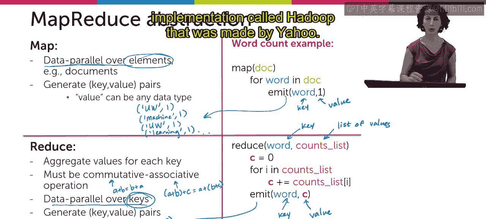

# 华盛顿大学《机器学习（分类，聚类和检索，第3-4课⧸共4课）｜Machine Learning》中英字幕 p156 34_一般MapReduce抽象.zh_en -BV1Sr421F7N7_p156-

。

So the map reduceuce abstraction has two different steps。

 one is the map step and the other one is the reduce step thus the name map reduce Okay。

 well in the map step we're going to assume that the operation we want to perform is data parallel over elements like our documents and the result of the map call is going to be to generate a key value pair。

 so for example， in our word count example。We're going to take in a document and then for every word in that document。

We're just going to emit the pair word comma one so。Cycle through our document。

 if we see the word UW， we emit UW1。We see the word machine。We。But Ma one。

 then we happen to see U du again， so we put UW one， and then we see learning。

So we emit learning one。And so on。So in this example。

 the key are the different words in our vocabulary， UW， machine learning， and so on。

 and the value is just the count of that word and for this specific implementation。

 we're emitting just a count of one every time we see a word instance。

 but when we're talking about the mapreuce abstraction， the value can be any data type。

Then for the reduced step here， this step is going to be one that aggregates over the values associated with every key。

 and this must be a commutative associative operation， so commutative means。嗯。

That the order of the operations doesn't matter， so for example， a plus B is equal to B plus a。

 so addition is commutative， and it's also associative。

 which means that the grouping of operations doesn't matter。 so again。

 addition satisfies this or A+ B， if we do that first and then add C。

 that's the same as if we had done。A plus。The operation of B plus E。Okay， and for a reduced step。

 we need this operation to be one that's data parallel over keys。Okay， so let me。

Emphasize what the object is data parallel over。In the map step。

 it's over the elements like documents in our corpus。 But here。

 once we produce these key value pairs， we take all the keys and the operation has to be。

Able to be performed independently for each key。I don't want to say key value each key。

And so just to make this a little bit more explicit in the map step。

 we're saying that the word count。In a given document doesn't depend on any other document in the reduced step we're saying the total count of a given word。

Doesn't depend on the total count of any other word。

So let's go through the reduced example for word counting。嗯。

Here what we're going to do is we're just going to initialize our count of a given word to be zero。

 so the reducer takes in the specific key as well as a list of values。

 so maybe I'll write this here so this is the key。And this is a list of values。

And what we're going to do is for every value in this list。

 we're going to increment our count by that value。嗯。So in this case it's count。

 it doesn't really always have to be a count， it could just be sums of values。

 and then we're going to emit this key value pair。So here's our key。Value pair。And in this example。

 this was our key。Value pair that was oted。So in particular， if we go along with this example here。

 if we were to。Call reduce on the key。Ud。And。Associated with that key， we had counts， let's say， 1。

 17，0，0， 12，2。Thenhan what we would admit。Would be。You dub。Coma。32。

So MaRuce has a really long history in functional programming。

 and somewhat more recently it was popularized by Google and then really it gained a lot of broad adoption through an open source implementation called Hadoop that was made by Yahoo。

