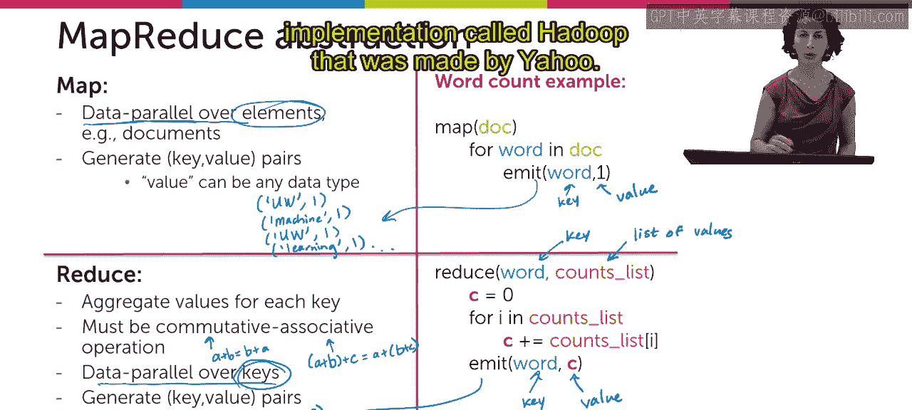
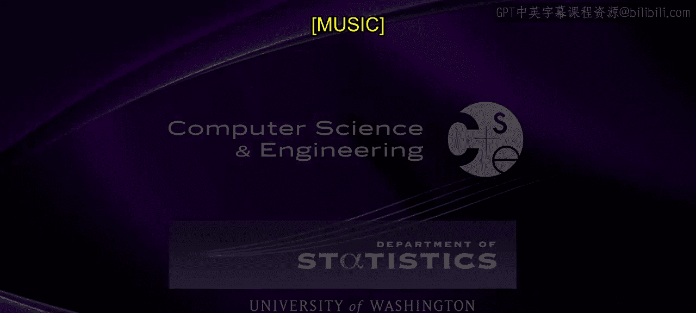

**机器学习：第3-4课：一般MapReduce抽象**


在本节中，我们将学习MapReduce这一核心计算抽象。MapReduce是一种用于处理大规模数据集的编程模型，它通过两个主要步骤——映射（Map）和归约（Reduce）——来简化并行计算。我们将通过一个简单的例子来理解其工作原理。

---

上一节我们介绍了MapReduce的基本概念，本节中我们来看看它的两个具体步骤。

**映射（Map）步骤**

在映射步骤中，我们假设要执行的操作在数据元素（例如文档）上是可并行化的。映射调用的结果是生成一系列键值对。

例如，在我们的词频统计例子中，我们将输入一个文档，然后对于文档中的每一个单词，我们都会输出一个键值对：`(单词, 1)`。这意味着我们遍历文档，每看到一个单词，就输出该单词和数字1。

以下是映射步骤的伪代码描述：
```python
def map_function(document):
    for word in document:
        emit(word, 1)
```
在这个例子中，键（key）是词汇表中的不同单词（如“UW”、“machine”、“learning”），值（value）是该单词的计数。在这个具体实现中，每次遇到一个单词实例，我们只输出计数1。但在MapReduce抽象中，值可以是任何数据类型。

**过渡到归约步骤**

映射步骤会为所有文档生成大量的键值对。接下来，我们需要将这些中间结果进行汇总。

**归约（Reduce）步骤**

归约步骤将对与每个键相关联的所有值进行聚合操作。这个操作必须是**可交换的**和**可结合的**。

*   **可交换**意味着操作顺序不影响结果，例如 `a + b = b + a`，加法是可交换的。
*   **可结合**意味着分组方式不影响结果，例如 `(a + b) + c = a + (b + c)`，加法也是可结合的。

在归约步骤中，操作必须在不同的键之间是**可并行化**的。让我强调一下这两个步骤并行化的对象有何不同：
*   在**映射**步骤中，并行化是针对数据元素（如语料库中的文档）。
*   在**归约**步骤中，一旦我们生成了这些键值对，我们就取所有的键，并且针对每个键的操作必须能够独立进行。例如，一个单词的总计数不依赖于任何其他单词的总计数。

让我们继续词频统计的例子，看看归约步骤如何工作。

以下是归约步骤的伪代码描述：
```python
def reduce_function(key, list_of_values):
    total_count = 0
    for value in list_of_values:
        total_count += value
    emit(key, total_count)
```
归约器接收一个特定的键以及与该键关联的一个值列表。它的工作就是遍历这个列表，将所有值（在这个例子中就是数字1）累加起来，然后输出最终的键值对 `(单词, 总次数)`。

具体来说，如果我们对键“UW”调用归约函数，并且与之关联的值列表是 `[1, 1, 1, ...]`（假设出现了很多次），那么归约器将输出 `("UW", 总出现次数)`。

**MapReduce的背景与应用**

MapReduce在函数式编程中有着悠久的历史。近年来，它被谷歌公司推广普及，随后通过雅虎开发的一个名为Hadoop的开源实现获得了广泛的采用，成为处理海量数据的基石技术之一。

---

**总结**





本节课中我们一起学习了MapReduce的一般抽象。我们了解到：
1.  **Map（映射）步骤**：将输入数据元素转换为独立的键值对，操作在数据元素层面并行。
2.  **Reduce（归约）步骤**：对拥有相同键的所有值进行聚合（如求和），该操作需满足交换律和结合律，并在不同的键之间并行执行。
通过词频统计的例子，我们清晰地看到了`map`函数如何发射`(单词, 1)`对，以及`reduce`函数如何将相同单词的计数相加得到最终结果。这种模型极大地简化了大规模分布式计算程序的设计。