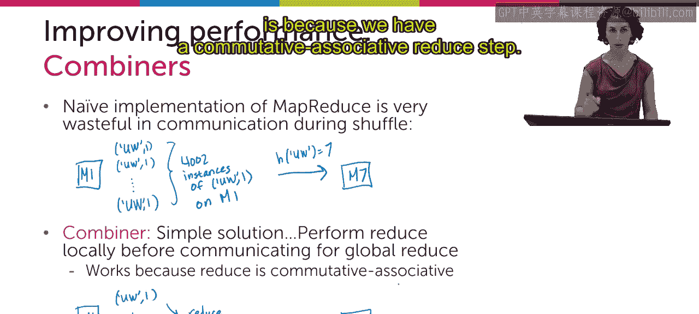

# 华盛顿大学《机器学习（分类，聚类和检索，第3-4课⧸共4课）｜Machine Learning》中英字幕 p157 35_MapReduce执行概述和组合器.zh_en -BV1Sr421F7N7_p157-

。

Now let's step back and summarize mapreuce in terms of the execution overview。 so in particular。

 we assume we have some large data set and we're going to split this data across machines。And then。

On each machine， this is our map phase， we're going to do some operation that's data parallel。

 so splits across the data divided on these different machines and then emit some key value pair。

 so for example， maybe we emit key value pair UW comma 1。

So that might be what K1 might represent UW and V1。

 the number one in the example that we showed on the last slide。

 and then after emitting all these key value pairs。

Then we do what's called the shuffle phase and the shuffle phase is where we take these key value pairs and assign。

Each of them that have the same key to the same machine for the reduce phase。

 so every key value pair。Is going to get assigned to machine H of that key where H is our hash function so then what we end up with is in the reduce phase there's going to be some aggregation step where for every key。

 we're going to look at all values associated with that key so we're going to look at all these key value pairs and for a given key。

 we're going to aggregate across all those values。And so for example， in our word counting。

 this might produce you a。UW comma 30。That might be。What K1， V1 represents here。

 but I want to mention that when we're talking about our map phase。

These are not necessarily unique keys that appear across the different machines。So。May have。Same。Ki。

Appear。On。Mti婆。Machines。Whereas when we're in the reduced phase。

We're going to end up with unique keys on every machine。

And that's why in terms of our notation here we say K1， K2， and this is K1 prime， K2 prime。And so on。

 so these primes indicate that it could take the same value as what it did on the other machine。

 whereas here， we're just saying K1， K2， K3， K4， K5，8。

 and so on these are each unique values from the entire set of possible keys。Okay。

 and remember that this reduced phase， it has to be an operation that's data parallel across keys。

And then finally， the last step is that。You're gonna。Save your results to disk。Okay。

 so this is the summary of the standard mapR execution flow。

But I quickly wanted to mention that we can often improve performance through something that are called combiners because this naive implementation of mapreduce can be really wasteful in terms of communication in that shuffle phase where you're taking all these key value pairs and you're sending them different machines because for example。

 if you have a large set of documents and you know some reasonable vocabulary you're gonna to have lots and lots and lots of these counts of you know word comma1 word comma1 word comma1 word comma1 and all of those have to be sent to a machine and so that's a lot of communication so just to make this really explicit。

Let's say we're looking at machine one， and we're。Counting words on all documents that were allocated to machine one。

 and we emit UW。Palma1， and we end up with， let's say。A whole bunch of Uw。

Words in the documents on this machine。Just to make this concrete。

 let's say we end up with 4002 instances。Of。Ud。1an。On machine one。And all of these are， let's say。

 going to be shuffled to Ma7 for a reduced phase， and this would happen if H of UW our hash function on key UW is equal to 7。

That's how we。Would shuffle all of these instances to Ma  seven。Okay， well。

 a combiner represents a very simple solution to this problem。

 which is to perform a reduced step before sending things over to another machine。

 so perform this reduce locally to each one of the machines。

In the map phase before doing the shuffle and the subsequent reduce。So in particular。

What we would do is take our Ma one and all these counts of UW。1。And we do。I reduce。

And our call to reduce would emit UW。4002。 and then we would send。Just this one UW 4002 over to Ma 7。

And note that the reason that this works， the fact that we can do this local reduce。

 and then do another reduce after we do a shuffle from the other machines is because we have a commutative associative reduce step。

