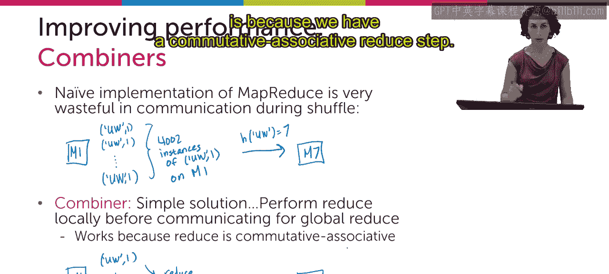

# 机器学习（分类，聚类和检索）：第3-4课：MapReduce执行概述与组合器

在本节课中，我们将学习MapReduce框架的执行流程，并了解如何通过“组合器”来优化其性能，以减少网络通信开销。

## MapReduce执行概述

上一节我们介绍了MapReduce的基本概念，本节中我们来看看其具体的执行流程。我们假设有一个大型数据集，它将被分割并分配到多台机器上。

以下是MapReduce标准执行流程的步骤：

1.  **Map阶段**：在每台机器上，我们执行一个数据并行的操作。该操作处理分配到此机器的数据分片，并发射出一些键值对。例如，我们可能发射键值对 `(UW, 1)`。这里，`K1` 可能代表“UW”，`V1` 代表数字“1”。

2.  **Shuffle阶段**：在此阶段，我们收集所有发射出的键值对，并根据键将它们分配到不同的机器上，为Reduce阶段做准备。分配规则是：每个键值对将被发送到机器 `H(key)`，其中 `H` 是我们的哈希函数。

3.  **Reduce阶段**：在此阶段，进行聚合操作。对于每一个唯一的键，我们查看与该键关联的所有值，并进行聚合。例如，在词频统计中，这可能会产生 `(UW, 30)` 这样的结果。

4.  **保存结果**：最后，将结果保存到磁盘。

需要注意的是，在Map阶段，不同的机器上可能出现相同的键（例如，`K1`）。而在Reduce阶段，每台机器上的键是唯一的（我们用 `K1'`, `K2'` 等表示）。此外，Reduce操作必须是跨键数据并行的。

## 引入组合器优化

然而，上述朴素的MapReduce实现在Shuffle阶段的通信上可能非常低效。例如，在词频统计中，我们可能会产生大量如 `(word, 1)` 的键值对，它们都需要被发送到另一台机器，这会产生巨大的通信开销。

为了解决这个问题，我们可以使用**组合器**。组合器是一个在Map阶段之后、Shuffle阶段之前执行的本地Reduce操作。它的目的是在数据发送到网络之前，先在本地机器上进行部分聚合。

让我们通过一个具体例子来理解：

假设在机器1上，我们统计单词“UW”，最终得到了4002个 `(UW, 1)` 实例。根据哈希函数 `H(UW) = 7`，所有这些实例都将被Shuffle到机器7。

**不使用组合器**：我们需要将4002个 `(UW, 1)` 键值对全部发送到机器7。

**使用组合器**：我们可以在机器1本地执行一个Reduce操作，将这些 `(UW, 1)` 聚合成一个 `(UW, 4002)`。然后，我们只需要将这**一个**键值对发送到机器7。

组合器能够工作的关键原因在于，Reduce操作必须是**可交换**和**可结合**的。这意味着，先进行本地聚合，再将聚合结果与其他机器的结果进行最终聚合，得到的结果与将所有原始数据一起聚合的结果是相同的。用公式表示，对于操作 `⊕`，需要满足：
*   **可结合性**：`(a ⊕ b) ⊕ c = a ⊕ (b ⊕ c)`
*   **可交换性**：`a ⊕ b = b ⊕ a`

例如，求和操作就满足这两个条件。

## 总结

本节课中我们一起学习了MapReduce的标准执行流程，包括Map、Shuffle、Reduce和保存结果四个阶段。更重要的是，我们了解了**组合器**这一优化技术。通过在Map阶段后、Shuffle阶段前执行本地Reduce操作，组合器可以显著减少需要在网络间传输的数据量，从而提升整体作业性能。这要求底层的Reduce操作必须是可交换和可结合的。