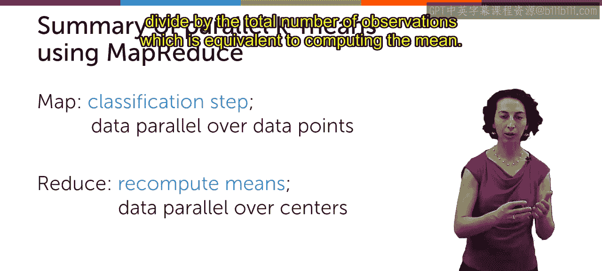

# 华盛顿大学《机器学习（分类，聚类和检索，第3-4课⧸共4课）｜Machine Learning》中英字幕 p158 36_K-means的MapReduce.zh_en -BV1Sr421F7N7_p158-

。

Let's now turn to applying Maproduce to kines。And first， let's just recall the two steps of K means。

 there' is one step which we'll now refer to as the Class step where we assign each data point to a cluster。

Then we have what we'll now call the reenter phase where we take all the data points that were assigned to a given cluster and we use that to update our cluster centers。

Well， let's think about these steps within the context of MaRduce and in particular what we see is that for the first step。

 this is something that's a data parallel operation that is for every data point。

 once you give me the cluster centers， I can independently perform the assignment of that data point to a cluster center。

 and it does not depend at all on the other data points。And so in particular。

 the mapper is going to emit these cluster label comma data pairs。

 where here this cluster label is going to serve as the key and the data value is going to serve as the value in this key value pair。

Then when we turn to the recenter step， we see that this is a step where we're performing an aggregation and this aggregation is independent across different cluster labels。

 so across different keys。So in particular， for every cluster。

I simply look at the data assigned to that cluster and I sum all the values and normalize。

 and so that can be implemented using a reduced step。

So let's dig into each one of these steps in a little bit more detail。So in particular。

 let's start with the classified step and look at the mapper for this step and what the mapper takes in are the set of cluster centers。

And a single data point。And then the map computes the distance between that data point and each one of these cluster centers and returns the index of the cluster center that's closest to that data point。

 so in particular emits。Questster， label。And。Data。Point。Pair where again。

 the cluster label serves as the key and the data value here or the data point serves as the value。

 so for example。Maybe we would。Amit to。咁啊。17，0，1，7， zero， zero，5。If。This data point。

Which might have been a word count vector with count 17，0，1，7，0，0。

5 on some set of words in a vocabulary is assigned to cluster 2。 So this is if Z I equals 2。Okay。

 so hopefully from this， it's easy to see how we can do this classified step using a map phase。

Then for the REent step， we see that we're just aggregating all data points within a given cluster。

Divided by the total number of data points in computing this as the new mean for that cluster。

 so our reducer。Is going to take in a given cluster label。Which remember is our key。

And then we're going to take in a list of values associated with that key， So here we have。

These are all。Data points。Assigned。2。Quster J。So they have。几。Jy。

And what this reducer does is it starts with。The total mass。In the cluster being zero。

And this is the total。Number of。Observations in the cluster。And we also initialize that to be0。

 And then for every x value in this list， we're simply going to increase the total mass by an amount X and then increase the total count number of observations in the cluster by one。

 and then we're going to return a key value pair where the key is the。Quster。Label。And the value。

Is the new mean， which is。Total mass。Divide by。Total number of observations in the cluster。So again。

 we see how our recenter step fits very nicely within the reduced phase。

So that's Mareduce for K means， but there are a couple things worth highlighting。

 one is the fact that remember that K means is an iterative algorithm so you run this classify recenter。

 classify recenter again and again and again until convergence。

 so this actually requires an iterative version of Mareduce which is a non-standard formulation but it's possible。

 and the other thing to remember is that the Maper gets the entire set of cluster means。

And there's lots of data to plow through and remember every map or call in the very general formulation or the naive implementation just gets a single data point and there's lots and lots of data points。

 so this is a lot of data to be passing around so a more efficient implementation is per map or call give a whole set of data points to classify so a whole set of points to plow through。

And so that would be a much more efficient implementation of Mareduce 4K meanss。

But to sum up the steps that are involved in K means fit really nicely within this mapRduce framework where the map step corresponds to our classification step。

 which is data parallel over our data points， just assigning data points to cluster labels。

 and then the reduced step corresponds to the recenter step in K means。

 which is data parallel over cluster labels， which represent the keys in this example。

Where we're just going to， for every cluster， aggregate all the data within that cluster and divide by the total number of observations。

 which is equivalent to computing the mean。

