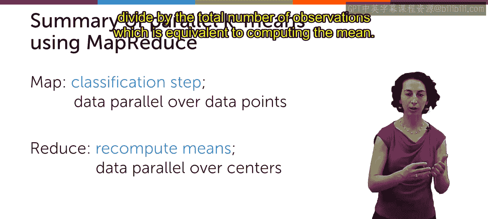

# 机器学习（分类，聚类和检索）：第3-4课：K-means的MapReduce实现 🧩


在本节课中，我们将学习如何利用MapReduce框架来实现K-means聚类算法。我们将看到，K-means的两个核心步骤——分配数据点到簇（分类）和更新簇中心（重新中心化）——可以非常自然地映射到MapReduce的“映射”和“归约”阶段。

上一节我们介绍了K-means算法的基本思想，本节中我们来看看如何将其应用于分布式计算环境。

## 算法步骤回顾

K-means算法包含两个主要步骤：
1.  **分类步骤**：将每个数据点分配到距离其最近的簇中心。
2.  **重新中心化步骤**：根据分配给每个簇的所有数据点，计算新的簇中心（均值）。

## MapReduce框架下的映射

在MapReduce的上下文中分析这两个步骤，我们发现：
*   **分类步骤**是一个数据并行操作。给定簇中心后，每个数据点的分配可以独立进行，不依赖于其他数据点。这非常适合“映射”阶段。
*   **重新中心化步骤**是一个聚合操作，且不同簇（不同键）之间的聚合是独立的。这非常适合“归约”阶段。

接下来，我们将详细探讨每个步骤在MapReduce中的具体实现。

### 分类步骤：映射器实现

在分类步骤中，映射器的任务是：接收当前的簇中心集合和一个数据点，计算该数据点到所有簇中心的距离，并将其分配给最近的簇。

映射器的输入是：
*   **簇中心集合**
*   **单个数据点**

映射器的处理逻辑如下：
1.  计算数据点到每个簇中心的距离。
2.  找出距离最近的簇中心索引。
3.  发射一个键值对，其中**键是簇标签（索引）**，**值是数据点本身**。

例如，如果一个数据点（可能是一个词频向量 `[17, 0, 1, 7, 0, 0, 5]`）被分配到簇2，那么映射器将发射：
`(2, [17, 0, 1, 7, 0, 0, 5])`

以下是映射器逻辑的伪代码描述：
```python
def mapper(cluster_centers, data_point):
    min_distance = INF
    assigned_cluster = -1
    for j, center in enumerate(cluster_centers):
        dist = distance(data_point, center)
        if dist < min_distance:
            min_distance = dist
            assigned_cluster = j
    emit(assigned_cluster, data_point)
```

### 重新中心化步骤：归约器实现

在重新中心化步骤中，归约器的任务是：接收同一个簇标签（键）下的所有数据点（值列表），计算这些数据点的均值，作为该簇的新中心。

归约器的输入是：
*   **键**：簇标签 `j`
*   **值列表**：所有被分配到簇 `j` 的数据点 `[x1, x2, ..., xn]`

归约器的处理逻辑如下：
1.  初始化簇内数据点的**总和**（`total_mass`）为0向量。
2.  初始化簇内**数据点计数**（`total_count`）为0。
3.  遍历值列表中的每个数据点 `x`：
    *   将 `x` 加到 `total_mass` 上。
    *   将 `total_count` 加1。
4.  计算新簇中心：**新均值 = total_mass / total_count**。
5.  发射键值对：`(j, 新均值)`。

以下是归约器逻辑的伪代码描述：
```python
def reducer(cluster_label, list_of_data_points):
    total_mass = zero_vector
    total_count = 0
    for x in list_of_data_points:
        total_mass += x
        total_count += 1
    new_center = total_mass / total_count
    emit(cluster_label, new_center)
```

## 实现注意事项

虽然K-means可以很好地适配MapReduce模型，但有两点需要注意：

1.  **迭代需求**：K-means是一个迭代算法，需要反复执行“分类-重新中心化”步骤直至收敛。这需要一个**支持迭代的非标准MapReduce实现**（如Spark的迭代计算模型）。
2.  **效率优化**：在基本实现中，每个映射器调用只处理一个数据点，但需要接收整个簇中心集合。当数据点极多时，这会带来大量的数据传输开销。更高效的实现是让**每个映射器处理一批数据点**，从而分摊簇中心广播的开销，提升整体效率。

## 总结

本节课中我们一起学习了如何将K-means算法映射到MapReduce框架。我们了解到：
*   **映射阶段** 对应K-means的**分类步骤**，这是一个在数据点上数据并行的操作，负责将数据点分配到最近的簇。
*   **归约阶段** 对应K-means的**重新中心化步骤**，这是一个在簇标签（作为键）上数据并行的操作，负责聚合簇内所有数据并计算新的均值作为簇中心。



通过这种映射，我们可以利用分布式计算框架的强大能力来处理大规模数据集的聚类任务。