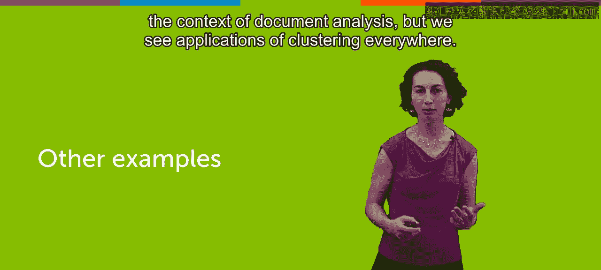
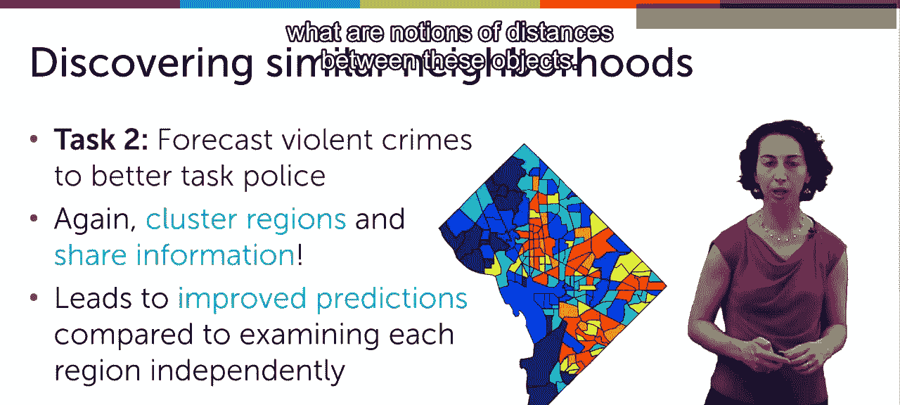

# 华盛顿大学《机器学习（分类，聚类和检索，第3-4课⧸共4课）｜Machine Learning》中英字幕 p159 37_聚类的其他应用.zh_en -BV1Sr421F7N7_p159-

。So far in this module we've discussed clustering in the context of document analysis。

 but we see applications of clustering everywhere。

As an example， maybe you want to cluster images， so in this case that we're showing here。

 you might want to be able to group all images associated with pictures of ocean or a pink flowerer dog。

 sunset， clouds and so on， and this can be useful for things like Google image search where a person types a word into Google images。

 perform some query on that images data and Google wants to display a set of images for that word。

 but maybe not all of our images in the data have been labeled by a human so if we can discover groups of related images。

 this can really help in image search。And there are other reasons you might want to perform clustering on images too。

 So for example， when again， using Google images， somebody types in a term like the term cardinal。

 Well that term might have multiple meanings。 And so if we take all images that have already been labeled again。

 maybe this was by a human as cardinal， then maybe we want to perform a clustering on。

The image is associated with this word because maybe some of the images correspond to a bird。

 but others to the baseball team and others to religious figures。

So when a person is going and searching for the word cardinal。

 we don't actually know which of these meanings the person meant。

 so when we're displaying images instead of having all the images be images of birds。

 but just different variants of that image， maybe we'd want to have a diverse set of images that cover these set of possible meanings so if we can cluster images all labeled with the same label。

 we can present results that might better explore what the person is actually intending when they do a Google image search。

So in this case we're using clustering to structure our output we can also think about applying clustering and applications that are very different than just for the sake of retrieval for example。

 maybe we can think about grouping patients but based on exhibited medical conditions。

If we can form this grouping， then we can do things like better study subpopulations as well as diseases so as an example of this。

 imagine we have intracranial EEG recordings from a set of patients so here we're showing three different brains and some electrodes placed on these brains and from each one of these patients。

We get a set of recordings of different seizure events。

Then we can take each one of these seizure events and think about clustering based on similarities between the events。

And then based on these types of clusterings， we can learn more about different types of seizures。

 we can characterize how many different types of seizures do we think there are as well as what are the properties of each one of these seizure types。

 we can also think about clustering patients based on the types of seizures that they exhibit and better understand different subpopulations within the class of people who have seizure disorders。

Another very different application is looking at products on Amazon and maybe here we would like to group products based on having similar purchase histories。

 And when I talk about purchase history of a product。

 what I mean is if we look at all users that go and purchase a given item and look at other items that they purchased either in that same shopping or in the recent history。

 and we look at that as a description of a product。

 So this would be aggregated over all users that purchase this product。

 then we can think about clustering similar product。

 So for example maybe when people go and buy this crib。

re also we also see that they're buying a car seat and other baby items And so from this。

 we can maybe lump this crib in with the set of baby items that are available on Amazon and even though let's say a seller labeled this under a category furniture。

One thing we could do with this clustering is actually either correct or add a label。

 which is baby that this is a baby product。And of course。

 we could also use this type of structure to do product recommendation， somebody goes。

 they have a certain set of things in their shopping cart。

 and you want to recommend other products they might be interested in。

And we can also think about discovering groups of users that have similar purchase behaviors。

 purchase or viewing behaviors， so there are lots of interesting things we can do through this clustering structure extracted both on users and products。

A less obvious example where clustering can be useful is in the following task。

 so imagine that we want to estimate housing value at very small spatial locations so here in this image we're showing the city of Seattle broken into census tracts so these are geographically small regions and we want to assess value within each one of these neighborhoods。

But an issue here is the fact that there are very few house sales。

per region at any given point in time and we want to be able to assess the value in that region so how do we do it if there isn't much data Well。

 one thing we can think about doing is discover clusters of regions that historically have behaved similarly and if we discover this cluster of regions we can think about sharing information between these regions pooling their observations to form better estimates of value locally。

A structurally related task， but with a very different application is in forecasting crimes。

 so now what this image is showing is Washington， DC。

 again broken down into census tracts and the goal is to be able to forecast how many crimes are going to occur in each one of these census tracts at the next point in time。

And again， here we can think about clustering regions to share information， and you can show that。

Forming predictions based on a discovered group of regions that behave similarly leads to better forecasts of crime rates than if we were to treat each region independently。

So as we see， there's a wide range of applications for clustering and the methods that we've described in this module extend to any one of these applications。

 obviously with some application specific tweaks to capture what it means to be a data object within a cluster and what are notions of distances between these objects。

