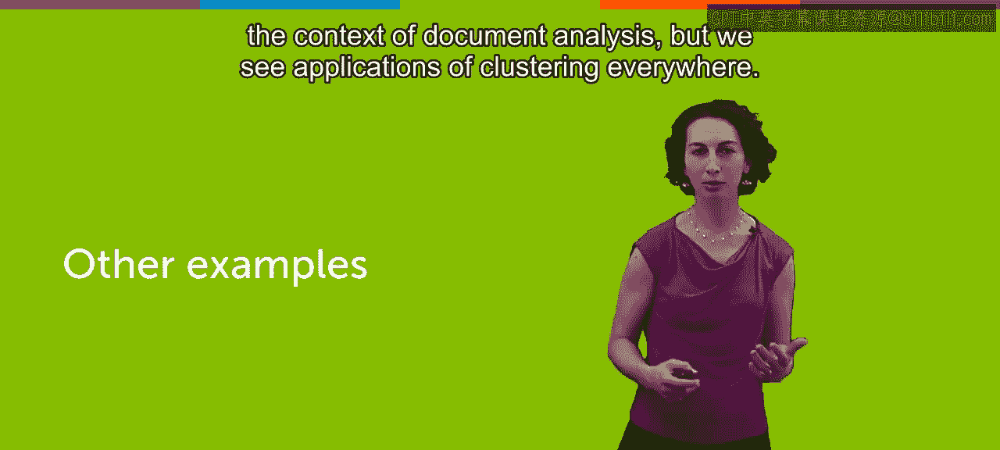
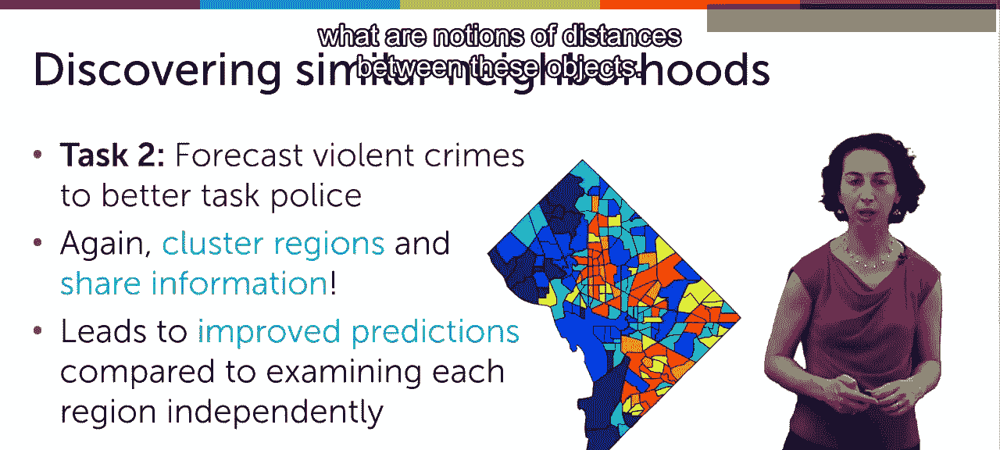

# 机器学习（分类，聚类和检索）：第3-4课：聚类的其他应用 🎯

在本节课中，我们将探讨聚类算法在文档分析之外的广泛应用。我们将看到，从图像搜索到医疗研究，再到商业推荐和城市数据分析，聚类都是一个极其强大的工具。

## 图像聚类 📸

上一节我们讨论了文档聚类，本节中我们来看看聚类在图像分析中的应用。

聚类可以用于组织图像。例如，你可能希望将所有与海洋、粉色花朵、狗、日落或云彩相关的图片自动分组。这对于像谷歌图片搜索这样的应用非常有用。当用户在谷歌图片中输入一个词时，系统需要从图片数据库中检索并显示一组相关图片。然而，并非所有图片都经过了人工标注。如果我们能自动发现相关的图片组，这将极大地帮助图片搜索。

以下是图像聚类的两个具体应用场景：

*   **辅助图像搜索**：当用户搜索一个词（如“cardinal”）时，这个词可能有多种含义（如一种鸟、一支棒球队、一种宗教头衔）。如果我们对所有被标注为“cardinal”的图片进行聚类，可能会发现它们自然地分成了几组，分别对应不同的含义。这样，在展示搜索结果时，我们就可以提供一个覆盖了所有可能含义的、多样化的图片集，而不是只显示单一含义（如鸟类）的变体，从而更好地满足用户的实际搜索意图。
*   **探索标签多样性**：通过聚类被同一标签标注的图片，我们可以发现该标签下隐藏的多样性，并据此构建更丰富的搜索结果。

## 医疗数据分析 🧠

聚类不仅能用于信息检索，还能应用于像医疗研究这样截然不同的领域。

我们可以考虑根据患者表现出的医疗状况对他们进行分组。如果能够形成这样的分组，我们就可以更好地研究亚群和疾病。例如，假设我们有一组患者的颅内脑电图记录。每位患者都记录了一系列不同的癫痫发作事件。

以下是基于此数据的分析步骤：

*   **事件聚类**：我们可以根据事件之间的相似性，对这些癫痫发作事件进行聚类。
*   **类型研究**：基于这些聚类结果，我们可以了解更多关于不同类型癫痫的信息，例如，我们认为存在多少种不同的癫痫类型，以及每种类型的特征是什么。
*   **患者聚类**：我们还可以根据患者表现出的癫痫类型对患者进行聚类，从而更好地理解癫痫患者群体中的不同亚群。

## 商业与产品分析 🛒

聚类在商业领域，特别是在电子商务中，有着广泛的应用。

一个应用是分析亚马逊上的产品，根据相似的购买历史对产品进行分组。这里所说的产品“购买历史”，是指观察所有购买过该产品的用户，看看他们在同一次购物或近期历史中还购买了哪些其他商品。我们将这些信息汇总，作为该产品的描述特征。

以下是基于产品聚类的应用：

*   **产品归类**：例如，当人们购买婴儿床时，我们可能发现他们还经常购买汽车座椅和其他婴儿用品。因此，我们可以将这个婴儿床与亚马逊上其他婴儿用品归为一类。即使卖家将其归类为“家具”，我们也可以通过聚类来修正或添加“婴儿产品”这个标签。
*   **产品推荐**：这种聚类结构也可用于产品推荐。当用户的购物车中有某些商品时，系统可以推荐他们可能感兴趣的其他相关产品。

此外，我们还可以发现具有相似购买或浏览行为的用户群。通过对用户和产品进行聚类分析，我们可以做很多有趣的事情。

## 区域数据分析与预测 🗺️

聚类在一个不那么明显的任务中也很有用：小区域数据估计与预测。

想象一下，我们想要在非常小的空间位置（如人口普查区）估算房屋价值。问题是，在任何给定的时间点，每个区域内的房屋销售数据都非常少。我们如何在没有太多数据的情况下评估该区域的价值呢？

以下是解决思路：

*   **区域聚类**：我们可以尝试发现历史上行为相似的区域集群。
*   **信息共享**：发现这些区域集群后，我们可以考虑在这些区域之间共享信息，汇总它们的观测数据，从而在局部形成更好的价值估计。

一个结构相似但应用不同的任务是犯罪预测。目标是在下一个时间点预测每个普查区将发生多少起犯罪。

以下是应用方法：

*   **聚类预测**：同样，我们可以对区域进行聚类以共享信息。事实证明，基于行为相似的区域集群进行预测，比独立处理每个区域能带来更好的犯罪率预测效果。

## 总结 📝

本节课中我们一起学习了聚类算法在多个领域的广泛应用。我们看到，无论是组织图像、分析医疗数据、理解商业行为，还是进行区域数据估计与预测，聚类的核心思想——**根据数据对象之间的“距离”或相似性将其分组**——都能通过适当的调整得到应用。关键在于为特定应用定义好**数据对象**的含义以及对象之间的**距离度量方式**。这些方法展现了聚类作为一项基础机器学习技术的强大通用性和灵活性。