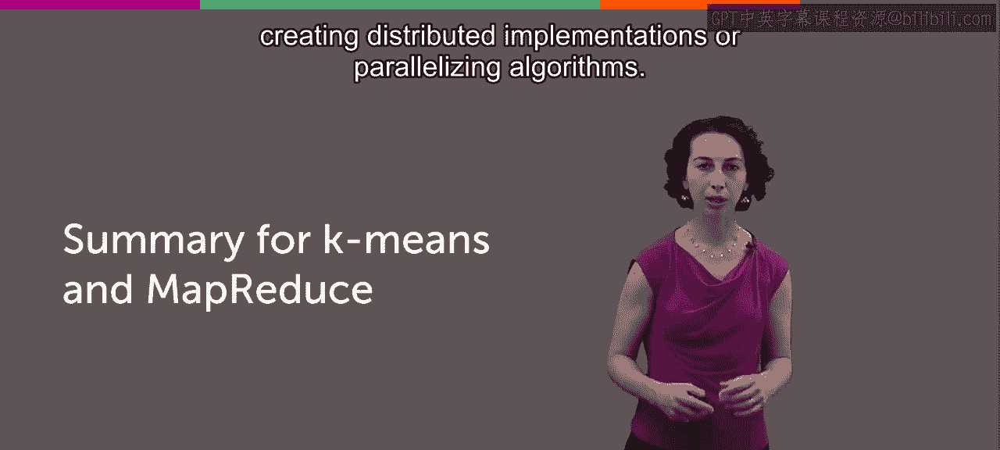
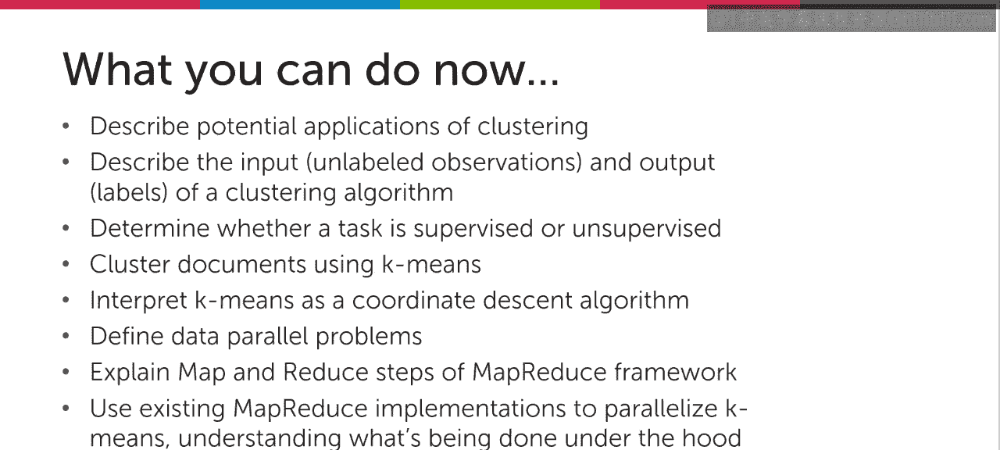

# 华盛顿大学《机器学习（分类，聚类和检索，第3-4课⧸共4课）｜Machine Learning》中英字幕 p160 38_简要回顾.zh_en -BV1Sr421F7N7_p160-

。

In summary， in this module we cover two very important and widely used algorithms。

 k means and Mareduce。We started the module by presenting the goal of clustering and since then we've motivated many applications of clustering and then we dug into K meanss as a specific algorithm for performing clustering and it really is the most widely used algorithm out there and then we took K means as an opportunity to present Mareduce。

 which is a general framework for parallellyzing algorithms and we showed how you can apply an iterative version of mapreduce to parallellyze k means and like we almost always say what you learned in this module really generalizes to a wide range of different applications in different things you might be interested in doing。

 but is really， really， really especially true for this module K meanss is a very generic tool for clustering and clustering is used in so many different areas and mapreduce is a very。

 very powerful and widely used framework for creating distributed implementations or parallel。

Sa algorithms。So in summary， here are the set of things that you should be able to do after finishing this module。

🎼。