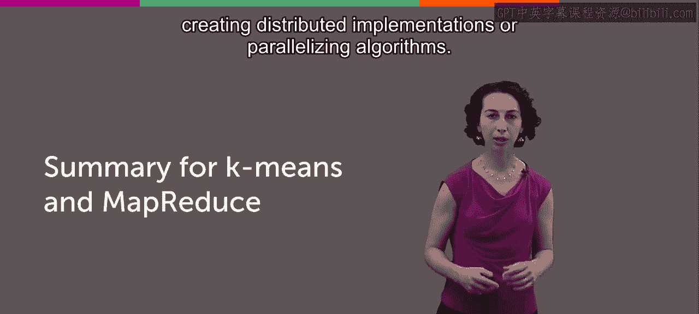
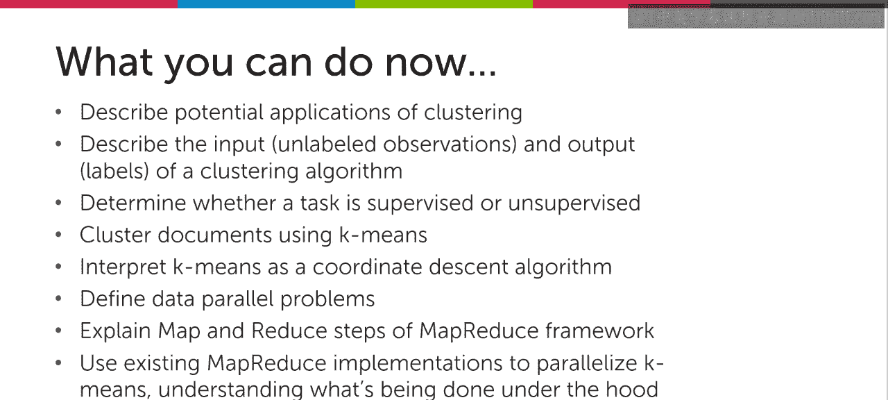

机器学习（分类，聚类和检索）：第3-4课：课程回顾与总结

在本节课中，我们将对模块三和模块四所涵盖的核心内容进行简要回顾与总结。我们主要学习了两种非常重要且广泛应用的算法：K均值聚类和MapReduce框架。

上一节我们介绍了聚类分析的目标及其广泛应用。本节中，我们来回顾一下本模块的核心知识点。

以下是完成本模块学习后，你应该掌握的能力要点：

*   **描述聚类的目标**：理解聚类分析旨在将数据点分组，使得同一组（簇）内的数据点彼此相似，而不同组之间的数据点相异。
*   **执行K均值聚类**：能够手动或通过代码实现K均值算法。该算法的核心步骤是迭代更新簇中心（质心）并将每个点分配到最近的质心所属的簇，公式表示为：**将点x分配到簇i，其中i = argmin_j ||x - μ_j||^2**，其中μ_j是簇j的质心。
*   **在MapReduce中实现K均值**：理解如何利用MapReduce框架并行化K均值算法。这通常涉及在Map阶段分配数据点到最近的质心，在Reduce阶段汇总并计算新的质心。
*   **描述MapReduce框架**：解释MapReduce作为一个通用并行计算框架的基本原理，它通过`map`和`reduce`两个函数阶段处理大规模数据集。
*   **识别MapReduce的应用场景**：能够判断哪些类型的算法或计算任务适合使用MapReduce框架进行并行化处理。

本节课中我们一起学习了K均值聚类这一最常用的聚类工具，以及MapReduce这一用于构建分布式或并行算法的强大框架。这些知识具有很强的通用性，能够广泛应用于众多不同的领域和场景。