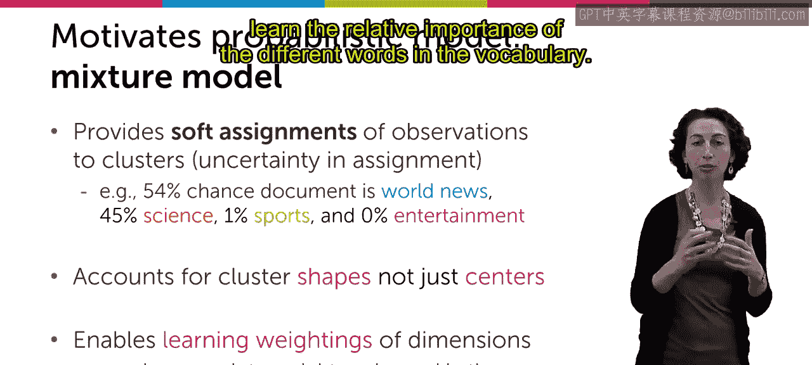

# 华盛顿大学《机器学习（分类，聚类和检索，第3-4课⧸共4课）｜Machine Learning》中英字幕 p161 39_概率聚类模型的动机.zh_en -BV1Sr421F7N7_p161-

。

In the last module， we discuss K means as an algorithmic approach to clustering Now in the rest of the course。

 we're going to turn to probabilistic model based approaches to clustering and compare and contrast with K means。

So why are we interested in probabilistic approach in the first place？Well， to motivate this。

 we can return to our task where were interested in learning a user's preference over a set of topics。

 and to do this we talked about clustering documents into some set of topics and then using the user feedback on the articles that the user read combined with this clustering structure to learn these set of preferences of this user over these topics。

But we're rarely in situations where the data are clearly separable。So for example， in this scenario。

 imagine that there's an article where it's not really clear is this article similar to the other articles that are about world news or is it more similar to the other articles about science Well maybe it's somewhere in between。

 but let's say for argument's sake that is a little bit closer to this science topic so this cluster for this orange cluster does that mean when the user said that they did not like this article that we should only include that information when we're going to update information about the user's preference for cluster 4 or maybe that should also somehow weigh into what we think the user likes about cluster2 so what we see is that these hard assignments made by K means don't really tell the false story instead what wed like to do is somehow be able to capture the uncertainty about whether the assignment of this article is to cluster2 or to cluster 4 and then use that uncertainty to extract extra information。

From the data set， so for example， we can think about doing fancier things when we're going to learn the user's preference over a set of topics。

And there are other limitations to K means as well。

 so remember that when K means goes to do an assignment of a data point to a cluster。

 it only takes into consideration the cluster centers。

So what that means is it's taking nothing about the cluster shape into account so you can think of this as being equivalent to assuming that the clusters all have these spherically symmetric shapes to them and they're all equal size spheres So what that means is that all dimensions get weighted equally and it's the same weighting in all of these different clusters when we're going to compute that score。

 so the only thing that differentiates between these clusters is where those clusters are located their're cluster centers。

You could however modify ke means to use weighted Euclidean distance or scaled Euclidean distance instead of just this vanilla form of Euclidean distance that we're showing here。

 but there are two things about this， one is that it still assumes that all of the clusters have the same axis aligned ellipses。

 meaning that when we're weighing the importance of the different dimensions it's exactly the same weighting in each of the different clusters。

 and the other thing is that the set of weights have to be prespecified。As a result。

 Kamine struggles in the following cases， One is if the clusters have different spreads to them。

 especially if they're not very， very well separated。 So， for example。

 take the following case where there's these two little orange and blue clusters and one really big green cluster and when I say big。

 I don't mean big in terms of the number of data points in the cluster， I mean。

 in terms of the spread of points within that cluster and what the ca means's algorithm is going to do in this case is if we fix the cluster centers to be at these three locations here and we look at our vonoid tesslllation。

 So that's what these lines are drawing。 So it's saying。Everything in this region。

Is getting assigned to this orange cluster。And everything。

In this region here is getting assigned to this blue cluster。And only the things here。

Are getting assigned to this green cluster。 So what's happened is it's taken observations that appeared in this green cluster。

And it's going to make assignments of these data points to the wrong clusters to the orange or to the blue cluster。

 Another issue is when you have overlapping clusters， Because， again。

 if we think about fixing our cluster centers here， K means is simply going to。Split。

These clusters up as follows， where。What happens now isn't necessarily an incorrect labeling。

 I mean it is incorrect to take these blue points here and assign them to the orange cluster。

 it's not really clear what should be done in those situations。

 if you see a data point here without knowing ahead of time that it's from the blue or orange cluster having other any other distinguishing information really what you have in these regions。

I'll just shade them in blue these regions here。you should have uncertainty about whether the observation belongs to the blue cluster or the orange or the blue or the green or the blue。

 sorry， green and orange， but Kme means is making hard assignments。K means。Make。Hard。Assignments。

When。Clearly， there's uncertainty。And the other thing that we said that k meanss does not account for is if the clusters have different shapes or orientations to those shapes。

 and especially if those shapes are not known ahead of time。

 what the weightings on the different dimensions should be。So for example。

 if we look at this observation right here under K means， it says， well。

 the distance to this blue cluster is smaller， so this observation will get assigned to the blue cluster and is not taken into consideration that this green cluster has a lot of spread along this axis。

And so what we like is an approach that can account for that shape to the cluster and say， well。

 you know， instead of just looking at the cluster centers。

 I want to take into consideration that this green cluster has this spread along this dimension。

 and maybe it's more likely that it's in the green cluster than in the blue cluster which is this nice kind of tight spherical cluster。

So these limitations motivate a probabilistic approach using something called a mixture model。

 and what a mixture model can do is it can provide what are called soft assignments of data points to clusters。

 and these soft assignments are going to account for uncertainty in these cluster assignments。

So for example， maybe we have a document and the soft assignment is going to say that there's 54% chance that that document is about world news。

 45% chance that it's about science， 1% chance that it's about sports and 0% chance that it's about entertainment。

And mixture models can also account for cluster shapes， not just the cluster centers。🎼And finally。

 another really important thing is we're going to end up learning the parameters of these mixture models and what we can do is we can actually learn the weightings on the different dimensions。

 so for example， we can per cluster， learn the relative importance of the different words in the vocabulary。

